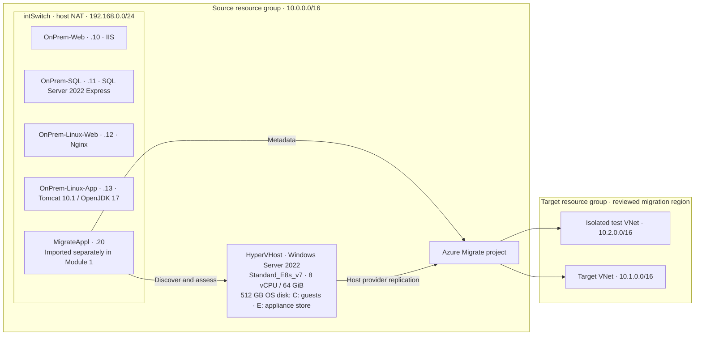

# TD SYNNEX | Azure Migrate Hyper-V Workshop

**Cloud Enablement Services** · Partner hands-on training

## Executive Summary

Cloud migration is a business and architecture decision, not just a server-copy exercise. This partner workshop gives Cloud Solution Architects and Infrastructure Engineers hands-on experience discovering, assessing and rehosting a small mixed Windows/Linux application portfolio with Azure Migrate. You will connect infrastructure choices to application dependencies, test the migrated workloads, plan a controlled cutover and review post-migration operations.

[Azure Migrate](https://learn.microsoft.com/en-us/azure/migrate/migrate-services-overview) unifies migration planning and execution: **Decide → Plan → Execute**. This workshop uses **one nested Hyper-V host and four workload VMs** to make that journey accessible without physical datacenter equipment. Deployment prepares the sample workloads; appliance registration, discovery, assessment, migration decisions and validation remain part of the learning experience.

The practical scope is **VM rehost to Azure IaaS**, not an automatic conversion to PaaS. All four Hyper-V VMs use the **Azure Site Recovery provider and Recovery Services agent on the Hyper-V host**. No guest Mobility Service is required for this Hyper-V replication path. The Azure Migrate appliance supplies discovery and assessment; it does not replicate these VMs. See the [Hyper-V migration tutorial](https://learn.microsoft.com/en-us/azure/migrate/tutorial-migrate-hyper-v).

**Audience:** intermediate-to-advanced infrastructure and cloud practitioners. Prepare the environment before the teaching session and allow time for downloads, discovery, data collection and replication. Duration depends on subscription capacity, connectivity and the environment; this is not a guaranteed four-hour exercise.

## Business Context

### Why Organizations Migrate to Azure

Organizations consider Azure to improve business agility, renew aging infrastructure, strengthen operational controls and create options for later modernization. Each outcome needs evidence:

- **Agility:** compare provisioning and change processes with the business's needs.
- **Cost management:** assess VM sizing, licensing and consumption rather than assuming cloud automatically costs less.
- **Security and governance:** plan identity, network access, monitoring and policy; a VM move alone does not establish compliance.
- **Resilience:** design and test backup, recovery and operating procedures rather than treating migration as disaster recovery.
- **Modernization:** use the discovered application portfolio to identify future platform opportunities after the initial move.

### Common Migration Strategy Options

This workshop practices **rehost**: move the four VMs to Azure IaaS while retaining their application stacks. A future modernization exercise could instead evaluate managed platforms or application changes. Base that decision on business value, dependencies, compatibility and operating requirements; some workloads may be better retained, replaced or retired. These are qualitative options, not a fixed-count strategy framework.

Tomcat-to-App-Service modernization uses [separate tooling](https://learn.microsoft.com/en-us/azure/app-service/app-service-java-migration). Database or other PaaS moves likewise require their own compatibility, support and operational review; they are not outputs promised by this Hyper-V VM lab.

### What This Workshop Simulates

The four VMs stand in for a small business's web, application and database tiers. Their mixed operating systems and real request/data paths let you discuss inventory, dependency groups, validation and cutover sequencing. The applications are deliberately small teaching samples, not production-equivalent implementations. The source is a **single Hyper-V host**, not a cluster, and the workshop does not implement a production Azure landing zone.

## Architecture Overview

### Lab Topology



### Why Nested Virtualization?

Hyper-V inside an Azure VM gives each participant a self-contained source environment without physical hardware. You can observe host discovery, replication and guest behavior while keeping the portfolio small enough for a workshop. It is a lab adaptation, not proof that its networking, capacity or security reproduces a production datacenter.

The default [Esv7 host](https://learn.microsoft.com/en-us/azure/virtual-machines/sizes/memory-optimized/esv7-series) has 8 vCPUs and 64 GiB of memory and supports nested virtualization. It requires a Generation 2 image with NVMe support. Verify the selected SKU, subscription restrictions, regional/family quota and actual capacity before deployment.

### Network and Storage Topology

- The source Azure VNet is `10.0.0.0/16`. The nested `intSwitch` uses `192.168.0.0/24`; the host is `.1`, the four workloads are `.10`–`.13`, and the separately imported appliance uses `.20`.
- Nested guest addresses use DHCP reservations. Host-side NAT provides outbound connectivity for the source lab; it is not an Azure NAT Gateway resource or a production firewall design.
- Migration uses a target VNet (`10.1.0.0/16`) and a separate test VNet (`10.2.0.0/16`). Choose a migration target region different from the source host region, and keep project migration settings, assessments and target/test networks consistent. Verify the required routing, DNS and outbound connectivity; the scripts do **not** create Azure NAT gateways.
- The 512 GB host OS disk holds the guests on `C:` and a separate appliance-store partition, normally `E:`. That partition is not a separate managed data disk. Fixed workload disks are 40 GB per Windows VM and 30 GB per Linux VM.
- Module 1 downloads and imports Microsoft's appliance VHD separately. An instructor can opt into download/extraction during deployment; this does not create or register an appliance VM. Allow at least 30 GB free for download/extraction and check actual import-copy headroom on the reported store drive; free space depends on the current archive and existing contents.

### Workload Portfolio & Real-World Mapping

The portfolio is chosen for **mixed operating systems, distinct business roles and observable application dependencies**, not to assign different migration methods according to service type.

| Lab workload | Actual technology and role | Business analogy and learning purpose |
|---|---|---|
| **OnPrem-Web** · `192.168.0.10` | Windows Server 2022, IIS static site on port 80 | A Windows web-tier entry point. The sample page is not a full .NET application. Optional Windows activity reads SQL data and checks application health, illustrating dependencies beyond a web page. |
| **OnPrem-SQL** · `192.168.0.11` | Windows Server 2022, SQL Server 2022 Express on 1433; `ContosoApp` Customers/Orders | The relational data tier of an order-processing system. Compare real data before/after testing and cutover, plan write quiescence and recovery, and keep database consumers in the migration plan. It uses the same host replication path as the other VMs. |
| **OnPrem-Linux-Web** · `192.168.0.12` | Ubuntu 24.04 LTS, Nginx static site on 80 and desk/API reverse proxy on 8080 | A Linux frontend/reverse-proxy role. Validate the proxy-to-application dependency, addressing and cross-OS connectivity rather than only the port-80 page. |
| **OnPrem-Linux-App** · `192.168.0.13` | Ubuntu 24.04 LTS, Tomcat 10.1 / OpenJDK 17, Jakarta Servlet 6.0 / Pages 3.1; Contoso Order Desk Java/JSP on 3000 | An internal order-entry application tier. JDBC reads/writes real Customers/Orders data in SQL; HTTP through Nginx exercises a multi-tier request. This is a lightweight sample, not a production-scale application. |

Initial deployment installs the application, database prerequisites and Nginx proxy. Optional traffic is **not** an application-install step. The dependency exercise adds Windows SQL reads/HTTP health checks and Linux HTTP requests through Nginx → Tomcat → SQL, including real sample-order writes. Observe those relationships when selecting migration groups and acceptance checks.

## Workshop Learning Path — Cloud Adoption Framework Context

The [Cloud Adoption Framework](https://learn.microsoft.com/azure/cloud-adoption-framework/) provides wider strategy, planning, readiness, governance and operations context. This lab samples those concerns; **discovery and assessment are migration activities, not an additional CAF methodology named “Assess.”** The practical learning sequence below follows discovery, assessment, migration and operations for four VMs.

| Module | Exercise | Learning and completion evidence |
|---|---|---|
| 0 | [Setup](docs/Module-0-Setup.md) | Prepare the source simulation and verify all four workload VMs, applications and appliance-store space. |
| 1 | [Discovery and assessment](docs/Module-1-Discovery.md) | Discover exactly four workloads, review an Azure VM readiness/sizing/cost assessment and discuss dependencies; optionally use [sample traffic](docs/Lab-Traffic.md). |
| 2 | [Web-workload migration](docs/Module-2-Agentless-Migration.md) | Replicate, test and cut over OnPrem-Web and OnPrem-Linux-Web using the Hyper-V host replication path. |
| 3 | [Database/application workload migration](docs/Module-3-Agent-Based-Migration.md) | Use the **same Hyper-V host replication path** for OnPrem-SQL and OnPrem-Linux-App; validate application connections and SQL data. |
| 4 | [Azure Migrate vs. Site Recovery](docs/Module-4-ASR-Comparison.md) | Compare a one-time migration with ongoing disaster recovery and explain when each is appropriate. |
| 5 | [Post-migration operations](docs/Module-5-Post-Migration.md) | Verify application/network behavior, monitoring, optional backup/restore, security and cost controls. |
| Finish | [Costs and Cleanup](#costs-and-cleanup) | Account for test VMs, replication, source/target resources, retained backup data and registrations. |

The Module 2/3 filenames and script filters `Agentless`/`AgentBased` are retained exercise-group labels. They do not mean that SQL or Tomcat requires guest Mobility Service installation. For this Hyper-V lab, use the host-based method for both groups; guest-agent installation instructions for a physical-server/other-cloud scenario are not required steps for these four VMs.

### Cloud Adoption Framework Flow

Use the wider business sequence **strategy and planning → environment readiness → migration execution → ongoing operation**, with governance and security throughout. Within the migration exercise, discover and assess first, group dependent workloads, test in isolation, authorize cutover, then validate and optimize. The two workload exercises group practice tasks; production migration waves must follow actual dependencies and business constraints.

## Prerequisites

### Azure Subscription Requirements

- Use an approved training subscription and new, dedicated lab resource groups. Confirm permissions to create the source/target resources and perform the selected project, replication, monitoring and backup tasks. Resource-provider registration and role assignment require their own permissions.
- Verify the resource providers listed in [Module 0](docs/Module-0-Setup.md), subscription policy, Windows/guest licensing, package-source access and budget approval.
- The default source host requires **8 vCPUs**, with sufficient regional and actual SKU-family quota. The four nested VMs and appliance consume host resources, not separate Azure VM allocations.
- Plan target/test quota separately in the migration region. Step 3's current defaults are B2s, B2ms, B1ms and B1ms: normally 6 vCPUs for a full four-VM target **or** test set. A full overlapping target-plus-test set would require 12 additional vCPUs; normal test cleanup precedes cutover. Verify actual selections rather than treating these defaults as assessment recommendations.
- Quota is not capacity. A valid region or an advertised SKU does not guarantee allocation, policy approval or access.

### Tooling, Network and Knowledge

| Requirement | Preparation |
|---|---|
| PowerShell and Az | An open Windows PowerShell 5.1 or supported PowerShell 7 deployment session with the required Az modules; host-side commands use Windows PowerShell 5.1. Confirm the module/cmdlet prerequisites in Module 0. |
| Repository | The complete instructor-approved checkout, including application/runtime assets. Git is useful for recording the exact revision; obtain the actual repository URL and branch from the instructor. |
| Host access | An RDP client and outbound TCP 3389 to the host's public IP. Deployment restricts incoming RDP to your supplied public IPv4 address. Bastion/VPN would be separately planned options, not resources provisioned by this lab. |
| Downloads and guest connectivity | Approved access to Microsoft, Canonical/Ubuntu and the other package sources listed in Module 0; outbound connectivity for appliance registration and replication. |
| Background knowledge | Azure VMs/VNets/NSGs, subscriptions and RBAC, Hyper-V administration, Windows/Linux service checks and basic SQL/application dependencies. |

Use lab-only credentials. Keep expanded configuration and logs containing credentials private. Neither the simple sample application's authentication/TLS choices nor the lab's trusted network ranges are a production security baseline.

## Quick Start — Prepare the Source Lab

The deployment script prepares the source simulation; it is not a complete enterprise landing-zone deployment. Follow [Module 0](docs/Module-0-Setup.md) for prerequisites and verification, then [Module 1](docs/Module-1-Discovery.md) for the appliance and project workflow.

### 1. Obtain the Reviewed Checkout

Use the repository URL and branch supplied by your instructor, not a guessed public URL. If using Git, substitute those reviewed values and record the commit:

```bash
git clone --branch <reviewed-ubuntu2404-branch> <workshop-repository-url> azure-migrate-workshop
cd azure-migrate-workshop
git rev-parse HEAD
```

This checkout uses Ubuntu 24.04 LTS and Tomcat 10.1/OpenJDK 17. Extract it separately and build a fresh lab; it is not an in-place upgrade for an Ubuntu 22.04 lab.

### 2. Authenticate and Deploy

Run from the checkout root in PowerShell. Region and resource names below are examples; verify your actual subscription, approved source region, quotas and access first.

```powershell
Connect-AzAccount

# Masked at the prompt so they are not readable over a shared screen
$secureSubscriptionId = Read-Host 'Workshop subscription ID' -AsSecureString
$secureAdminCidr = Read-Host 'Your public IPv4 address' -AsSecureString
$password = Read-Host 'Lab-only administrator password' -AsSecureString

$sourceRg = 'rg-ces-source-01'
$location = 'eastus'

.\scripts\deploy-lab.ps1 -SubscriptionId $secureSubscriptionId `
    -ResourceGroupName $sourceRg -Location $location `
    -AdminUsername 'labadmin' -AdminPassword $password -AdminSourceCidr $secureAdminCidr
```

Supply your actual public IPv4 address when prompted; the script accepts it with or without `/32`. Do not use a shared training password in source files or command history. Appliance download/extraction is optional, default No; students normally obtain it through their project in Module 1. Opting in is for instructor preparation and does not automate appliance import, registration or discovery.

Use a **new dedicated source resource group** for a new lab. A recognized incomplete deployment can resume under its own checks; that is not permission to replay provisioning against a completed or migrated lab. Do not point this Ubuntu 24.04 checkout at an existing 22.04 host or upgrade those guests in place.

### 3. Connect and Begin the Student Exercises

Connect to HyperVHost using the deployment output and complete Module 0's guest/application checks. Create/register the Azure Migrate project and import the verified appliance through Module 1. Confirm exactly the four workload names in discovery, not the appliance as a fifth migration workload.

The required assessment is an **Azure VM assessment of four servers**. The Step 2 helper defaults to `-AssessmentMode Classic`; here “Classic” identifies the grouped assessment API, not a retired first-generation Azure Migrate project. Start with AsOnPremises/configuration-based sizing, the chosen migration target region and your actual offer/licensing settings. Separately compare a performance-based portal assessment after collecting sufficient data. [Assessment estimates depend on collected data](https://learn.microsoft.com/en-us/azure/migrate/review-assessment?view=migrate). [Assessments capture point-in-time inputs](https://learn.microsoft.com/en-us/azure/migrate/concepts-assessment-calculation?view=migrate-classic). For this lab, review the actual readiness, cost and sizing output; do not treat idle-sample measurements as production utilization or script defaults as automatically selected recommendations.

### Student Portal Path and Instructor Helpers

The module guides are the student path. Complete their portal actions and validation rather than treating a helper's final message as the learning objective. Module 2 includes target landing-zone preparation; Step 1 is an optional instructor shortcut for networking and project guidance, not automatic project creation.

Use an open PowerShell window for the interactive migration helpers. They can load their required Az modules, sign in as needed and prompt for omitted environment values. For example:

```powershell
Get-AzContext
.\scripts\migrate-step1-setup-project.ps1
.\scripts\migrate-step2-discover-assess.ps1 -SourceResourceGroup $sourceRg
```

The `migrate-step` scripts use the active Az subscription; verify `Get-AzContext` before running them. Select the actual host, project, source and target groups. Choose and verify the separate migration target region **before** portal Create resources / Finalize discovery locks it; keep the assessment and target/test networks aligned with that choice.

| Helper | Scope and operator responsibility |
|---|---|
| `deploy-lab.ps1` | Creates the billable source host, four guest VMs and sample workloads; prepares host discovery settings and the appliance-store partition. Verify the deployed guests in Module 0. |
| `migrate-step1-setup-project.ps1` | Optional target/test network preparation with region/quota preflight and portal project guidance. The student can instead follow the portal path in Module 2. |
| `migrate-step2-discover-assess.ps1` | Assists host/appliance preparation, discovery and four-server assessment. Project-key, appliance and credential actions still require the operator. |
| `migrate-step3-replicate.ps1` | Replication helper for `-Workload All\|Agentless\|AgentBased`. Its B-series target sizes are script defaults, not automatically applied assessment recommendations. |
| `migrate-step4-test-migrate.ps1` | Creates/validates isolated test copies and handles test cleanup for the selected workload group. |
| `migrate-step5-cutover.ps1` | Performs the selected group's final migration, including source shutdown. Review the cutover and rollback plan before running. |
| `migrate-step3a-agentless.ps1` / `migrate-step3b-agent-based.ps1` | Instructor state-bridging wrappers: sequence Steps 3, 4 and 5 for the web pair or database/application pair. They include **cutover and source shutdown**, not just replication or a rehearsal. Both use the Hyper-V host replication path. |
| `enable-lab-traffic.ps1` | Optional source-side sample activity staged on HyperVHost; follow [Lab Traffic](docs/Lab-Traffic.md). Stop with `-Disable` when no longer needed. |
| `post-migration-labtraffic.ps1` | Optional target-side Check/Prepare/Start/Status/Stop controller; use its [separate guide](docs/post-migration-labtraffic.md) and confirm target identities. |
| `migrate-step6-post-migration.ps1` | Configures post-migration monitoring, backup/security/cost controls; creates or changes Azure resources. Validate before and after its hardening. |
| `cleanup-lab.ps1` | Confirms and deletes one selected resource group, then reports retained/manual cleanup items. Review every deletion scope. |

## Migration Methodology

**Discover → Assess → Plan dependency groups → Replicate → Test → Authorize cutover → Validate and operate**

1. **Discover:** register the appliance, configure valid host/guest credentials and verify the four-server inventory. Host metadata alone is not proof that guest software and dependencies have been inventoried.
2. **Assess:** review Azure readiness, sizing assumptions, data coverage and estimated monthly cost. Document the selected target region and licensing assumptions. Treat idle-lab performance data as limited evidence, not production utilization.
3. **Plan:** identify the Nginx → Tomcat → SQL request path and any Windows reporting consumers. Decide how addressing, application writes, validation and rollback will work across a migration group. The two teaching groups do not prescribe production wave boundaries.
4. **Replicate and test:** enable host-based replication and test copies in an isolated non-production VNet. Isolate copies from source application connections **before first boot**; replicated generators and configuration may otherwise contact or write to the source.
5. **Cut over:** authorize a planned outage, quiesce application activity and shut down the relevant source VMs for the final synchronization. Check replication and validation results before accepting the migrated application. Do not promise zero downtime or automatic success.
6. **Validate and operate:** compare data and endpoints, confirm network dependencies, then review monitoring, backup, access and cost. Rehost is the start of Azure operations, not the end of application ownership.

### Optional Activity and Post-Migration Validation

Optional source traffic provides dependency observations; the Windows side reads SQL/checks HTTP, while Linux requests go through Nginx to Tomcat and can insert real sample orders into SQL. The applications work without starting generators. Source traffic can persist across consoles and reboots, so stop it explicitly when the runbook calls for it.

After cutover, follow [Post-migration lab traffic](docs/post-migration-labtraffic.md): **Check → Prepare → Check → optional Start → Status → Stop** on the confirmed target VMs. Prepare explicitly repoints approved aliases; Start produces real activity. Its default interval is 30 seconds and default duration 60 minutes, bounded and disabled on boot. Check network/application behavior **before Step 6 hardening**, then Check again afterward. For test copies, use the guide's pre-boot isolation and explicit `-TestMigration` workflow; do not substitute source connectivity for target validation.

## Key Architectural Decisions

| Decision | Lab choice and rationale |
|---|---|
| Hyper-V source | One nested host makes host discovery and migration observable without physical hardware. Other source platforms have different replication architectures; do not generalize this lab's host-provider model to every scenario. |
| Memory-optimized host | Standard_E8s_v7 provides 64 GiB for the Windows host, four small workload VMs and the separately imported appliance. Validate support and availability rather than assuming a smaller SKU has enough headroom. |
| Mixed OS and business tiers | IIS, Nginx, Tomcat and SQL expose cross-platform checks, real application/data dependencies and different operational concerns while remaining manageable in a teaching lab. |
| Fixed guest resources | Fixed 40/40/30/30 GB disks and static guest memory make the source allocation understandable. The sample workload's utilization does not predict production sizing. |
| Internal switch and host NAT | An isolated nested segment simplifies the source lab. It is not a statement of production network equivalence or an Azure NAT Gateway deployment. |
| Separate appliance import | Use the verified Microsoft appliance package in Module 1; distinguish appliance discovery/assessment from the host provider's replication work. |
| Test before cutover | Isolated copies let you validate addressing, application paths and SQL data before authorizing source shutdown. Plan for the final outage and recovery decisions. |

## Costs and Cleanup

Estimate the source host, 512 GB OS disk, target/test VMs, replicated disks/storage, public IPs, monitoring ingestion and any enabled backup/DR services using the [Azure pricing calculator](https://azure.microsoft.com/pricing/calculator/). Separately added Bastion, gateways or other resources add costs; the workshop scripts do not deploy Azure NAT gateways. There is no verified fixed daily price or guaranteed saving.

Set a budget and review consumption during the workshop. Deallocating a VM stops its compute charge but does not remove persistent disks, retained backups or other billable resources, and does not release its quota allocation. Remove unneeded test copies before cutover according to the runbook.

Review the actual source and target resource groups before using the cleanup helper. Set `$targetRg` to the verified group; these commands are destructive and each run confirms one group:

```powershell
Get-AzContext
$targetRg = Read-Host 'Exact target resource group to delete'
.\scripts\cleanup-lab.ps1 -ResourceGroupName $targetRg
.\scripts\cleanup-lab.ps1 -ResourceGroupName $sourceRg
```

The script lists resources and asks for confirmation; `-Force` bypasses that prompt. Do not use it on shared resource groups. Account for Azure Migrate/replication artifacts, Recovery Services vault protection/retained backup data, key-vault soft deletion and the appliance's Microsoft Entra app registration. These can need separate cleanup or live in a different scope; deleting the two selected groups is not proof that every workshop artifact has gone. Confirm the final inventory and remaining charges.

## Repository Structure

```text
azure-migrate-workshop/
├── README.md                              # Student introduction and starting path
├── VersionNotes.md                        # Maintainer history and open items
├── docs/
│   ├── Module-0-Setup.md
│   ├── Module-1-Discovery.md
│   ├── Module-2-Agentless-Migration.md
│   ├── Module-3-Agent-Based-Migration.md
│   ├── Module-4-ASR-Comparison.md
│   ├── Module-5-Post-Migration.md
│   ├── Lab-Traffic.md
│   └── post-migration-labtraffic.md
├── scripts/                               # Deployment and migration helpers
│   └── host/configure-host.ps1             # Host-side provisioning payload
└── apps/contoso-orderdesk/                 # Java/JSP application and runtime assets
```

## Contributing

Send workshop corrections and improvement suggestions through the upstream repository's contribution process. Include the reviewed revision, affected module and clear reproduction/validation evidence, without credentials or private subscription details. Preserve existing attribution notices and update related learner instructions when behavior changes.

## License and Third-Party Software

This supplied checkout has no LICENSE file. Confirm the upstream repository's licensing terms before redistribution and preserve its notices. Azure services, Windows guests, SQL Server and third-party packages have their own licensing/use terms; this README does not grant those rights.

## Additional Resources

| Microsoft Learn reference | Updated |
|---|---|
| [Azure Migrate overview](https://learn.microsoft.com/en-us/azure/migrate/migrate-services-overview) | 2026-05-18 |
| [Hyper-V migration](https://learn.microsoft.com/en-us/azure/migrate/tutorial-migrate-hyper-v) | 2026-10-10 |
| [Azure VM assessment](https://learn.microsoft.com/en-us/azure/migrate/review-assessment?view=migrate) | 2026-08-25 |
| [Classic assessment calculations](https://learn.microsoft.com/en-us/azure/migrate/concepts-assessment-calculation?view=migrate-classic) | 2026-02-26 |
| [Esv7 specifications](https://learn.microsoft.com/en-us/azure/virtual-machines/sizes/memory-optimized/esv7-series) | 2026-08-24 |
| [Java migration resources](https://learn.microsoft.com/en-us/azure/app-service/app-service-java-migration) | 2025-12-12 |

For retained maintainer history and troubleshooting, see [Version Notes](VersionNotes.md).
