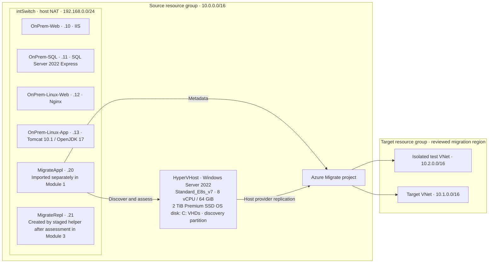

# TD SYNNEX | Azure Migrate Hyper-V Workshop

**Cloud Enablement Services** · Partner hands-on training

## Executive Summary

Cloud migration is a business and architecture decision, not just a server-copy exercise. This partner workshop gives Cloud Solution Architects and Infrastructure Engineers hands-on experience discovering, assessing and rehosting a small mixed Windows/Linux application portfolio with Azure Migrate. You will connect infrastructure choices to application dependencies, test the migrated workloads, plan a controlled cutover and review post-migration operations.

[Azure Migrate](https://learn.microsoft.com/en-us/azure/migrate/migrate-services-overview) unifies migration planning and execution: **Decide → Plan → Execute**. This workshop uses **one nested Hyper-V host and four workload VMs** to make that journey accessible without physical datacenter equipment. Deployment prepares the four sample workloads and stages a standalone helper plus the original generalized Windows Server 2022 base image. **After assessment, Module 3 uses that helper to create clean `MigrateRepl` automatically**; students do not size/build another VM manually. Microsoft appliance installation/registration, discovery, assessment, migration decisions and validation remain part of the learning experience.

The workshop scope is **four VM rehosts to Azure IaaS**, not automatic PaaS conversion. Web/Linux-Web use the **Hyper-V host provider**; SQL/App are treated **as physical servers**, using a **separate modern replication appliance and guest Mobility Service**. The independent discovery appliance does not replicate either group. Both methods prepare **one connected application**, with source service maintained during initial/delta replication and tests, then **one planned final maintenance window**. Verify current support, resource associations, appliance capacity and test isolation before enabling replication.

**Audience:** intermediate-to-advanced infrastructure and cloud practitioners. Prepare the environment before the teaching session and allow time for downloads, discovery, data collection and replication. Duration depends on subscription capacity, connectivity and the environment; this is not a guaranteed four-hour exercise.

## Business Context

### Why Organizations Migrate to Azure

Organizations consider Azure to improve business agility, renew aging infrastructure, strengthen operational controls and create options for later modernization. Each outcome needs evidence:

- **Agility:** compare provisioning and change processes with the business's needs.
- **Cost management:** assess VM sizing, licensing and consumption rather than assuming cloud automatically costs less.
- **Security and governance:** plan identity, network access, monitoring and policy; a VM move alone does not establish compliance.
- **Resilience:** design and test backup, recovery and operating procedures rather than treating migration as disaster recovery.
- **Modernization:** use the discovered application portfolio to identify future platform opportunities after the initial move.

### Common Migration Strategy Options

This workshop practices **rehost**: move the four VMs to Azure IaaS while retaining their application stacks. A future modernization exercise could instead evaluate managed platforms or application changes. Base that decision on business value, dependencies, compatibility and operating requirements; some workloads may be better retained, replaced or retired. These are qualitative options, not a fixed-count strategy framework.

Tomcat-to-App-Service modernization uses [separate tooling](https://learn.microsoft.com/en-us/azure/app-service/app-service-java-migration). Database or other PaaS moves likewise require their own compatibility, support and operational review; they are not outputs promised by this Hyper-V VM lab.

### What This Workshop Simulates

The four VMs stand in for a small business's web, application and database tiers. Their mixed operating systems and real request/data paths let you discuss inventory, dependency groups, validation and cutover sequencing. The applications are deliberately small teaching samples, not production-equivalent implementations. The source is a **single Hyper-V host**, not a cluster, and the workshop does not implement a production Azure landing zone.

## Architecture Overview

### Lab Topology



### Why Nested Virtualization?

Hyper-V inside an Azure VM gives each participant a self-contained source environment without physical hardware. You can observe host discovery, replication and guest behavior while keeping the portfolio small enough for a workshop. It is a lab adaptation, not proof that its networking, capacity or security reproduces a production datacenter.

The default [Esv7 host](https://learn.microsoft.com/en-us/azure/virtual-machines/sizes/memory-optimized/esv7-series) has 8 vCPUs and 64 GiB of memory and supports nested virtualization. It requires a Generation 2 image with NVMe support. Verify the selected SKU, subscription restrictions, regional/family quota and actual capacity before deployment.

### Network and Storage Topology

- The source Azure VNet is `10.0.0.0/16`. The nested `intSwitch` uses `192.168.0.0/24`; the host is `.1`, the four workloads are `.10`–`.13`, discovery `MigrateAppl` uses `.20`, and replication guest `MigrateRepl` uses `.21` after its Module 3 creation. SQL/App must reach the replication appliance on private TCP 443/9443; the appliance also needs approved outbound HTTPS to Azure. No additional Azure VM or public IP is created.
- Nested guest addresses use DHCP reservations. Host-side NAT provides outbound connectivity for the source lab; it is not an Azure NAT Gateway resource or a production firewall design.
- Migration uses a target VNet (`10.1.0.0/16`) and a separate test VNet (`10.2.0.0/16`). Choose a migration target region different from the source host region, and keep project migration settings, assessments and target/test networks consistent. Verify the required routing, DNS and outbound connectivity; the scripts do **not** create Azure NAT gateways.
- One **2 TiB (2048 GiB) Premium SSD (`Premium_LRS`) host OS disk** holds the host, base images, four unchanged workload VHDs on `C:` and the retained 100-GiB discovery `ApplianceStore` partition, normally `E:`. There is **no additional Azure managed data disk**. Fixed workload disks remain 40 GB per Windows VM and 30 GB per Linux VM.
- Initial deployment **stages, but does not run**, `C:\AzMigrateLab\prepare-replication.ps1` and retains the original generalized `C:\AzMigrateLab\VHDs\WindowsServer2022-Base.vhdx` with recorded SHA256. After Module 1 assessment, the standalone helper creates `MigrateRepl` from that **same clean base image**, never a workload or registered-appliance clone: Windows Server 2022 Desktop Experience English (`en-*`), eight shared vCPUs, **16 GiB static RAM**, 80-GiB OS and separate 620-GiB local data VHDX. Both SCSI disks reside under host `C:\AzMigrateLab\ReplicationAppliance`; full data-disk growth is budgeted, not oversubscribed or placed on Azure temporary/cache storage. The discovery partition is not this data disk. Initial deployment reserves the disk capacity; the later helper rechecks actual storage/memory headroom with discovery and host reserve. Eight guest vCPUs share the outer host's eight, not additional dedicated Azure cores.
- **VM counts:** initial deployment creates **four nested workload VMs**; Module 1's `MigrateAppl` import brings the total to **five**; only after assessment does Module 3's helper create `MigrateRepl`, bringing the total to **six**. In Azure, this remains **one source host VM and one persistent 2-TiB managed OS disk**, not four/five/six Azure VMs or two additional managed disks for the replication guest's VHDXs. The existing temporary `WinServerBase-temp` image-preparation disk is still used during provisioning and cleaned up when setup termination is confirmed. These counts do not enumerate networking or later migration resources; assessment, replication selection and cutover remain scoped to the **four workloads**.
- Successful initial deployment confirms the helper/base image are **staged**, not that `MigrateRepl` exists or is ready. Only successful Module 3 helper execution leaves its OS Running; Microsoft appliance software is still **not installed or registered**. It is infrastructure, never an assessment/migration workload, traffic/CPU target or workload-backup exercise. Module 3 retains manual installer, project registration and SQL/App Mobility work. Do not rerun `deploy-lab.ps1` to create it.
- Module 1 downloads and imports Microsoft's appliance VHD separately. An instructor can opt into download/extraction during deployment: the background stage starts with OS image preparation and is collected before final host readiness. This does not import or register the discovery appliance VM; `MigrateRepl` is created separately in Module 3. There is no final checksum prompt; without `-ApplianceVhdSha256`, staging is unverified, and Module 1 §2.1 retains the optional recommended publisher comparison. Wait for deployment to finish before accessing the host. Allow at least 30 GB free for download/extraction and check actual import-copy headroom on the reported store drive; free space depends on the current archive and existing contents.

### Workload Portfolio & Real-World Mapping

The portfolio is chosen for **mixed operating systems, distinct business roles and observable application dependencies**, not to assign different migration methods according to service type.

| Lab workload | Actual technology and role | Business analogy and learning purpose |
|---|---|---|
| **OnPrem-Web** · `192.168.0.10` | Windows Server 2022, IIS static site on port 80 | A Windows web-tier entry point. The sample page is not a full .NET application. Windows lab traffic reads SQL data and checks application health, illustrating dependencies beyond a web page. |
| **OnPrem-SQL** · `192.168.0.11` | Windows Server 2022, SQL Server 2022 Express on 1433; `ContosoApp` Customers/Orders | The relational data tier of an order-processing system. Compare real data before/after testing and cutover, plan write quiescence and recovery, and keep database consumers in the migration plan. SQL and Linux-App use the modern physical-server/Mobility Service replication path in Module 3. |
| **OnPrem-Linux-Web** · `192.168.0.12` | Ubuntu 24.04 LTS, Nginx static site on 80 and desk/API reverse proxy on 8080 | A Linux frontend/reverse-proxy role. Validate the proxy-to-application dependency, addressing and cross-OS connectivity rather than only the port-80 page. |
| **OnPrem-Linux-App** · `192.168.0.13` | Ubuntu 24.04 LTS, Tomcat 10.1 / OpenJDK 17, Jakarta Servlet 6.0 / Pages 3.1; Contoso Order Desk Java/JSP on 3000 | An internal order-entry application tier. JDBC reads/writes real Customers/Orders data in SQL; HTTP through Nginx exercises a multi-tier request. This is a lightweight sample, not a production-scale application. |

Initial deployment installs the application, database prerequisites and Nginx proxy. Starting lab traffic is **required for the student dependency exercise**, not an application-install step. It adds Windows SQL reads/HTTP health checks and Linux HTTP requests through Nginx → Tomcat → SQL, including real sample-order writes. Complete [Module 0 §6](docs/Module-0-Setup.md#6-start-the-sample-business-traffic) before discovery; dependency results will not appear correctly without this lab traffic and still need time for collection. Observe those relationships when selecting migration groups and acceptance checks.

## Workshop Learning Path — Cloud Adoption Framework Context

The [Cloud Adoption Framework](https://learn.microsoft.com/azure/cloud-adoption-framework/) provides wider strategy, planning, readiness, governance and operations context. This lab samples those concerns; **discovery and assessment are migration activities, not an additional CAF methodology named “Assess.”** The practical learning sequence below follows discovery, assessment, migration and operations for four VMs.

| Module | Exercise | Learning and completion evidence |
|---|---|---|
| 0 | [Setup](docs/Module-0-Setup.md) | Prepare and verify the four source workloads, applications and appliance-store space; start and verify required network lab traffic in §6. CPU simulation is optional. |
| 1 | [Discovery and assessment](docs/Module-1-Discovery.md) | Verify the four workload identities in discovered inventory, select only those four for assessment, and discuss readiness/sizing/cost and dependencies with network traffic running. |
| 2 | [Web-workload migration](docs/Module-2-Agentless-Migration.md) | Configure Web/Linux-Web Hyper-V provider replication in §§4–6, then continue to Module 3 before monitoring or testing the frontends. |
| 3 | [Database/application workload migration](docs/Module-3-Agent-Based-Migration.md) | Configure SQL/App modern physical/Mobility replication in §§4–8; both pairs must be configured before either test walkthrough. Return to Module 2 §§7–8, then Module 3 §§9–10, and perform one shared final cutover in Module 3 §11. |
| 4 | [Azure Migrate vs. Site Recovery](docs/Module-4-ASR-Comparison.md) | Compare a one-time migration with ongoing disaster recovery and explain when each is appropriate. |
| 5 | [Post-migration operations](docs/Module-5-Post-Migration.md) | Verify application/network behavior, monitoring, optional backup/restore, security and cost controls. |
| Finish | [Costs and Cleanup](#costs-and-cleanup) | Account for test VMs, replication, source/target resources, retained backup data and registrations. |

**Replication and test route:** Module 2 §§4–6 (submit frontend replication) → Module 3 §§4–8 (submit SQL/App replication) → Module 2 §§7–8 (monitor/test frontends) → Module 3 §§9–10 (monitor/test SQL/App and the full application) → **Module 3 §11 (one coordinated final maintenance window)**. Keep both pairs replicating while following this route; do not complete a frontend cutover first.

**This course teaches two replication methods.** Module 2 uses the Hyper-V host provider for OnPrem-Web and OnPrem-Linux-Web. Module 3 uses guest Mobility Service and a separate modern replication appliance for OnPrem-SQL and OnPrem-Linux-App. This division is a teaching comparison, not a requirement imposed by SQL or stateful data. Both pairs belong to one application and share one coordinated final cutover.

**The retained migration helper scripts do not implement Module 3’s Mobility workflow.** Their workload filters are not alternative student procedures. Follow the module instructions for replication, testing and cutover.

### Cloud Adoption Framework Flow

Use the wider business sequence **strategy and planning → environment readiness → migration execution → ongoing operation**, with governance and security throughout. Within the migration exercise, discover and assess first, group dependent workloads, test in isolation, authorize cutover, then validate and optimize. The two workload exercises group practice tasks; production migration waves must follow actual dependencies and business constraints.

## Prerequisites

### Azure Subscription Requirements

- Use an approved training subscription and new, dedicated lab resource groups. Confirm permissions to create the source/target resources and perform the selected project, replication, monitoring and backup tasks. Resource-provider registration and role assignment require their own permissions.
- Verify the resource providers listed in [Module 0](docs/Module-0-Setup.md), subscription policy, Windows/guest licensing, package-source access and budget approval.
- The default source host requires **8 vCPUs**, with sufficient regional and actual SKU-family quota. The four workload VMs, Module 1's imported `MigrateAppl` and Module 3's later `MigrateRepl` consume host resources, not separate Azure VM allocations. Static allocations are 12 GiB for workloads plus 16 GiB per appliance; actual available memory and host overhead still require preflight when the helper runs, not an assumed free-memory balance.
- Plan target/test quota separately in the migration region. Cost-ordered eligible B2/D2 targets use **2 vCPUs each**: **8 vCPUs** for one full four-VM target **or** test set, or **16 vCPUs** for full target-plus-test overlap; normal test cleanup precedes cutover. Step 1 checks the whole plan against actual regional SKU and family quota metadata, counting existing usage without double-counting it. These workshop sizes are not assessment recommendations.
- Quota is not capacity. A valid region or an advertised SKU does not guarantee allocation, policy approval or access.

### Tooling, Network and Knowledge

| Requirement | Preparation |
|---|---|
| PowerShell and Az | An open Windows PowerShell 5.1 or supported PowerShell 7 deployment session with the required Az modules; host-side commands use Windows PowerShell 5.1. Confirm the module/cmdlet prerequisites in Module 0. |
| Repository | The complete instructor-approved checkout, including application/runtime assets. Git is useful for recording the exact revision; obtain the actual repository URL and branch from the instructor. |
| Host access | An RDP client and outbound TCP 3389 to the host's public IP. Deployment restricts incoming RDP to your supplied public IPv4 address. Bastion/VPN would be separately planned options, not resources provisioned by this lab. |
| Downloads and guest connectivity | Approved access to Microsoft, Canonical/Ubuntu and the other package sources listed in Module 0; outbound connectivity for appliance registration and replication. |
| Background knowledge | Azure VMs/VNets/NSGs, subscriptions and RBAC, Hyper-V administration, Windows/Linux service checks and basic SQL/application dependencies. |

Use lab-only credentials. Keep expanded configuration and logs containing credentials private. Neither the simple sample application's authentication/TLS choices nor the lab's trusted network ranges are a production security baseline.

## Quick Start — Prepare the Source Lab

The deployment script prepares the source simulation; it is not a complete enterprise landing-zone deployment. Follow [Module 0](docs/Module-0-Setup.md) for prerequisites and verification, then [Module 1](docs/Module-1-Discovery.md) for the appliance and project workflow.

### 1. Obtain the Reviewed Checkout

Use the repository URL and branch supplied by your instructor, not a guessed public URL. If using Git, substitute those reviewed values and record the commit:

```bash
git clone --branch <reviewed-ubuntu2404-branch> <workshop-repository-url> azure-migrate-workshop
cd azure-migrate-workshop
git rev-parse HEAD
```

This checkout uses Ubuntu 24.04 LTS and Tomcat 10.1/OpenJDK 17. Extract it separately and build a fresh lab; it is not an in-place upgrade for an Ubuntu 22.04 lab.

### 2. Authenticate and Deploy

Run from the checkout root in PowerShell. Region and resource names below are examples; verify your actual subscription, approved source region, quotas and access first.

```powershell
Connect-AzAccount

# Masked at the prompt so they are not readable over a shared screen
$secureSubscriptionId = Read-Host 'Workshop subscription ID' -AsSecureString
$secureAdminCidr = Read-Host 'Your public IPv4 address' -AsSecureString
$password = Read-Host 'Lab-only administrator password' -AsSecureString

$sourceRg = 'rg-ces-source-01'
$location = 'eastus'

.\scripts\deploy-lab.ps1 -SubscriptionId $secureSubscriptionId `
    -ResourceGroupName $sourceRg -Location $location `
    -AdminUsername 'labadmin' -AdminPassword $password -AdminSourceCidr $secureAdminCidr
```

Supply your actual public IPv4 address when prompted; the script accepts it with or without `/32`. Do not use a shared training password in source files or command history. Appliance download/extraction is optional, default No; students normally obtain it through their project in Module 1. Opting in is for instructor preparation and does not automate appliance import, registration or discovery.

Use a **new dedicated source resource group** for a new lab. A recognized incomplete deployment can resume under its own checks; that is not permission to replay provisioning against a completed or migrated lab. Do not point this Ubuntu 24.04 checkout at an existing 22.04 host or upgrade those guests in place.

### 3. Connect and Begin the Student Exercises

Deployment automatically installs/starts **required source network traffic after application readiness**, without a network question. Before reporting completion, it confirms the Windows task, active/enabled Linux unit, direct/proxy readiness and two increasing API total-order counts. This stage and cleanup are included in deployment timing. Independent **optional CPU Simulation [No]** follows the end/elapsed messages; CPU may remain No. Neither component requires an Azure Migrate project or appliance download.

Connect to HyperVHost only after deployment timing ends and complete Module 0's guest/application checks. **Before discovery, complete [Module 0 §6](docs/Module-0-Setup.md#6-start-the-sample-business-traffic): inspect the automatically started Network Status and verify readiness plus two rising total-order counts. Do not restart a confirmed successful deployment Start. An incomplete/unknown required network stage means deployment is not complete; inspect Status/Stop before an approved manual retry, never replay deployment.** Dependency results will not appear correctly without this lab traffic, and collection still takes time. Source startup is not permission to automate the manual Mobility, replication, test, cutover or post-migration exercises. Create/register the Azure Migrate project and manually import the published appliance through Module 1; its recommended publisher SHA256 comparison is optional. Verify the four workload names and source VM IDs in discovery; inventory can also include infrastructure. Select only `OnPrem-Web`, `OnPrem-SQL`, `OnPrem-Linux-Web` and `OnPrem-Linux-App` for the four-server assessment and assigned migration methods. Exclude `HyperVHost`, `MigrateAppl` and `MigrateRepl`; do not hide infrastructure by blocking discovery. See [Lab Traffic](#lab-traffic) and [Optional CPU Simulation](#optional-cpu-simulation) for detailed controls.

The required assessment is an **Azure VM assessment of four servers**. The Step 2 helper defaults to `-AssessmentMode Classic`; here “Classic” identifies the grouped assessment API, not a retired first-generation Azure Migrate project. Start with AsOnPremises/configuration-based sizing, the chosen migration target region and your actual offer/licensing settings. Separately compare a performance-based portal assessment after collecting sufficient data. [Assessment estimates depend on collected data](https://learn.microsoft.com/en-us/azure/migrate/review-assessment?view=migrate). [Assessments capture point-in-time inputs](https://learn.microsoft.com/en-us/azure/migrate/concepts-assessment-calculation?view=migrate-classic). For this lab, review the actual readiness, cost and sizing output; do not treat idle-sample measurements as production utilization or script defaults as automatically selected recommendations.

### Student Portal Path and Instructor Helpers

The module guides are the student path. Complete their portal actions and validation rather than treating a helper's final message as the learning objective. **The remaining toolkit examples in this subsection are instructor references, not student prerequisites or an alternate SQL/App Mobility route.** Module 2 includes target landing-zone preparation; Step 1 is an optional instructor shortcut for networking and project guidance, not automatic project creation. Required source traffic normally starts during deployment; the staged HyperVHost controller in Module 0 §6 provides Status/Stop and approved manual recovery. It does not require Step 1 or a project.

Use an open PowerShell window for the interactive migration helpers. They can load their required Az modules, sign in as needed and prompt for omitted environment values. For example:

```powershell
Get-AzContext
.\scripts\migrate-step1-setup-project.ps1
.\scripts\migrate-step2-discover-assess.ps1 -SourceResourceGroup $sourceRg
```

The `migrate-step` scripts use the active Az subscription; verify `Get-AzContext` before running them. Select the actual host, project, source and target groups. Choose and verify the separate migration target region **before** portal Create resources / Finalize discovery locks it; keep the assessment and target/test networks aligned with that choice.

**Target VM sizing:** Step 1 and Step 3's `-Workload Agentless` preflight offer numbered B2/D2 menus for all four roles, filtered first by the signed-in Azure subscription's live regional eligibility and quota using `Get-AzComputeResourceSku` and `Get-AzVMUsage`. Known OS-specific USD/hour pay-as-you-go compute prices from the official Azure Retail Prices API sort ascending with deterministic ties; unpriced candidates appear separately as **Price unavailable**, with incomplete cost ranking. Rows show the SKU, RAM, actual family, regional/family quota headroom and exact Windows/Linux USD/hour prices when available. Each target has exactly 2 billable vCPUs, with minimum RAM of 4 GiB for Web, 8 GiB for SQL and 2 GiB for each Linux VM. Current B-series v2 and supported D-series v4/v5 candidates must support x64, Generation 2, SCSI and Premium SSD; ARM, 1-GiB, NVMe-only and retired sizes are excluded. Review guest/controller and migration-provider eligibility in the portal. The source `Standard_E8s_v7` host is unaffected. Choose each size explicitly: Enter has no cheapest/default choice, and blank input cancels before writes. Step 1 plans quota and landing-zone preparation only; it does not persist the choice, reserve cores or create target VMs. It prints the reusable map and a Step 3 command with your actual chosen SKUs. After discovery and assessment, use the explicit `Agentless` example below for frontend-only prerequisite checks and manual Hyper-V portal guidance; Step 1's printed `All` command now returns the two-method manual handoff instead:

```powershell
.\scripts\migrate-step1-setup-project.ps1
# Copy Step 1's printed map with your actual chosen SKUs, not these placeholders.
$targetVmSizes = @{
    'OnPrem-Web' = '<chosen SKU>'
    'OnPrem-SQL' = '<chosen SKU>'
    'OnPrem-Linux-Web' = '<chosen SKU>'
    'OnPrem-Linux-App' = '<chosen SKU>'
}
# Complete Step 2 discovery and assessment before enabling replication.
.\scripts\migrate-step3-replicate.ps1 -Workload Agentless -TargetVmSizes $targetVmSizes
```

Step 1 and Step 3's `Agentless` path accept optional `-TargetVmSizes`: a hashtable with exactly `OnPrem-Web`, `OnPrem-SQL`, `OnPrem-Linux-Web` and `OnPrem-Linux-App` mapped to actual selected SKUs. Omitting it opens all four numbered selections; supplying it bypasses only the size prompts, not eligibility, RAM or combined regional/family quota checks. Step 3's **frontend-only preflight retains the full four-role quota plan**, revalidated against the current live subscription and actual target VNet region; it never selects SQL/App for Hyper-V protection, silently changes a previous choice or resizes existing replication. **`AgentBased` and `All` stop before Azure sign-in/resource reads, vault/provider/source inspection and sizing/quota checks**; a supplied map is not evaluated or approved by those handoffs. `-ForecastVmSizes` remains a separate, nonbinding Step 1 quota forecast, not an explicit selection override.

The chosen plan supplies target-sizing guidance for the manual replication wizard, not an automated replication write, source-host change or allocation guarantee. Missing SKU metadata, subscription restrictions or unknown quota do not approve a size. Missing public prices alone do not block an explicit choice with verified eligibility and combined quota, but cost ranking is incomplete and no cheapest claim is valid; no third-party price fallback or static rates are used. Apply your recorded choices in the portal; live prices, eligibility and quota can change, and actual allocation can still fail for lack of capacity.

For `Agentless` only, Step 3 uses explicit-version REST GETs in the current Az subscription, avoiding local `Get-AzResource` API-version-cache lookup; an empty legacy `Servers-Migration-ServerMigration` `vaultId` does not mean no vault exists. Vault provisioning `Succeeded`, provider `CurrentConnection = Connected` and healthy VM replication are separate checks. Without a trustworthy project-service vault reference, select an existing candidate from the `-SourceResourceGroup` scope by default (or `-VaultResourceGroup`), with optional `-VaultResourceId` / `-RecoveryServicesProviderId` for explicit identities. A name match proves no link: association source `StudentSelected` leaves project association `Unknown`, not `AzureVerified`. Review existing jobs/replication first; use manual portal Create resources only if genuinely needed after reviewing complete inspected-scope inventory and the migration-region lock, and register the host provider only if needed. Rerunning only rereads status, without resource creation or replication restart; the safe JSON report uses a unique default path or optional `-ReportPath` and is inventory, not readiness or completion.

**Step 3 provides method-aware guidance, not replication automation.** `Agentless` retains read-only frontend checks; `AgentBased` and `All` return a manual course map immediately, with skipped probes explicitly `NotRun` in the JSON report. No route enables/monitors replication or completes a module. `ManualActionRequired` or `Blocked` and a nonzero exit are **not completion**. Follow the [Hyper-V migration tutorial](https://learn.microsoft.com/en-us/azure/migrate/tutorial-migrate-hyper-v) for the two frontends and the separate Module 3 modern physical-server/Mobility procedure for SQL/App. Test migration/cleanup and authorized cutover remain **manual portal stages**, including source shutdown at the shared cutover:

| Helper filter | Selected workloads | Corresponding manual course path | Boundary |
|---|---|---|---|
| `Agentless` | OnPrem-Web, OnPrem-Linux-Web | Read-only Hyper-V preflight; manual Module 2 §§4–6 replication, then §§7–8 monitoring/test after SQL/App replication is configured | Full four-role sizing/quota plan only; HOLD final cutover for Module 3 §11. |
| `AgentBased` | OnPrem-SQL, OnPrem-Linux-App | Immediate manual handoff to Module 3 §§4–8 modern appliance/Mobility replication, then §§9–10 monitoring/test | No Azure/Hyper-V inspection, sizing approval, appliance/Mobility installation or replication automation. |
| `All` | Both method groups, four workloads | Immediate manual map of the [two-method course route](#workshop-learning-path--cloud-adoption-framework-context); rerun `Agentless` only for frontend preflight | No all-four Hyper-V selection or completed preflight; one final window in Module 3 §11. |

Keep the same reviewed workloads, target region and sizes through the portal stages. After assessment, **manually run the authorized `prepare-replication.ps1` command in Module 3 §7**: that distinct staged host helper creates clean `MigrateRepl` at `.21`, not a migration workload. It is **not** `migrate-step3-replicate.ps1`, and Step 3 never invokes it or asserts that the VM/software is already installed or registered. Microsoft appliance installation/registration, SQL/App Mobility Service and portal protection remain manual. Exclude `HyperVHost`, `MigrateAppl` and `MigrateRepl` from assessment/migration selections.

**Steps 4 and 5 remain retained host-provider prerequisite/guidance helpers, not implementations of the SQL/App Mobility route or the course's coordinated cutover.** Their guards prevent unverified VMwareCbt test/migration calls from executing; `ManualActionRequired`/`Blocked` is not completion. No ASR disaster-recovery workaround is substituted. Use the module guides for testing both pairs and the single shared final window.

| Helper | Scope and operator responsibility |
|---|---|
| `deploy-lab.ps1` | Creates the billable source host with one 2-TiB Premium SSD OS disk and four unchanged workload guests; prepares discovery settings and the 100-GiB discovery-store partition. Stages the standalone replication-VM helper and retains the original clean Windows base image for Module 3, without creating `MigrateRepl` yet. |
| `migrate-step1-setup-project.ps1` | Optional target/test network preparation with region/quota preflight and portal project guidance. The student can instead follow the portal path in Module 2. |
| `migrate-step2-discover-assess.ps1` | Assists host/appliance preparation, discovery and four-server assessment. Project-key, appliance and credential actions still require the operator. |
| `migrate-step3-replicate.ps1` | `Agentless`: read-only frontend Hyper-V preflight with the full four-role sizing/quota plan. `AgentBased`/`All`: early manual method handoff, no Azure reads or sizing validation. No modern/Mobility implementation, helper invocation or replication writes/monitoring. |
| `migrate-step4-test-migrate.ps1` | Guarded host-provider prerequisite/group checks and manual portal test/cleanup guidance only. The course uses Module 2 §8 / Module 3 §10; this helper does not implement the SQL/App Mobility route or report completed migration. |
| `migrate-step5-cutover.ps1` | Guarded host-provider prerequisite/group checks and separately authorized manual portal cutover guidance only. The course's one coordinated final window is Module 3 §11; no automated migration, source shutdown or completed-state claim. |
| `enable-lab-traffic.ps1` | Source-side controller staged on HyperVHost: required network lab traffic and independently optional CPU simulation. Follow [Lab Traffic](#lab-traffic); network-only Stop preserves apps and CPU. |
| `post-migration-labtraffic.ps1` | Optional target-side Check/Prepare/Start/Status/Stop controller; use the bottom-of-README [instructor reference](#post-migration-lab-traffic--instructor-reference) and confirm target identities. |
| `migrate-step6-post-migration.ps1` | Configures post-migration monitoring, backup/security/cost controls; creates or changes Azure resources. Validate before and after its hardening. |
| `cleanup-lab.ps1` | Confirms and deletes one selected resource group, then reports retained/manual cleanup items. Review every deletion scope. |

## Migration Methodology

**Discover → Assess → Plan dependency groups → Replicate → Test → Authorize cutover → Validate and operate**

1. **Discover:** register the appliance, configure valid host/guest credentials and verify the four-server inventory. Host metadata alone is not proof that guest software and dependencies have been inventoried.
2. **Assess:** review Azure readiness, sizing assumptions, data coverage and estimated monthly cost. Document the selected target region and licensing assumptions. Treat idle-lab performance data as limited evidence, not production utilization.
3. **Plan:** identify the Nginx → Tomcat → SQL request path and any Windows reporting consumers. Decide how addressing, application writes, validation and rollback will work across a migration group. The two teaching groups do not prescribe production wave boundaries.
4. **Replicate and test:** configure Web/Linux-Web host-provider replication and SQL/App modern physical/Mobility replication before either test walkthrough. Test copies in an isolated non-production VNet. Isolate copies from source application connections **before first boot**; replicated generators and configuration may otherwise contact or write to the source.
5. **Cut over:** authorize a planned outage, quiesce application activity and shut down the relevant source VMs for the final synchronization. Check replication and validation results before accepting the migrated application. Do not promise zero downtime or automatic success.
6. **Validate and operate:** compare data and endpoints, confirm network dependencies, then review monitoring, backup, access and cost. Rehost is the start of Azure operations, not the end of application ownership.

## Instructor Preparation — Qualify the Provided Baseline

Complete this preparation **before teaching Module 3**. Provide a fixed, identified build so students confirm a match in [Module 3 §4](docs/Module-3-Agent-Based-Migration.md#4-prerequisites), rather than repeat a full compatibility investigation each session.

1. **Identify the revision and sources.** Record the lab revision, qualification date, source VM identities and actual Windows Server 2022 / Ubuntu 24.04 versions. Match the selected Mobility Service build to the actual OS and running kernel/flavour, not an assessment's Ready label. Recheck after an image, kernel, agent, storage/controller or architecture change; an unchanged distribution name is insufficient.

2. **Inspect the guest support tuple.** On **source OnPrem-Linux-App — approved SSH**, retain these read-only observations:

   ```bash
   cat /etc/os-release
   uname -r
   lsblk -o NAME,KNAME,TYPE,SIZE,FSTYPE,FSVER,MOUNTPOINTS,PKNAME,TRAN,MODEL,LOG-SEC,PHY-SEC
   findmnt /
   test -d /sys/firmware/efi && printf 'UEFI boot\n' || printf 'Review boot mode\n'
   ```

   For **both SQL and App**, record every required disk, guest controller/driver, filesystem/LVM, logical-sector size, boot/EFI layout, Secure Boot state and free space; use approved read-only guest/Hyper-V inspection for facts not shown above. Check the current source-support matrix against the exact tuple. Linux guest NVMe and 4-KiB logical sectors are unsupported in the cited matrix; host NVMe does not establish guest NVMe. Do not downgrade/pin a guessed kernel, replace storage, loosen security or install an unsupported agent to proceed.

3. **Qualify the staged helper, base image and appliance capacity.** Initial deployment stages the standalone helper and preserves the original generalized Windows Server 2022 base image; `MigrateRepl` (`192.168.0.21`) is created automatically **only in Module 3, after assessment**. Rehearse that helper with the approved clean Desktop Experience English image: 8 shared vCPUs, 16 GiB static RAM, 80-GiB OS and separate 620-GiB local data disk. Both guest disks are backed by the single 2-TiB Premium SSD host OS disk, not the discovery partition. Check storage reservation at deployment and actual memory/storage at helper execution, guest disks, licensing, networking and budget. The guest has no Hyper-V, IIS or AD DS role before the vendor installer; the outer HyperVHost retains Hyper-V.

   **Nested-training qualification remains required.** This Azure-hosted nested appliance is a training adaptation, not a claim of Microsoft-certified/supported placement. Meeting the 2026-10-15 appliance matrix's minimum resources and no-Hyper-V-role requirement inside the appliance OS does not qualify the actual hosting placement. Live end-to-end rehearsal and vendor/support qualification of this placement remain pending; do not treat generated source or a readiness marker as runtime acceptance. Resolve qualification before teaching appliance installation/replication, rather than asking students to size or build a second machine.

4. **Confirm associations and hand off the baseline.** Manually verify the intended Azure Migrate project, physical-route appliance and source registrations alongside the frontend Hyper-V provider, including actual managed-vault associations. A name match is not proof; do not impose a generic separate-ASR-vault rule on Migrate. Preserve fresh identities and no dual protection. Confirm privileges, target capacity and test isolation through Module 3 §§6–7, then tell students which qualified build to match. If support, hosting, associations or the build match remain unconfirmed, resolve them before agent installation/replication; students stop and ask rather than invent a workaround.

**Source guidance — reviewed 2026-10-21 (page dates shown):**

- [Physical-server migration tutorial](https://learn.microsoft.com/en-us/azure/migrate/tutorial-migrate-physical-virtual-machines?view=migrate) — 2026-06-27: separate replication appliance; Site Recovery components explain the support-matrix dependency.
- [Source support matrix](https://learn.microsoft.com/en-us/azure/site-recovery/vmware-physical-azure-support-matrix) — 2026-10-15: match actual OS/kernel and Mobility version; check storage and boot restrictions.
- [Modern appliance support matrix](https://learn.microsoft.com/en-us/azure/site-recovery/replication-appliance-support-matrix) — 2026-10-15: verify dedicated machine, capacity, role and network prerequisites before installation.
- [Mobility Service overview](https://learn.microsoft.com/en-us/azure/site-recovery/vmware-physical-mobility-service-overview) — 2026-10-15: failed VSS processing can leave crash-consistent replication; agent health does not guarantee application-consistent data.

## Lab Traffic

**Network traffic is required for the student dependency exercise and starts automatically during deployment.** Complete [Module 0 §6](docs/Module-0-Setup.md#6-start-the-sample-business-traffic) after deployment and the guest/application checks, before discovery, to observe its confirmed status and ongoing order growth. There is no deployment network question or default skip. Dependency results will not appear correctly without this lab traffic. Collection/upload windows still apply, so startup does not guarantee an immediate complete map.

Deployment already provisions the Tomcat order desk, its shared SQL login, lab aliases and Nginx 8080 desk/API proxy. Traffic is not an application-install step, and the port-80 IIS/Nginx sites are unchanged. CPU simulation is an independent optional component, not a network dependency.

| Edge | Protocol | Driven by |
|---|---|---|
| OnPrem-Web → OnPrem-SQL | TDS 1433 | `LabOrderDeskTraffic` scheduled task reads existing orders. |
| OnPrem-Web → OnPrem-Linux-App | HTTP 3000 | The same task calls health. |
| OnPrem-Linux-App → OnPrem-Linux-Web | HTTP 8080 | `contoso-orderdesk-traffic` Python HTTP generator. |
| OnPrem-Linux-Web → OnPrem-Linux-App | HTTP 3000 | Existing Nginx desk/API reverse proxy. |
| OnPrem-Linux-App → OnPrem-SQL | TDS 1433 | Actual Tomcat Java process reads/inserts through its bounded JDBC pool. |

Python never connects directly to SQL and contains no SQL password. The original Linux-App generator performs health and order reads and at most one fixed `Order Desk demo` insert through Nginx per cycle; Windows reporting shares its interval. The source interval defaults to **300 seconds (five minutes)**, range **20–600 seconds**. This is not a production load/sizing benchmark. The real JVM keeps initial/min idle 1 and maxActive 4 JDBC connections after readiness; no arbitrary sockets are opened merely to affect dependency polling.

A separate **synthetic employee-order** service, `contoso-employee-orders.service`, runs on Linux-Web through **127.0.0.1:8080 → Nginx → Tomcat → SQL**. During **UTC 06:00 inclusive–22:00 exclusive**, before each order attempt it chooses **1–3 pages inclusive** uniformly and reads that many available **20-record** order pages, newest first from a fresh snapshot, stopping at the end without repeating pages. It then selects an existing customer and a uniformly selected distinct existing product, preserves a compatible recorded unit price, chooses quantity **1–3**, makes at most one order POST, then waits a random **120–1200 seconds inclusive** after the cycle. It sleeps until **06:00 UTC** overnight with no catch-up queue. This fixed UTC window matches CPU day/night hours but does not depend on CPU being enabled, its process, or its expiry; the original five-minute generator continues overnight.

There is no Products table: read-only `/api/order-options` derives products from the **full Orders history**, not the 20 recent rows, choosing each product's earliest compatible recorded price. Repeated demo orders do not crowd out seeded products. Options are bounded to 500 customers and 500 distinct products; invalid/empty options cause a skipped cycle, never fabricated customers/products. The worker is root-owned code with a single DynamicUser systemd process, private state and a distinct User-Agent/journal prefix; it creates no employee identities. A timeout/uncertain acknowledgement is logged **outcome-unknown**, never automatically POST-retried. A persisted next-cycle boundary also prevents immediate replay after interruption; no automatic process restart is configured.

The desk starts with the **newest 20** orders. **Records per page** offers **20, 40, 60, 80 or 100**; **Apply** applies the selection and starts a fresh newest-first view. **Next X** reads older records; **Previous X** returns toward newer records in the same snapshot, where X is the selected size. Controls are disabled at either end and the final page can be partial. Paging is GET-only, uses validated parameterized integer cursors and an initial maximum OrderID anchor, and leaves total order/customer counts global. Concurrent new inserts do not shift pages; refresh the snapshot to see them. Deleted rows are omitted without OFFSET shifts; a stale out-of-range cursor is bounded to the corresponding surviving end. An empty/end page never creates an order.

Employee browsing uses the same SQL-backed paging API, not static HTML or preloaded rows, independently of a person's selected page size. Page/cursor metadata is typed and checked before following locally constructed URLs. An empty/failed/invalid browse or options read skips the write; UTC/Stop are checked before every new GET and POST. An in-flight request may finish after 22:00, but no next request starts overnight. State/journal report page and record counts, not customer/product identities. These extra proxy reads exercise **Linux-Web → OnPrem-Linux-App:3000 → SQL** and may improve observation opportunities, but **do not guarantee Azure Migrate dependency capture**; sampling, collection and upload still apply.

### Source Startup, Status and Stop

**Execution location: HyperVHost — elevated Windows PowerShell, after deployment completion and Module 0 §5 checks.** Use the already staged controller and deployment-generated `C:\AzMigrateLab\lab-traffic.settings.json`; no Azure Migrate project is required. If deployment network startup was confirmed successful, skip Start and inspect Status. For an unknown/partial result, inspect Status and stop as needed before retrying.

```powershell
# Approved manual recovery only, after Status/Stop; do not repeat a confirmed deployment Start.
C:\AzMigrateLab\enable-lab-traffic.ps1 -Mode Start -Component Network -CpuSimulation Skip
# Inspect without starting or renewing anything.
C:\AzMigrateLab\enable-lab-traffic.ps1 -Mode Status -Component Network
# An explicit source interval, when an approved Start is needed.
C:\AzMigrateLab\enable-lab-traffic.ps1 -Mode Start -Component Network -CpuSimulation Skip -IntervalSeconds 300
# Approved troubleshooting/final-boundary stop: applications and CPU remain unchanged.
C:\AzMigrateLab\enable-lab-traffic.ps1 -Mode Stop -Component Network
```

The two Start lines are **alternatives**, not consecutive actions. Enter the existing lab password privately at the controller's masked prompt; never put a password literal in command history. `LinuxUsername` comes from settings unless explicitly overridden or requested at the prompt. Windows guest configuration uses **PowerShell Direct**; Linux configuration uses **SSH**. OpenSSH **8.4+** can reuse the initial password prompt with askpass; older clients prompt per guest. If interactive startup reports a missing SSH capability, use its approved host-side installation path as needed; do not weaken guest authentication or substitute a workstation launch. Noninteractive mode does not install capabilities or prompt for missing credentials.

| Source controller control | Meaning and guard |
|---|---|
| `-Mode Start\|Check\|Status\|Stop` | Check is a read-only alias of Status. Start defaults to Network. Check/Status, Stop and `-Disable` default to Both unless a component is explicit. |
| `-Component Network\|Cpu\|Both` | Selects the synthetic component(s), not applications. Explicit Cpu/Both opts into CPU and conflicts with `-CpuSimulation Skip`. |
| `-CpuSimulation Prompt\|Start\|Skip` | Independent CPU choice with network startup. Prompt skips CPU in noninteractive use. Explicit network Start is not CPU consent. |
| `-IntervalSeconds 300` | Source network cycle; 20–600 seconds. This does not add a network stop timer. |
| `-SettingsPath <path>` / `-LinuxUsername <name>` | Override the deployment-generated settings path or confirmed Linux deployment username. Preserve private settings. |
| `-NonInteractive` | Requires supplied credentials and supported SSH/password/sudo preflight on both Linux guests. It forbids missing-input prompts, capability installation and Windows-only `SkipLinux` success. |
| `-SkipLinux` | Configures Windows only and saves Linux commands for console execution. It does **not** satisfy full network startup for the student exercise. |
| `-Disable` | Stops/removes the Windows traffic task, disables/stops both Linux order services and stops/disarms CPU workers on all four guests. Use explicit `-Component Network` when CPU must remain unchanged. |
| `-CpuDurationHours` / `-RenewCpu` | CPU lifetime/explicit renewal only; see [Optional CPU Simulation](#optional-cpu-simulation). |

A bare launch starts required network traffic without a network question, then retains the independent optional CPU choice (No/Enter). Explicit `-Mode Start` or `-Component Network` also starts network without a network question. Reruns update generator tasks/configuration only: SQL mixed-mode/login preparation belongs to deployment. The controller checks the existing proxy rather than replacing it. **Stopping generators preserves the SQL login, proxy, hosts, Tomcat, SQL, IIS/Nginx sites and application data.**

Source network generators survive console closure and resume after reboot while enabled. There is **no network stop timer or automatic lab-completed detector**; completing a script or the workshop does not stop them. Declining optional CPU leaves existing CPU workers unchanged. Keep source network traffic serving during discovery, both methods' initial/delta replication and isolated tests. Freeze source manual/synthetic writers only at Module 3's final planned cutover boundary or an approved troubleshooting stop. Never replay deployment/source startup on retired sources or start the source controller on test/target copies.

### Deployment and Instructor Prompt Controls

Deployment always stages the controller/assets, then installs/starts and verifies required source network traffic after application readiness, for interactive and unattended runs alike. Network verification and cleanup are inside deployment timing; an incomplete/unknown network result leaves deployment **NeedsReview**, not complete, without automatic retry or rollback. Deployment has no network opt-in parameter or question; the obsolete deployment `-LabTraffic` parameter has been removed. Only independent **optional CPU** follows cleanup and the end/elapsed messages: `-CpuSimulation Prompt` defaults to No interactively and skips unattended; explicit `Start|Skip` remains available. `-CpuDurationHours` defaults to 24 (1–168), with no automatic renewal. `LAB_NO_PAUSE=1` suppresses the default CPU question; explicit `-CpuSimulation Prompt` overrides that only interactively. Neither component depends on appliance staging or an Azure Migrate project.

The older **Step 1 instructor offer** remains a reference option, not the normal student startup route or a prerequisite. It verifies the selected project and all four running workloads before offering network first, CPU separately, both No/Enter. With all environment inputs supplied, its default offers are skipped; use `-LabTraffic Prompt` / `-CpuSimulation Prompt` to request them interactively or explicit Start to opt in. `-LabTraffic Skip` leaves existing generators unchanged. `-LabTrafficPassword` accepts an optional SecureString; otherwise the password is obtained privately after opt-in. No traffic option bypasses project or guest-readiness checks in that helper.

Remote prompt launches require Az.Compute managed Run Command **ProtectedParameter** support, the staged controller/settings and host OpenSSH 8.4+. The password is a protected parameter, never script text or an ordinary argument. The selected host's Azure instance metadata must match subscription, resource group, VM name and VM ID before a local launch; otherwise the helper uses the remote path. Noninteractive launch preflights Linux password/sudo access on both Linux guests. Unsupported preflight means traffic has **not been initiated**; use the elevated host-interactive route after resolving the prerequisite.

The deployment's required network confirmation requires the Windows task Running; both Linux generators loaded, active/running and enabled with live PIDs (including fresh employee state; overnight `night-sleep` is healthy); direct/proxy readiness; and two numeric API total-order counts increasing at least 90 seconds apart. Read-only growth observation is bounded by the configured baseline interval plus 120 seconds (420 seconds at the five-minute default, up to 720 at 600 seconds); it does not require a random employee insert or any overnight employee writes, and never retries Start or POST. Network Status reports employee UTC phase/next due or wake and emits `LAB_NETWORK_RUNNING_CONFIRMED` only for the task/unit/state checks; it does not by itself prove order growth. A manual Start's `LAB_TRAFFIC_FULLY_STARTED` still requires the separate readiness/count observations below. Partial/failed startup can leave generators running. Managed execution requires terminal execution state, successful exit code and its exact full-start result, not Azure provisioning success alone. Timeout/read/submission uncertainty is **unknown**, not proof of no traffic; inspect the named managed Run Command and host, then Stop before another Start. Only terminal managed command resources are cleaned up; removing one does not stop traffic. A separate CPU result does not cancel confirmed network startup, and neither startup result proves sustained application health or appliance collection.

### Verify Actual Activity

**HyperVHost — Windows PowerShell:**

```powershell
Invoke-RestMethod http://192.168.0.13:3000/api/ready
Invoke-RestMethod http://192.168.0.12:8080/api/ready
$orders = Invoke-RestMethod http://192.168.0.13:3000/api/orders
$orders | Select-Object count,customerCount
```

Take fresh GET-only observations at least 90 seconds apart: readiness must remain `ready`, and API **`count`** must rise within the configured baseline interval plus up to 120 seconds of processing margin (**7 minutes at the default 300 seconds; up to 12 minutes at 600 seconds**). Do not force a POST or restart generators to manufacture growth; if the bound expires without growth, keep that evidence unconfirmed and inspect status/logs. It is the total order count; `.orders.Count` is only the returned recent array, capped at 20. Never blindly resubmit an uncertain manual order POST. The Windows log is `C:\LabTraffic\traffic.log`; on Linux-App use `sudo journalctl -u contoso-orderdesk-traffic -n 15 --no-pager`. On Linux-App, `sudo ss -ntp | grep ':1433'` should attribute SQL sockets to **java**, not Python. Windows traffic credentials are in an administrator/SYSTEM ACL-protected script: root-equivalent lab storage, not production secret management. Do not share that file. After disabling traffic, direct/proxy readiness must still work.

Without generators, HTTP edges may be idle; the Tomcat→SQL dependency still exists. An empty or partial polling view is not evidence of no dependency. Use the appliance's actual guest credential and validate SSH reachability, recursive CATALINA_HOME/BASE directory read/execute, and sudo netstat/ls separately. Leave real traffic/pool activity across multiple five-minute polling windows; dependency uploads can take six hours and web-app configuration 24 hours. No local health test proves appliance discovery. Nginx is separate inventory, not a supported assessed web-app platform.

For test migration/cutover, repoint only lab aliases/private DNS to **actual new private IPs**, restart Tomcat to close the old pool and reload Nginx to resolve its new upstream. Update Windows generator aliases too. Isolate test dependencies from source/production **before first boot**, then stop/disarm inherited generators before functional tests. Network generators can resume at boot if enabled; disable/stop `contoso-employee-orders.service` on Linux-Web and `contoso-orderdesk-traffic.service` on Linux-App before copied application tests or final writes. Leave the employee service disabled on test/target copies unless deliberately authorized; never run the source startup controller there. Follow [Module 3](docs/Module-3-Agent-Based-Migration.md), the [application guide](apps/contoso-orderdesk/README.md) and the optional [post-migration instructor reference](#post-migration-lab-traffic--instructor-reference). Existing private-network firewall rules permit the graph; no broad public rule is needed. Retain app-tier access from intended Nginx/Windows clients only.

## Optional CPU Simulation

CPU simulation is **not required for network dependencies**. It runs local low-priority calculation workers on the four existing two-vCPU source guests: Windows Server 2022 on Web/SQL and Ubuntu 24.04 on Linux-Web/Linux-App, not on HyperVHost or either appliance. The daily UTC profile has no daylight-saving adjustment or midday peak:

- **06:00–22:00 UTC:** 16-hour day, approximately **15% total guest CPU**.
- **22:00–06:00 UTC:** 8-hour night, approximately **2% total guest CPU**.

These are best-effort total-guest targets across both vCPUs, not extra load above application CPU or a cap on real applications. Workers reduce their contribution as real activity rises and rest when existing load meets/exceeds the target. They rest on measurement failure or the **30% high-CPU guard**; resumption requires CPU below **20%** and a **60-second cooldown**. OS activity and host contention can prevent an exact target.

**HyperVHost — elevated Windows PowerShell:**

```powershell
C:\AzMigrateLab\enable-lab-traffic.ps1 -Mode Start -Component Cpu -CpuDurationHours 24
C:\AzMigrateLab\enable-lab-traffic.ps1 -Mode Status -Component Cpu
C:\AzMigrateLab\enable-lab-traffic.ps1 -Mode Stop -Component Cpu
```

The default run is **24 hours**, configurable **1–168 hours**, with guest-local expiry and **no reboot auto-resume**. Closing the console does not stop it. Do not repeat a confirmed deployment CPU Start. Repeating Start reuses a healthy active run without extending its deadline; a stopped/expired deadline or unresolved run does not silently become a new run. Inspect Status and Stop as needed. `-RenewCpu` is the explicit choice to replace the CPU session and deadline. CPU-only Stop preserves network traffic and all applications/data.

Status reports actual task/unit and PID, heartbeat freshness/staleness, UTC phase, total target, measured total/baseline/worker CPU, guard/cooldown and expiry. Windows uses `LabCpuSimulation`; Linux uses `lab-cpu-simulation.service`. A healthy task/unit and fresh heartbeat show a live worker, **not achievement of the CPU target**; baseline-above-goal, invalid measurement or high-CPU cooldown can leave a live worker deliberately resting. `LAB_CPU_FULLY_STARTED` confirms all four starts; `LAB_CPU_PARTIAL_OR_FAILED` requires per-guest inspection and does not cancel confirmed network startup. Neither result proves the requested percentage.

For manual observation, use each Windows guest's **Task Manager > Performance > CPU**, or Linux `top` aggregate CPU summary, over several minutes and record UTC time. Do not confuse one process's percentage with total guest CPU. Stop source CPU **before migration testing or cutover**, or maintenance, not simply when initial replication starts. Before test boot, isolate copies from source networks, then verify copied workers are stopped/disarmed. The post-migration controller never starts CPU on test or migrated VMs; its Prepare/Start/Stop actions disarm inherited workers on confirmed running guests.

This is educational daily CPU history, not production capacity evidence or a memory/disk/network-pressure simulation. Start or explicitly renew once appliance performance collection is active so expiry covers the intended capture. Partial CPU history can appear earlier; **at least 24 hours of collection is needed for the full 16-hour day/8-hour night cycle**. Allow the full selected history window, longer if applicable, matching it to captured data before comparison. In [Module 1's optional portal comparison](docs/Module-1-Discovery.md#56--optional-performance-comparison-and-business-case), create a **second** performance-based assessment of the same four servers with unchanged region/pricing assumptions and history matching the capture; recalculate after more collection if needed. The required Step 2 **AsOnPremises/configuration-based** assessment does not use CPU history or offer a performance-based switch. Do not expect immediate graphs or a changed recommended SKU; see the [Hyper-V assessment tutorial](https://learn.microsoft.com/en-us/azure/migrate/tutorial-assess-hyper-v?view=migrate-classic).

No additional VM, size change or paid service is created. CPU use on an existing fixed-price VM has no separate usage fee; keeping the lab running longer continues normal compute/storage billing.

## Key Architectural Decisions

| Decision | Lab choice and rationale |
|---|---|
| Hyper-V source | One nested host makes host discovery and migration observable without physical hardware. Other source platforms have different replication architectures; do not generalize this lab's host-provider model to every scenario. |
| Memory-optimized host | Standard_E8s_v7 provides 64 GiB shared by the host, four unchanged workloads, Module 1's 16-GiB `MigrateAppl` and Module 3's later 16-GiB `MigrateRepl`. Check actual available memory plus host reserve; nominal allocations do not guarantee headroom. |
| Mixed OS and business tiers | IIS, Nginx, Tomcat and SQL expose cross-platform checks, real application/data dependencies and different operational concerns while remaining manageable in a teaching lab. |
| Fixed guest resources | Fixed 40/40/30/30 GB disks and static guest memory make the source allocation understandable. The sample workload's utilization does not predict production sizing. |
| Internal switch and host NAT | An isolated nested segment simplifies the source lab. It is not a statement of production network equivalence or an Azure NAT Gateway deployment. |
| Separate appliance import | Use the published Microsoft appliance package in Module 1, with its optional recommended publisher SHA256 check; distinguish appliance discovery/assessment from the host provider's replication work. |
| Test before cutover | Isolated copies let you validate addressing, application paths and SQL data before authorizing source shutdown. Plan for the final outage and recovery decisions. |

## Costs and Cleanup

Estimate the source host, its **single 2-TiB (2048-GiB) Premium SSD OS disk**, target/test VMs, replicated disks/storage, public IPs, monitoring ingestion and any enabled backup/DR services using the [Azure pricing calculator](https://azure.microsoft.com/pricing/calculator/). No second managed disk, Azure VM or public IP is added for `MigrateRepl`. Its two nested VHDXs consume that disk's capacity. The 2-TiB disk remains billable while the host is deallocated and until removed through approved source-resource-group cleanup. Separately added Bastion, gateways or other resources add costs; the workshop scripts do not deploy Azure NAT gateways. There is no verified fixed daily price or guaranteed saving.

Set a budget and review consumption during the workshop. Deallocating a VM stops its compute charge but does not remove persistent disks, retained backups or other billable resources, and does not release its quota allocation. Remove unneeded test copies before cutover according to the runbook.

Review the actual source and target resource groups before using the cleanup helper. Set `$targetRg` to the verified group; these commands are destructive and each run confirms one group:

```powershell
Get-AzContext
$targetRg = Read-Host 'Exact target resource group to delete'
.\scripts\cleanup-lab.ps1 -ResourceGroupName $targetRg
.\scripts\cleanup-lab.ps1 -ResourceGroupName $sourceRg
```

The script lists resources and asks for confirmation; `-Force` bypasses that prompt. Do not use it on shared resource groups. Account for Azure Migrate/replication artifacts, Recovery Services vault protection/retained backup data, key-vault soft deletion and the appliance's Microsoft Entra app registration. These can need separate cleanup or live in a different scope; deleting the two selected groups is not proof that every workshop artifact has gone. Confirm the final inventory and remaining charges.

## Repository Structure

```text
azure-migrate-workshop/
├── README.md                              # Introduction, source controls and instructor reference
├── docs/
│   ├── Module-0-Setup.md
│   ├── Module-1-Discovery.md
│   ├── Module-2-Agentless-Migration.md
│   ├── Module-3-Agent-Based-Migration.md
│   ├── Module-4-ASR-Comparison.md
│   └── Module-5-Post-Migration.md
├── scripts/                               # Deployment and migration helpers
│   └── host/configure-host.ps1             # Host-side provisioning payload
└── apps/contoso-orderdesk/                 # Java/JSP application and runtime assets
```

## Contributing

Send workshop corrections and improvement suggestions through the upstream repository's contribution process. Include the reviewed revision, affected module and clear reproduction/validation evidence, without credentials or private subscription details. Preserve existing attribution notices and update related learner instructions when behavior changes.

## License and Third-Party Software

This supplied checkout has no LICENSE file. Confirm the upstream repository's licensing terms before redistribution and preserve its notices. Azure services, Windows guests, SQL Server and third-party packages have their own licensing/use terms; this README does not grant those rights.

## Additional Resources

| Microsoft Learn reference | Updated |
|---|---|
| [Azure Migrate overview](https://learn.microsoft.com/en-us/azure/migrate/migrate-services-overview) | 2026-05-18 |
| [Hyper-V migration](https://learn.microsoft.com/en-us/azure/migrate/tutorial-migrate-hyper-v) | 2026-10-10 |
| [Azure VM assessment](https://learn.microsoft.com/en-us/azure/migrate/review-assessment?view=migrate) | 2026-08-25 |
| [Classic assessment calculations](https://learn.microsoft.com/en-us/azure/migrate/concepts-assessment-calculation?view=migrate-classic) | 2026-02-26 |
| [Esv7 specifications](https://learn.microsoft.com/en-us/azure/virtual-machines/sizes/memory-optimized/esv7-series) | 2026-08-24 |
| [Java migration resources](https://learn.microsoft.com/en-us/azure/app-service/app-service-java-migration) | 2025-12-12 |
| [Execute server migrations](https://learn.microsoft.com/en-us/azure/migrate/execute-server-migrations?view=migrate) | 2026-07-02 |
| [Physical/virtual machine migration](https://learn.microsoft.com/en-us/azure/migrate/tutorial-migrate-physical-virtual-machines?view=migrate) | 2026-06-27 |
| [Simplified Azure Migrate experience](https://learn.microsoft.com/en-us/azure/migrate/simplified-experience-for-azure-migrate?view=migrate) | 2026-07-20 |
| [Modern replication appliance support matrix](https://learn.microsoft.com/en-us/azure/site-recovery/replication-appliance-support-matrix) | 2026-10-15 |
| [VMware/physical source support matrix](https://learn.microsoft.com/en-us/azure/site-recovery/vmware-physical-azure-support-matrix) | 2026-10-15 |
| [Deploy the modern replication appliance](https://learn.microsoft.com/en-us/azure/site-recovery/deploy-vmware-azure-replication-appliance-modernized) | 2026-09-21 |
| [Modern physical-server architecture](https://learn.microsoft.com/en-us/azure/site-recovery/physical-server-azure-architecture-modernized) | 2026-09-21 |
| [Mobility Service overview](https://learn.microsoft.com/en-us/azure/site-recovery/vmware-physical-mobility-service-overview) | 2026-10-15 |
| [Execute and track waves](https://learn.microsoft.com/en-us/azure/migrate/how-to-execute-track-waves?view=migrate) | 2025-11-07 |
| [Define and manage applications](https://learn.microsoft.com/en-us/azure/migrate/define-manage-applications?view=migrate) | 2026-06-15 |

The retained source-register dates above were checked as of 2026-10-17; review current support and UI guidance when running the lab.

For student troubleshooting, use each module's troubleshooting section, the [application diagnostics](apps/contoso-orderdesk/README.md), and [Lab Traffic](#lab-traffic).

## Post-migration lab traffic — instructor reference

**Instructor reference only; not a student prerequisite.** Students follow the manual [Module 5](docs/Module-5-Post-Migration.md) actions. This optional controller does not replace the two-method migration, test, cutover or student validation steps.

Use `scripts/post-migration-labtraffic.ps1` after the accepted shared cutover and **before post-migration hardening**, then run Check again after hardening. It does not install or upgrade a runtime. This is an ordinary **Windows PowerShell 5.1+** controller, not a Cloud Shell, Hyper-V Direct, WinRM or SSH script. Existing generators may survive replication and already have inserted orders: **inventory first is not prevention of inherited traffic**.

Source CPU simulation is independent of network/order traffic, locally bounded and has no reboot auto-resume. Do not assume a copied worker is stopped merely because its deadline is bounded. Check/Status inventory inherited CPU workers on all four guests without changing them. Prepare/Start/Stop stop and disarm inherited CPU workers on confirmed running guests; an unreachable or powered-off guest remains unverified. **Start produces only bounded network traffic, never CPU simulation on test or migrated VMs.** These actions leave SQL, Tomcat, Nginx and IIS intact.

### Prerequisites and Target Confirmation

- Existing Az.Accounts, Az.Resources, Az.Network and Az.Compute, including managed `Set/Get/Remove-AzVMRunCommand` and `ProtectedParameter` support. Working Azure VM agents, their required connectivity, and RBAC for network/VM reads and managed guest command execution are required. Guest commands run elevated; no guest admin password is required. Nothing automatically repairs agents, routes, firewalls or permissions.
- Select the intended subscription and exact target resource group. Omit `-TargetResourceGroup` to enter it at a prompt; strict validation still applies and no source/default group is inferred. Every invocation displays each VM's exact ARM identity, OS, single NIC/primary private IPv4, VNet/subnet and observed public-IP DNS FQDN. Type **each exact VM name** to confirm it, then confirm subscription/RG scope; no guest command is submitted until all four confirmations pass. Multiple NICs/IP configurations, duplicate IPs and mixed VNets are rejected rather than guessed. Guest IP/hostname and DNS-confirmed guest FQDN are observed separately; unavailable FQDN is reported, never invented. Lab aliases are **not** true DNS names.
- Default names are `OnPrem-Web`, `OnPrem-SQL`, `OnPrem-Linux-Web`, `OnPrem-Linux-App`. Explicit `-TestMigration` selects only their `-test` counterparts; it never falls back to cutover VMs. **Isolate test copies from source networks before first boot**, including inherited application connections and generators. Record the actual job-produced test identities in the lab register; if their names do not match this controller's explicit selection, stop rather than guessing or substituting final targets. Stop source CPU before migration testing or cutover, not merely because initial replication begins; verify copied workers are stopped/disarmed before testing.
- Even Check/Status create/remove Azure Run Command resources and need execution/write permission, not Reader alone. Default Check/Status are read-only **in the guests**: first-inventory/validation summaries are console-only, with no guest log/ACL writes, pause, repoint or start. `-VerifySampleOrder` is the explicit order-write exception. Prepare/Start/Stop retain protected Web summary logging.

### Ordinary PowerShell Sequence

**Execution location: instructor workstation — ordinary Windows PowerShell 5.1+, complete checkout root.** Enter actual reviewed names/IDs, not assumed defaults. The sequence is **Check → Prepare → Check → optional Start → Status → Stop**, with another Check after hardening:

```powershell
Connect-AzAccount
$subscriptionId = Read-Host 'Intended subscription ID'
Set-AzContext -SubscriptionId $subscriptionId
$targetRg = Read-Host 'Exact target resource group'
$controller = '.\scripts\post-migration-labtraffic.ps1'

& $controller -TargetResourceGroup $targetRg -SubscriptionId $subscriptionId  # Default Check: jobs first
& $controller -Mode Prepare -TargetResourceGroup $targetRg -SubscriptionId $subscriptionId
& $controller -Mode Check -TargetResourceGroup $targetRg -SubscriptionId $subscriptionId
# Optional real network/order activity after the checks pass:
& $controller -Mode Start -TargetResourceGroup $targetRg -SubscriptionId $subscriptionId `
    -IntervalSeconds 300 -DurationMinutes 60
# After separately approved post-migration hardening:
& $controller -Mode Check -TargetResourceGroup $targetRg -SubscriptionId $subscriptionId
& $controller -Mode Status -TargetResourceGroup $targetRg -SubscriptionId $subscriptionId
& $controller -Mode Stop -TargetResourceGroup $targetRg -SubscriptionId $subscriptionId
```

For isolated test copies add `-TestMigration` to **every** invocation and enter their actual resource group. Start itself repeats inventory, Prepare and every required Check before arming/launching either generator. Every mode inventories traffic on all roles before mutations; Stop attempts inventory best-effort without requiring application readiness. Powered-off targets are skipped/reported partial, while Stop continues on other confirmed running targets; no VM is automatically booted.

Prepare/Start explicitly authorize pausing/disabling inherited jobs, backing up hosts files, replacing only `onprem-web/sql/nginx/app` aliases on all four guests while preserving other names and comments, restarting `contoso-orderdesk.service` and reloading Nginx. Existing SQL data, JNDI credentials, application units and proxy configuration are preserved. No Private DNS deployment or network modification occurs. Check reports stale aliases and skips functional calls that could follow them. TCP probes use only verified target private IPs; **IP-only success cannot authorize Start**.

Checks originate in the guests: Web→SQL:1433, Web→App:3000, App→SQL:1433, App→Linux-Web:8080, Linux-Web→App:3000. Local IIS:80, SQL Express:1433, Nginx:80/8080 and Tomcat:3000 services/listeners, expected pages, health/readiness, authenticated SQL existing-order reads and HTTP existing-customer/order reads must all pass. Readiness requires `status=ready`, `database=reachable` and the expected app. Order totals use API `count` or SQL `COUNT_BIG`, not the up-to-20 recent rows. Controller HTTP probes use no environment proxy and reject redirects; the installed generator retains its no-environment-proxy implementation and fixed lab URL. The optional `migrate-step6-post-migration.ps1` helper independently maintains private-IP NSG rules for this graph; rerun Check after any hardening. A failure requires inspection of NSGs/routes/guest firewalls or workload state, not opening all ports or assuming a live target was verified by this documentation.

### Writes, Lifetime and Credentials

Start uses the installed Linux HTTP generator's normal cycle: at most one order POST per interval, **300 seconds default**, **30 seconds minimum**, **60 minutes default**, duration **1–120 minutes**. Tomcat Java, not Python, inserts into SQL. Windows performs SQL reports/count snapshots and HTTP health calls, not inserts. Arming/launching consumes part of the shared duration; very short durations can expire before launch and fail closed. Each guest independently enforces a durable deadline plus scheduler/systemd runtime limit.

The inherited `contoso-employee-orders.service` remains **stopped/disabled**: this reference inventories/stops it, Check rejects an active/enabled copy, and Start never enables it. Only the existing App/Windows bounded generators are launched. Linux reuses the installed `contoso-orderdesk-traffic.service` unchanged: `DynamicUser=true`, original `ExecStart`, strict filesystem/home protection, `NoNewPrivileges` and 64 MiB limit are verified. Its drop-in overrides only `RuntimeMaxSec` and `Restart=no`; boot stays disabled. A separate guest-local timer/root handler only stops traffic and updates expiry state; it never generates HTTP traffic. No boot trigger, automatic restart or reboot auto-resume is installed. Stop disables/stops only generators and expiry controls, leaving application/SQL/proxy/aliases/data intact.

`-VerifySampleOrder` with Check, Prepare or Start is a separate **explicit WRITE**: insert and read back one real sample order after all gates pass. Without this switch, validation performs no order insertion, although inherited jobs may still write. A lost POST response can mean an order committed: **do not retry blindly**.

Web reuses only the exact base64 literal password assignment from the protected migrated `C:\LabTraffic\order-desk.ps1`; it never evaluates that script or prints the credential. If unavailable, explicitly supply the existing **restricted `labapp` SQL login** password:

```powershell
$sqlPassword = Read-Host 'Existing labapp SQL password' -AsSecureString
# Add -SqlPassword $sqlPassword to the intended controller invocation.
```

It is sent only as a managed **protected parameter** when needed. Start stores a machine-DPAPI-protected copy under SYSTEM/Administrators-only ACLs. SQL uses lab-only `TrustServerCertificate=true`; this is not production TLS guidance. Keep credentials, private settings and secret-bearing output out of shared evidence.

### Evidence and Recovery

Web keeps protected `C:\LabTraffic\summary.log` and `native-traffic.log`, each rotated at 1 MiB with two retained rotations, plus Application events from `LabPostMigrationTraffic` and `post-migration-state.json` / config / expiry task. Linux keeps `/var/lib/contoso-orderdesk/labtraffic/state.json` and config; inspect `journalctl -u contoso-orderdesk-traffic.service` locally for individual insert IDs. Linux journal retention follows the existing guest policy; bounded duration limits this run's messages. **Linux detail is not merged into Web's summary**, and no Azure Monitor/DCR collector is added. Status reports native/inherited Windows tasks, original/legacy Linux generators and the inherited Linux-Web employee-order unit, the guest deadline timer/handler, and durable state/deadline; an expired flag can remain with a last-written running phase after a kill.

The CPU observation reports `LabCpuSimulation` tasks on both Windows guests and `lab-cpu-simulation.service` on both Linux guests, including actual PID, heartbeat freshness/staleness, UTC phase, total target, measured total/baseline/worker CPU, guard/cooldown and expiry when state is available. A live service/task and fresh heartbeat do not prove the CPU target was achieved; a worker may be deliberately resting. After Prepare/Start/Stop, verify the CPU task/unit is disarmed and its worker PID absent on **every confirmed guest**. Partial/unknown results require inspection, not an assumption that expiry or controller completion stopped all copied workers.

ARM provisioning success is insufficient: every action needs **Succeeded InstanceView, exit code zero and one matching compact JSON marker**. Polls are bounded, writes are not retried, and errors/logs omit raw secret-bearing diagnostics. Unknown, failed or partial Start must be inspected with Status/Run Command and **Stop before another Start**; a controller crash cannot cancel guest deadlines. An unreachable agent prevents remote Stop too: use guest-local Task Scheduler/systemctl or wait for **verified** expiry. Do not remove a still-running/unknown Run Command thinking that it stops generators.
