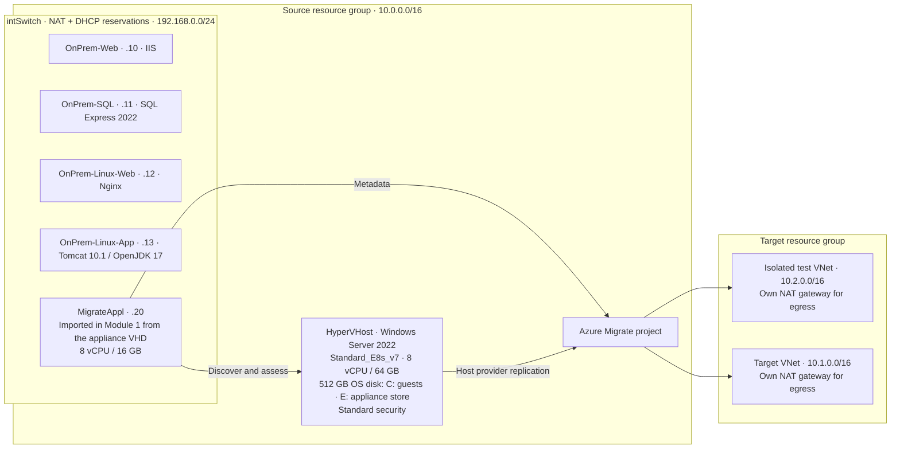

# TD SYNNEX | Azure Migrate Hyper-V Workshop

**Cloud Enablement Services** · Partner hands-on training

Work through the guides linked below in order. Each module builds on the environment the previous one left behind.

Discover, assess, test and migrate four Hyper-V VMs to Azure, then validate and clean up the environment. All four workloads use the **Hyper-V host replication provider**. The discovery appliance performs assessment; the replication provider on the Hyper-V host moves VM data. SQL Server does not require a different replication architecture simply because it stores data. [Microsoft Hyper-V migration tutorial](https://learn.microsoft.com/azure/migrate/tutorial-migrate-hyper-v)

**Release status:** rebuilt and statically verified; awaiting a Windows PowerShell 5.1 parser/regression run and full live Azure/Hyper-V/appliance acceptance. Validate the scripts end to end in a training subscription before partner delivery, and record the revision you used.

## Ubuntu 24.04 rebuild — fresh separate lab only

This full 62-file revision is staged as **azure-migrate-workshop-ubuntu2404.zip**,
separate from the earlier Tomcat update. Both Linux guests are Ubuntu **24.04 LTS (Noble)**;
Linux-App uses the Ubuntu **tomcat10** packages (Tomcat **10.1.x**), explicit **OpenJDK 17**,
and Jakarta Servlet **6.0** / Pages **3.1** JSP source. Java SE `javax.sql`/`javax.naming`
and the original database, HTTP routes and resource bounds are retained.

Extract the full archive into a new checkout and deploy a **new dedicated source resource
group/Hyper-V host**, then a reviewed separate target landing zone. Do not run it against
an existing 22.04 lab, upgrade a guest in place, or try to coexist with the same nested VM
names on one host. Provisioning rejects old/unmarked lab state; only an incomplete build
bearing this revision's marker can resume. No live host or old package is changed by delivery.

The source is Canonical's [Noble current QCOW2 image](https://cloud-images.ubuntu.com/noble/current/)
and exact-filename SHA256SUMS, checked even for cached QCOW2 before conversion. `current`
is moving, not a pinned image digest; a publication race requires a matching retry, not a
checksum bypass. Distinct Ubuntu2404 cache filenames prevent reusing the 22.04 base.
The installed running kernel/flavour is resolved with `uname -r`, never a hard-coded 5.15
or 6.8 patch; packages/tools must match before and after any later reviewed kernel update.
This build does not request an unattended distribution/kernel upgrade or use an Azure
kernel VHD as a substitute for the nested generic/virtual cloud image.

Ubuntu 24.04 standard maintenance extends to May 2029 for applicable Main packages;
Tomcat is in Universe, whose security coverage must be reviewed separately (including
Ubuntu Pro/ESM where applicable). Install current approved Noble repository updates and
record actual versions; do not freeze an old base Tomcat patch or assume all packages
share Main's coverage. See [Ubuntu lifecycle](https://ubuntu.com/about/release-cycle) and
[Tomcat 10.1 migration](https://tomcat.apache.org/migration-10.1.html).

## Classic Azure VM assessment — required four-server workshop path

Step 2 defaults to **`-AssessmentMode Classic`** on both maintained branches. The required
module remains discovery, an **Azure VM assessment of exactly four servers**, Hyper-V
replication, test migration and cutover. Classic here means the grouped
`MachineAssessment` assessment API, **not a retired first-generation Azure Migrate project**.
It does not turn the workshop into a PaaS/application-modernization project.

The isolated live Classic test produced an export with **four assessed servers and four
Ready results**. That proves creation/results for that test, not execution of this merged
full script. The restored workflow also incorporates the observed group behavior; merely
changing the default would have left the missing-provisioning/capability failure in place.
A full native checker and end-to-end lab run are still required before partner delivery.

### Working group preparation and assessment safeguards

- Resolve the existing assessment backend from the selected Migrate project's solution
  reference; verify its actual ARM identity/type and Active/Succeeded state. Do not infer
  its name from the Migrate project name. If no verifiable link exists, list all same-scope
  backends read-only and stop for explicit `-AssessmentProjectName`; never silently select
  one or create a replacement project.
- Retain normalized relevant provider metadata and the endpoint-specific plan: parent
  assessmentProjects LIST/GET **2023-03-15**; machines, groups, grouped Classic assessment
  and results **2024-01-15**; solution GET 2018-09-01-preview; provider GET 2021-04-01.
  Registered namespace and implemented parent version are required. Sparse optional child
  catalog rows warn and still require fixed read-only checks; they are not an alias for a
  different assessment route. No latest-preview guessing or provider/feature registration.
- Map each of the four distinct OffAzure Hyper-V source IDs through inventory
  `discoveryMachineArmId` to the real assessment-namespace machine ID, across every page.
  Do not match by names alone or include the appliance as a fifth workload.
- Create a new group with **only `properties.groupType=Default`**. Capability metadata is
  service-populated, not forced in PUT. A fresh empty Default group can legitimately return
  `supportedAssessmentTypes=[Unknown]`, count zero and no `provisioningState`.
- Shared group readiness accepts missing/null provisioning **only with `groupStatus=Completed`**.
  Created/Updated require explicit Succeeded provisioning; Running/Accepted/HTTP 202 stay
  pending. Returned failed/canceled/deleting, malformed or unknown states are never overridden
  by Completed. Logs show actual status, provisioning presence, capability labels and count.
- Only a fresh, empty, idle group owned by this run receives one `updateMachines` POST
  (`operationType=Add`) containing exactly four validated assessment IDs. After Add, bounded
  reads require exact inventory membership, count four, a ready group and idle state. Unknown
  or explicitly nonmatching capability metadata remains pending after membership; it cannot
  cause premature rejection of an empty group or authorize an assessment. An absent optional
  capability field is reported, not invented; the assessment service response must establish
  the requested contract. Both completion modes use the same group-state helper.
- `GroupNotFound` is expected absence only for HTTP 404 on the actual group GET;
  `AssessmentNotFound` only for HTTP 404 on the matching Classic/Modern assessment GET.
  These codes on a parent, list, wrong resource, write or another HTTP status cannot authorize
  creation. Parent/scope errors, schema failures and RBAC failures stop at their actual stage.
- Existing exact-four groups and matching assessments are reused without membership writes,
  PUT overwrite or recomputation. Existing empty/partial/extra-member groups remain preserved,
  even if an earlier failed attempt created them. This run does not assume prior ownership.
  No DELETE, membership removal, wildcard eTag or atomic-concurrency claim is introduced.

Classic PUT/GET stays under `/assessmentProjects/<backend>/groups/<group>/assessments/<name>`.
Start with **AsOnPremises**, the actual migration target region, applicable offer/currency,
no reserved commitment and no Windows/Linux benefit without confirmed entitlement. The
friendly offer `MS-AZR-0003P` is sent as `MSAZR0003P`. No security/billing/PaaS resources are
created. For the student comparison, use a separate performance-based portal assessment
only after sufficient data collection; idle-lab NoData/confidence gaps are not installer failures.

Acceptance or a successful creation PUT is not completed computation. Classic handoff
requires **`status=Completed` on nonpending assessment GETs**. The assessment's optional
`provisioningState` may be absent, null or blank; when populated it must be Succeeded.
Provisioning/Updating/Accepted remain pending; failed, canceled, deleting, unknown and
nonstring metadata block handoff. The same helper checks initial and final GETs. Exactly
four fully paginated unique source-linked results, verified identity/settings, an idle
group, exact membership, stable source mappings and an unchanged update timestamp remain
mandatory. This corrects the earlier mandatory-Succeeded assessment-field assumption.
Step 6 reports failures immediately; Step 7 polls automatically only after accepted/matching
work. Only transient GETs receive a bounded retry, never writes; pagination stays pinned to
cloud/subscription/resource group/collection/API. Az owns tokens through pinned-context
`Invoke-AzRestMethod -DefaultProfile`; no token unwrapping or credential/header dump.

### Continue a running lab without redeploying it

Refresh the complete checkout **of the same OS/Tomcat branch**, keep the host, four guests,
appliance and discovery, and rerun Step 2 with the **existing exact-four group and matching
Classic assessment names and settings**. This completion-field correction needs neither a
new assessment nor redeployment. Do not rerun deployment or upgrade the running guests.
Set the variables below to the existing verified resource names:

```powershell
.\scripts\migrate-step2-discover-assess.ps1 -SourceResourceGroup $sourceRg `
    -MigrateProjectName $projectName -Location $migrationTargetRegion `
    -AssessmentMode Classic -AssessmentGroupName $existingGroupName `
    -AssessmentName $existingAssessmentName
```

Reuse remains read-only for matching groups/assessments; identity, settings, membership and
result checks still apply. Only a separately inspected empty/conflicting group requires
explicit conflict resolution and deliberately chosen unused names. Reconnect only for an authentication rejection,
not to repair missing resources, RBAC or schema errors. See
[Module 1 recovery](docs/Module-1-Discovery.md#51--instructor-step-2-api-errors-and-recovery).

### Modern API and advanced architecture exploration are deferred

`-AssessmentMode Modern` remains **explicit experimental opt-in**, not the core module or
a successful live integration claim. Its retained 2024-03-03-preview top-level profile still
requires its own provider advertisement, does not select an unimplemented 2025 version,
and retains source-linked result checks and ManualReview instead of automatic replication.
The isolated Modern request was rejected with HTTP 400 `MalformedRequestBody`; no Modern
assessment was created by that test. More API information is needed before curriculum use.
**Neither mode silently falls back to the other.** Optional portal application/PaaS comparisons
and a student's advanced architecture inquiry do not trigger app/SQL/container/PaaS code
changes, new assessment automation or changes to Steps 3–6.

## Current runtime and complete checkout

Initial deployment includes Tomcat 10.1/OpenJDK 17, the original named WAR, protected JNDI
credentials, SQL mixed mode/shared restricted login, lab aliases and Nginx desk/API proxy.
No manual app install, extra password prompt or traffic command is needed by students.
SQL-independent health precedes SQL setup; final success requires actual SQL readiness/data,
named UI and proxy readiness. Discovery credentials still need appliance-side validation.
The `AgentBased` wrapper/filter remains a Module 3 grouping/instructor agentless shortcut,
not proof of a Mobility Service migration path or a waiver of guest discovery permissions.

The checkout contains all app source, WAR/runtime binary assets and rebuild/tests under
[apps/contoso-orderdesk](apps/contoso-orderdesk/README.md). A new checkout has no workspace
or output-folder dependency. Read the pinned JDBC/local-checksum prerequisite options there.
**Learner Windows deployment and migration need no Python on the learner/instructor machine.**
Region, project, workload-readiness and traffic controls are already inline PowerShell.
The recent offline regressions and full-checkout packager are now consolidated into the
existing checker; the three recent Python test files and root `build.py` are removed.
Earlier Linux guest helpers (including runtime extraction and HTTP traffic) still use Python
inside the Linux guests. The older optional maintainer integration/app tests and app rebuild
helper also retain Python; converting those would change the workload/platform, not simplify
Windows deployment.

From the checkout root in **Windows PowerShell 5.1**:

```powershell
.\scripts\check-lab-scripts.ps1                       # Parse only; no file writes.
.\scripts\check-lab-scripts.ps1 -RunRegressionChecks  # Offline; no Azure/VM actions.
.\scripts\check-lab-scripts.ps1 -PackagePath '..\azure-migrate-workshop-ubuntu2404.zip'
```

Packaging automatically requires parser/regression success, verifies the existing
`runtime.sha256`, refreshes `SHA256SUMS` and verifies ZIP CRC/per-file SHA256. It uses built-in
.NET, does not rebuild app assets, and requires an existing destination folder **outside the
checkout**. Use `-OverwritePackage` explicitly to replace that chosen ZIP; no implicit
packaging/writes occur by default. `-UpdateChecksums` refreshes only the manifest after checks.
The **169 defined check groups** include the 11 Classic-completion regressions alongside
retained AST/helper, communication, assessment/context, backend/provider, Modern, discovery,
Step 6/controller and lexical contracts. These are not live Azure/traffic tests. The native
checker, its PowerShell fixtures and native packager were **not executed in this environment**. Optional older maintainer checks remain
`python3 -B tests/integration_checks.py` and
`python3 -B apps/contoso-orderdesk/tests/static_checks.py`.
No Java/SQL/appliance test is claimed by the static validation report. Optional 3001 staging
is scoped to a reviewed older application on an **already-24.04** guest only; it is neither
an OS upgrade nor a path to update the existing 22.04 lab. New deployment needs no staging.

## Guest communication readiness (configure-host and Step 2)

VM power, app health and an **Enabled** integration service do not prove guest-to-host
communication. New deployment now requires all four guests' live Hyper-V KVP CIM component
(`Msvm_KvpExchangeComponent`) to be enabled, have numeric primary `OperationalStatus = 2`
and supply nonblank recognized-family `OSName`/`OSVersion`. LostCommunication (13), NoContact
(12), incompatible protocol (7), degraded (3), missing/unknown status or failed CIM reads
block completion. An unimplemented/null inherited `CommunicationStatus` is allowed; a known
bad value is not. Localized status text and HealthState are not readiness gates.

Linux provisioning installs **both running-kernel** `linux-tools-$(uname -r)` and
`linux-cloud-tools-$(uname -r)`, checks the exact executable and enables KVP. It intentionally
keeps KVP stopped until cloud-init's scheduled reboot. Critical installation failures are
recorded and KVP is masked so later runcmd items/reboot cannot hide them; no `-virtual`
fallback or kernel/OS upgrade is attempted. Joint application/KVP readiness retries for at
most 20 minutes, requires three consecutive observations, and is checked again immediately
before the completion marker. The existing host-preparation JSON gains numeric KVP/OS rows.

Step 2 separately probes the **selected Azure host** before prerequisites success, project
key, download/import or discovery/assessment. Complete, unique marked JSON and all four
expected VM identities are required; errors/unknowns stop rather than enter the WinRM repair
prompt. The probe is read-only and requires no Linux password from the learner. Updating this
package does **not** repair an already deployed guest; follow [Module 1 section 2](docs/Module-1-Discovery.md#2-prepare-the-hyper-v-host), then rerun Step 2. Do not rerun provisioning on a completed host.

For release acceptance, verify `/etc/os-release` reports 24.04 on both Linux guests and
that fresh appliance inventory shows their OS metadata plus Tomcat 10.1/Java 17 and a
visible Contoso Order Desk Java web asset. Local HTTP success cannot waive this check.
Do not promise that changing the OS or Servlet namespace fixes an appliance classifier
or compressed-WAR/custom-CATALINA_BASE discovery issue; that remains unproven.

These checks prove host-observed KVP transport and available OS metadata, **not** direct
post-reboot `systemctl` status, appliance-side OS classification or fresh software/web
inventory. Appliance credentials, SSH permissions and discovery remain separate checks.
This completion-field correction adds no delivered files: the complete package contains **62 files**.

## Workload power and optional traffic handoff

Instructor Steps 1 and 2 verify the selected Azure host and exactly four nested workloads
are Running through read-only Azure Run Command. Missing/off/saved/paused/unknown states
stop progress with manual host-side repair instructions; no nested VM is automatically
started. Running proves power state only, not app health. Step 1 rechecks before verified
project guidance, then offers optional background sample-order traffic **after WHAT TO DO
NEXT**, default No. An absent/unverified project receives no offer.

`-LabTraffic Skip` makes no generator changes. Fully supplied Step 1 environment inputs
also skip the traffic prompt by default; `-LabTraffic Prompt` explicitly requests the safe
`[y/N]` prompt, and `-LabTraffic Start` explicitly opts in. An optional
`-LabTrafficPassword` accepts a SecureString; otherwise the deployment password is prompted
privately after opt-in. Supported workstation launches use protected managed Run Command;
verified elevated on-host launches run the staged script interactively. Unsupported remote
prerequisites cause a clear not-initiated message and host-interactive fallback. Traffic
persists across consoles/reboots: lab completion does **not** stop it. Stop on the host with
`C:\AzMigrateLab\enable-lab-traffic.ps1 -Disable`, or stop/remove VMs during teardown.
See [traffic prerequisites and results](docs/Lab-Traffic.md). After cutover, use the
[native post-migration traffic controller](docs/post-migration-labtraffic.md) to inventory
inherited jobs, safely repoint aliases and run bounded traffic before Step 6; Check again
after hardening. Test copies require pre-boot source isolation and explicit `-TestMigration`.

## Separate source and migration regions: quota preflight

Step 1 now asks for a **migration target region different from the actual source Hyper-V
host region**, with no inherited source default. It validates names/display names against
`Get-AzLocation`. The host's actual VM region, project data geography and resource-group
metadata location are three different settings. Resource-group metadata does not bind child
resource regions; existing VNet/NSG regions do, and conflicts stop before provider/resource
writes. Networks cannot be moved: use a fresh landing zone if necessary.

Example only, **not** a promise of subscription access, SKU availability or capacity:

```powershell
$sourceRg = 'rg-ces-source-01' # Existing deployed source group.
$sourceRegion = 'eastus'       # Example only; the actual host region is read, not assumed.
$migrationTargetRegion = 'westus2'
$targetRg = 'rg-ces-target-01'
$projectName = 'ces-migrate-01'
.\scripts\migrate-step1-setup-project.ps1 -SourceResourceGroup $sourceRg `
    -TargetResourceGroup $targetRg -Location $migrationTargetRegion -MigrateProjectName $projectName
.\scripts\migrate-step2-discover-assess.ps1 -SourceResourceGroup $sourceRg `
    -TargetResourceGroup $targetRg -Location $migrationTargetRegion -MigrateProjectName $projectName
```

Step 1 needs `Az.Compute` as well as Accounts/Resources/Network. Its **read-only subscription
quota heads-up** shows a UTC timestamp, masked current subscription and both regions' actual
reported Total Regional vCPUs, relevant VM-family quotas and regional VM-count usage/limits/
remaining. Usage includes resources outside the workshop and VM scale sets. Both regional
and family vCPU quota must fit. Allocated and deallocated VMs count; deallocation is not a
quota-release strategy. The nested four workloads and `MigrateAppl` are not separate Azure
VMs: only their Azure Hyper-V host consumes source Azure VM quota, already included in usage.

Planning defaults mirror step 3: B2s + B2ms + B1ms + B1ms, normally **6 vCPUs** for one full
new target **or** test set (four Azure VMs), derived from live SKU `vCPUs`/family metadata.
**12 vCPUs**/eight new VMs is only the hypothetical full-target-plus-full-test overlap in the
same target region. Step 4 normally cleans tests before step 5, and replication disks do not
reserve VM cores. Forecasts are not actual usage or reservations: existing target VMs are
already reported, so do not add them again. Rerun with `-ForecastVmSizes` listing actual
planned sizes (repeat a size for each VM) if choices/counts change. This does not change step 3
or portal migration sizing.

Missing rows/SKU metadata, unregistered Compute or denied/failed reads show **Unknown**, never
zero or assumed free capacity. Insufficiency, Unknown or applicable SKU restrictions in the
target planning baseline trigger `[1] Choose another target region` (recommended),
`[2] Continue NETWORK-ONLY despite warnings`,
or `[3] Cancel`. With supplied `-Location`, warnings stop before writes unless explicitly
acknowledged by `-AllowQuotaWarning`; that switch permits only step 1 networking and is **not**
an Azure quota bypass, VM allocation approval or region-conflict override. Fully supplied
source/target/project/location values avoid step 1's entry/pause questions; supply
`-HyperVHostVMName` too if source VM selection is ambiguous. Region validity alone does not
prove quota, policy, zone/SKU eligibility or physical capacity.

**Choose and verify the migration target before portal Create resources / Finalize discovery
locks that project's migration target.** All subsequent migrations/test networks must match.
The preflight does not verify that project/recovery lock; inspect existing resources in the
portal. It neither creates nor remaps the Azure Migrate project or its data geography.
Step 2's assessment uses the chosen target, not source metadata; without optional
`-TargetResourceGroup` it explicitly asks for the assessment target region. Steps 3–6 derive
location from the actual target VNet and reject an explicitly conflicting `-Location` before
writes; step 4 also checks an existing test VNet. The 3a/3b wrappers pass location through.
See [VM quotas](https://learn.microsoft.com/en-us/azure/virtual-machines/quotas).

## Learning path

Provision the environment before the teaching session. Budget a full working day for initial delivery; actual deployment, discovery, replication and backup time depends on bandwidth, quota and regional capacity. Measure the duration yourself before advertising a timed agenda.

| Module | Exercise | Completion evidence |
|---|---|---|
| 0 | [Setup](docs/Module-0-Setup.md) | Four nested VMs healthy on fixed disks; `E:` appliance store present |
| 1 | [Discovery and assessment](docs/Module-1-Discovery.md) | Four workload names discovered and an Azure VM assessment; optionally a populated dependency map via the [lab traffic mesh](docs/Lab-Traffic.md) |
| 2 | [Agentless migration](docs/Module-2-Agentless-Migration.md) | OnPrem-Web and OnPrem-Linux-Web replicated and test-migrated with no agent installed |
| 3 | [Agent-based migration](docs/Module-3-Agent-Based-Migration.md) | OnPrem-SQL and OnPrem-Linux-App replicated continuously, then cut over with SQL data compared |
| 4 | [Azure Migrate vs. Site Recovery](docs/Module-4-ASR-Comparison.md) | Explain one-time migration versus ongoing disaster recovery |
| 5 | [Post-migration operations](docs/Module-5-Post-Migration.md) | Monitoring evidence, optional backup/restore, cost and security review |
| Finish | Cleanup | Test/replication artifacts and all workshop resources accounted for |

## Environment



This is a **single nested Hyper-V host**, not a cluster or a production landing zone. Its internal NAT topology is a workshop adaptation. Microsoft documents an external switch for a production appliance deployment; validate the nested topology yourself and do not describe it as production support certification. [Appliance prerequisites](https://learn.microsoft.com/azure/migrate/deploy-appliance-script)

The IIS and Nginx port-80 sites remain static. **Contoso Order Desk** is now a real lightweight Java/JSP application on Linux-App: it reads/writes the unchanged `ContosoApp` Customers/Orders tables through a bounded JDBC pool. Nginx provides a separate desk/API proxy on 8080; optional generators are not needed for application setup.

## Start here

1. Read [Module 0](docs/Module-0-Setup.md), including subscription, quota, licensing, downloads and cost preparation.
2. Obtain the repository and record the exact commit shown below. For partner delivery, supply the release tag or commit you validated so every learner uses the same revision. Run these commands in a terminal, then continue from the repository directory:

   ```bash
   git clone --branch <reviewed-ubuntu2404-branch> <workshop-repository-url>
   cd azure-migrate-workshop
   git rev-parse HEAD
   ```

3. In a PowerShell session with the current Az modules, choose your dedicated subscription and variables:

```powershell
Connect-AzAccount

# Masked at the prompt so they are not readable over a shared screen
$secureSubscriptionId = Read-Host 'Workshop subscription ID' -AsSecureString
$secureAdminCidr = Read-Host 'Your public IPv4 address' -AsSecureString
$password = Read-Host 'Lab-only administrator password' -AsSecureString

$sourceRg = 'rg-ces-source-01'
$location = 'eastus'

.\scripts\deploy-lab.ps1 -SubscriptionId $secureSubscriptionId `
    -ResourceGroupName $sourceRg -Location $location `
    -AdminUsername 'labadmin' -AdminPassword $password -AdminSourceCidr $secureAdminCidr
```

### Two ways to launch

`deploy-lab.ps1` runs the same way either from an open PowerShell window or from a right-click
**Run with PowerShell**. Every value it needs is a mandatory parameter, so PowerShell prompts
for anything not supplied, and the three sensitive ones are masked as you type.

On a right-click launch the window closes the instant the script ends, so the script holds it
open at the finish and after a failure, and writes a full error report next to itself
(`deploy-lab-error-<timestamp>.log`, with GUIDs redacted). Set `LAB_NO_PAUSE=1` to skip the
pause for an unattended run.

In an open window it also clears any leftover `Write-Host` / `Write-Warning` override left
behind by a `migrate-step` script run earlier in that session. Those scripts install console
overrides to mask subscription IDs, and a leftover one used to make `deploy-lab.ps1` fail on a
`Write-Host` line.

The `migrate-step` scripts are built for an open window. They work from a right-click too and
hold the window open the same way, but they are interactive throughout — they ask which
resource group, which project, which VM — so a console you can read and scroll back through is
the better fit.

Every `migrate-step` script then runs on its own, with no arguments:

```powershell
.\scripts\migrate-step1-setup-project.ps1
```

Each one loads the Az modules it needs, signs you in if the session is not signed in, offers a choice of subscription when none is current, and then lists the resource groups, projects and VMs it finds so you pick from what exists rather than typing names. Passing values on the command line still works and skips the matching question:

```powershell
.\scripts\migrate-step2-discover-assess.ps1 -SourceResourceGroup $sourceRg
```

The deployment scripts require **new, dedicated resource groups**. They intentionally refuse existing groups: replaying setup after cutover could restart the retired source VMs. They do not register the appliance or start replication. Complete Module 1 next.

## Which script completes which module step

The scripts and the modules are run separately. Each script also carries this in its own
`MODULE COVERAGE` block — `Get-Help .\scripts\<script>.ps1 -Full` shows it.

| Script | Completes |
|---|---|
| `deploy-lab.ps1` | Module 0 §4 in full; Module 1 §2 in full; Module 1 §3.3 download and extract only when opted in |
| `migrate-step1-setup-project.ps1` | **Optional.** Module 2 §4.1 (target landing zone), as an instructor shortcut — the student builds the same thing in the portal there. Module 1 §1 is **not** automated; it prints the portal steps |
| `migrate-step2-discover-assess.ps1` | Module 1 §3.2–3.5, §4 and §5. §3.1 (project key) stops for you |
| `migrate-step3-replicate.ps1` | Module 2 §5–§7, or Module 3 §8–§9, per `-Workload` |
| `migrate-step3a-agentless.ps1` | Module 2 §5–§9 in one run |
| `migrate-step3b-agent-based.ps1` | Module 3 §8–§11 end state — **not** §5–§7 (Mobility Service) |
| `migrate-step4-test-migrate.ps1` | Module 2 §8, or Module 3 §10, per `-Workload` |
| `migrate-step5-cutover.ps1` | Module 2 §9, or Module 3 §11, per `-Workload` |
| `migrate-step6-post-migration.ps1` | Module 5 §2–§5 |
| `enable-lab-traffic.ps1` | Module 0 §6; supplies what Module 1 §6 needs to show anything |
| `cleanup-lab.ps1` | Teardown. Leaves the Migrate project, key vault and recovery vault |
| `check-lab-scripts.ps1` | Nothing — maintenance tool |

Nothing automates Module 4: it is analysis, with no lab state to reach.

## Script responsibilities

| Script | Behavior |
|---|---|
| `deploy-lab.ps1` | Billable source host, nested guests on fixed disks, DHCP/NAT and samples; creates the `E:` appliance store partition; protected setup parameters; fails if readiness is not observed |
| `host/configure-host.ps1` | Runs inside the Windows host; creates the four workload VMs and stages the optional traffic generator |
| `migrate-step1-setup-project.ps1` | Billable target/test network preparation; portal project creation follows |
| `enable-lab-traffic.ps1` | Optional; staged on HyperVHost by deployment and run there with its generated settings file. Wires the four workloads into one order desk so dependency analysis has real traffic to observe; `-Disable` stops generators without removing the application prerequisites |
| `migrate-step2` – `migrate-step5` | Discovery/assessment, replication, test migration and cutover helpers for Modules 1–3. Steps 3–5 accept `-Workload All\|Agentless\|AgentBased` |
| `migrate-step3a-agentless.ps1` | Bridges the lab to the end state of **Module 2** (OnPrem-Web, OnPrem-Linux-Web) in one run |
| `migrate-step3b-agent-based.ps1` | Bridges the lab to the end state of **Module 3** (OnPrem-SQL, OnPrem-Linux-App). Reaches that state agentlessly — see CHANGES.md |
| `migrate-step6-post-migration.ps1` | Configures monitoring, backup, security rules and cost controls on migrated VMs; creates or changes Azure resources |
| `check-lab-scripts.ps1` | Parses every lab script without running any of them; reports file, line and column for anything that will not parse |
| `cleanup-lab.ps1` | Lists the resource group's contents, confirms, deletes the group, then reports what went and what must still be removed by hand. Refuses to start when a CanNotDelete lock is present |

## Costs and teardown

Estimate the host, OS disk, target/test VMs, replicated disks/storage, **two NAT gateways and their public IPs**, monitoring ingestion, optional Bastion and optional backup/DR. Use the [Azure pricing calculator](https://azure.microsoft.com/pricing/calculator/) for your region and agreement. There is no verified fixed daily price for this workshop. Deallocating VMs stops VM compute charges but does not remove billable disks, NAT gateways, IPs or retained backups.

```powershell
.\scripts\cleanup-lab.ps1 -ResourceGroupName $targetRg
.\scripts\cleanup-lab.ps1 -ResourceGroupName $sourceRg
```

The script takes one resource group per run and confirms before deleting. Review what it lists before confirming; `-Force` skips the prompt.

Deleting the two resource groups does not finish the teardown. A soft-deleted key vault keeps
its name reserved, a Recovery Services vault holding backup items refuses to be deleted, and the
appliance's Microsoft Entra app registration is not an Azure resource at all. `cleanup-lab.ps1`
prints all of them, with the commands to check, at the end of every run — including a cancelled
one. Clear them before you close out, or the next lab fails in ways that look unrelated.

> The `migrate-step` and `cleanup-lab` scripts take no subscription parameter. They act on whichever subscription is active in your session, so confirm it with `Get-AzContext` first.

## A note from the author

These notes record environment issues met while building and running this lab, and why parts of the scripts look the way they do. They are observations from one subscription and one region, not a compatibility matrix.

**The host size default changed from `Standard_E8s_v5` to `Standard_E8s_v7`.** The v5 size was not available to the subscription this lab was built in. Esv7 offers the same 8 vCPU / 64 GB shape and reports nested virtualization support, so it became the default. `deploy-lab.ps1` validates whatever size you pass against your own subscription's SKU metadata and quota, so a different family works if it meets the lab's floor.

**Esv7 is a Generation 2 only series, and its sizes require an OS image with NVMe support.** The workshop's Windows Server 2022 Gen2 host image satisfies both. If you change the host image, check those two properties first.

**Deployment pins the image catalog API version and forces Standard security on the temporary guest disk.** Both are deliberate. Letting the installed Az.Compute module pick its own API version produced inconsistent results across machines, and the disk cmdlets will otherwise default a Trusted Launch image lookup that is incompatible with exporting the disk to nested Hyper-V guests.

**The Azure Migrate appliance VHD Microsoft publishes for Hyper-V is Generation 1.** Module 1 creates the appliance VM with `-Generation 1` for that reason. Confirm the current generation and disk format in Microsoft's article before you run it — a Generation 2 VM will not boot a Generation 1 VHD, and the failure looks like a corrupt download.

**The lab stages the appliance on the host's own OS disk.** An earlier revision attached a separate managed data disk for this. It was removed because the 512 GB OS disk already has the capacity and a data disk bills continuously, including while the VM is deallocated.

No attempt has been made to solve for environments beyond the one this was built in. If you hit a different compatibility problem — a region without the host size, a policy that blocks disk export, a proxy that blocks a package source — please open an issue with the error and your region and subscription type. Feedback of that kind is what turns one environment's findings into guidance that holds up more broadly.

## Maintenance and provenance

Parse every script with PowerShell before sharing changes, and confirm the documentation links resolve. The host-side scripts target Windows PowerShell 5.1; the deployment client works on either 5.1 or PowerShell 7.

Preserve upstream license/attribution notices when merging this reviewed source into the workshop repository. This supplied baseline does not include a LICENSE file; do not infer Microsoft-derived attribution or silently manufacture licensing metadata.
