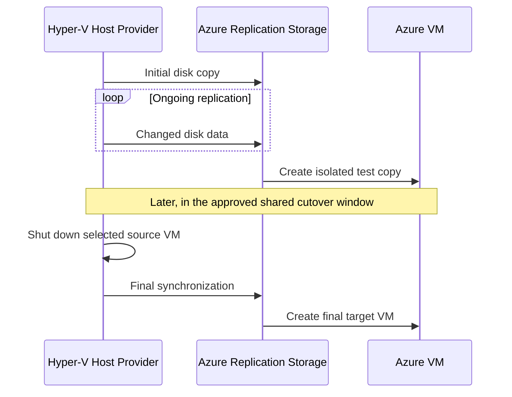

# Module 2: Agentless Migration — Hyper-V Web Workloads

| **Estimated Time** | 60–90 minutes, plus replication time |
|---------------------|---------------|
| **Level**           | Advanced — Cloud Solution Architect |
| **Prerequisites**   | [Module 1: Discovery & Assessment](Module-1-Discovery.md) completed |
| **CAF Phase**       | **Migrate** — Cloud Adoption Framework |

### Learning Objectives — Concepts

By the end of this module, you will understand host-based replication, target-network planning, isolated test migration, coordinated cutover, and rollback. You will practice enabling replication and testing IIS and Nginx. The complete application test and shared four-VM cutover continue in [Module 3: Stateful Workload Migration](Module-3-Agent-Based-Migration.md); completing this module's frontend cutover is **not** a prerequisite for starting Module 3.

---

## 1. Overview — Zero-Footprint Migration: When and Why

### Concepts

Agentless migration avoids installing a migration agent inside each source guest. As a Cloud Solution Architect, understanding what happens under the hood is essential for setting stakeholder expectations and designing migration waves. In this Hyper-V lab, the **Azure Site Recovery Provider and Recovery Services agent on HyperVHost** perform replication for all four workloads. The discovery appliance inventories and assesses machines; it is **not a replication appliance**.

### How It Works Architecturally

1. **Initial replication** — The registered Hyper-V host provider coordinates copying the selected VM disks to Azure.
2. **Delta replication** — Changed disk data continues to replicate while source workloads run.
3. **Test migration** — Azure creates separate test copies in an isolated network while sources continue running.
4. **Final sync & cutover** — A planned migration shuts down the selected source VM, completes final synchronization, and creates its Azure target.

```text
Source guests (no guest migration agent)
    → Hyper-V host provider + Recovery Services agent
    → Azure replication storage / replica disks
    → Isolated test copies OR final Azure target VMs

Discovery appliance → Inventory and assessment (separate role)
```

#### Hyper-V Replication Flow



### RPO/RTO Characteristics

| Metric | Meaning | Planning Implication |
|--------|---------|----------------------|
| **RPO** | Acceptable age of recovered data | Review the actual latest recovery point; do not promise zero data loss |
| **RTO** | Acceptable service-restoration time | Include shutdown, final sync, provisioning, dependency updates, and validation |
| **Initial sync** | First copy of selected disks | Duration depends on disk size, churn, bandwidth, and service conditions |

### When to Choose Guest-Agentless Replication

- Stateless web servers, reverse proxies, and Linux servers with standard configurations are useful pilot candidates.
- Avoiding guest migration software can simplify change approval, but the host still needs its provider.
- Stateful workloads need data-consistency and dependency planning, **not a different migration architecture merely because they hold state**. The SQL and Tomcat VMs use this same Hyper-V provider in Module 3.
- Source platform, supported configuration, recovery objectives, disk layout, and measured churn determine migration suitability. A web-server label alone is not a readiness test.

**Hands-On — Student Actions**

1. In your student notes, distinguish the discovery appliance from the registered Hyper-V replication host.
2. Identify the frontend pair: `OnPrem-Web` and `OnPrem-Linux-Web`.

**Expected Result:** You can explain which component discovers machines and which component replicates their disks.

**CSA Why:** A correct platform choice prevents applying a different source platform's workflow to Hyper-V.

---

## 2. Migration Runbook — CSA Artifact

### Concepts

A Cloud Solution Architect treats every migration as a **controlled operation**, not an ad-hoc activity. Before touching the portal, define the migration runbook in your student notes.

### Pre-Migration Checklist

- [ ] Module 1 assessment reviewed — compatibility and blockers understood
- [ ] Target resource group, VNet, subnet, and NSG planned
- [ ] Azure RBAC permissions confirmed for the project and target resources
- [ ] Source backup and rollback procedure available; a checkpoint alone is not a database backup
- [ ] Regional and VM-family quota checked for the actual selected sizes
- [ ] Required host-to-Azure and guest management outbound connectivity verified against the lab network plan
- [ ] All four application dependencies included in the isolated test and shared cutover

### Migration Window Planning

| Factor | Workshop (This Lab) | In Production |
|--------|-------------------|---------------|
| **Window type** | One coordinated four-VM window after the full test | Scheduled maintenance window |
| **Duration** | Estimate from observed replication and test timings | Include final sync, validation, and rollback allowance |
| **Business hours?** | Keep manual order entry paused during cutover | Agree service interruption with application owners |
| **Approval required?** | Record your go/no-go decision | Follow change-management approval |

### Communication Plan

| When | Who to Notify | Message |
|------|---------------|---------|
| **Before the window** | Application owner and operations | Scope, dependencies, expected interruption, rollback criteria |
| **T-1 hour** | Operations and on-call team | Replication readiness and planned start |
| **T-0** | Affected users | Order entry paused; migration starting |
| **T+complete** | Application owner | Azure targets created; validation in progress |
| **T+validated** | Affected users | Application accepted; traffic may resume |

### Success Criteria

- [ ] All four targets run in the selected target network with their intended OS and disks
- [ ] IIS and Nginx static pages return expected content
- [ ] The isolated full application test passes before final migration
- [ ] Target SQL data matches the captured cutover baseline before additional writes
- [ ] Tomcat SQL readiness, Nginx proxy, and one sample-order readback succeed
- [ ] Source VMs are retained shut down until acceptance and the agreed rollback window closes

**Hands-On — Student Actions**

1. Record the source VM names, target names, selected region, sizes, resource group, and networks in your student notes.
2. Set acceptable recovery-point age, downtime, validation criteria, and rollback triggers for this exercise.
3. Reserve one application-wide window; do not schedule the frontend pair as an independent final cutover.

**Expected Result:** Your notes contain an actionable four-VM plan, not just a list of migration jobs.

**CSA Why:** Teaching pairs make the exercise manageable; dependency groups determine the real service boundary.

---

## 3. Prerequisites

### Concepts

The source is a single, nonclustered **HyperVHost** Azure VM: Windows Server 2022, **Standard_E8s_v7**, Generation 2. Its nested guests are separate source machines, not additional Azure VM allocations.

| VM Name | OS | Role | Source IP |
|---------|----|------|-----------|
| `OnPrem-Web` | Windows Server 2022 | IIS static site, TCP 80 | `192.168.0.10` |
| `OnPrem-Linux-Web` | Ubuntu 24.04 | Nginx static site 80; application proxy 8080 | `192.168.0.12` |

The nested source network is `192.168.0.0/24` (host `.1`, discovery appliance `.20`). The source Azure VNet is `10.0.0.0/16`; these are different address layers.

**Hands-On — Student Actions**

1. Confirm [Module 1](Module-1-Discovery.md) discovery and assessment are complete and all four source VMs appear in the correct Azure Migrate project.
2. Confirm the source pair is running and you have approved access to the Hyper-V host and guests.
3. Confirm permission to prepare migration, register the host, create target networks, and migrate VMs.
4. For Azure test/target guests, plan **VM → Run command → RunPowerShellScript** on Windows or **RunShellScript** on Linux once the VM agent is ready. Alternatively, use already-approved RDP/SSH access. Run Command executes **inside the selected guest**, so localhost checks do not require a public IP. Your workstation is not assumed to reach `10.2.0.0/24`.

**Expected Result:** The right project, discovered sources, permissions, and guest-access method are known before replication setup.

**CSA Why:** Management access and application connectivity are separate requirements.

---

## 4. Step 1 — Prepare for Migration

### Concepts

Choose the actual target region before preparing the project's migration resources or registering the host. The target must be **different from the source HyperVHost VM's actual region** in this lab's regional design. **East US → West US 2 is an example only**, not an allocation or capacity guarantee. Project location and resource-group metadata location do not determine where the target VMs run.

### Hands-On — Student Actions

### 4.1 Choose the Region and Compute Plan

1. Open **Virtual machines → HyperVHost → Overview** and read its actual **Location**.
2. Select a different target region. Review the Module 1 assessment for that region; assessment recommendations do not automatically bind this lab's chosen sizes.
3. In **Subscriptions → Usage + quotas**, filter to the target region and check **Total Regional vCPUs**, the selected **VM-family quota**, and VM-count allowance. Check SKU eligibility in the portal's size selector as well.
4. Plan the complete application, including any test/target overlap:

| Exact Target VM Name | Default Size | vCPU / RAM | Alternate Plan if B-series Is Unavailable |
|----------------------|--------------|------------|------------------------------------------|
| `OnPrem-Web` | `Standard_B2s` | 2 / 4 GB | `Standard_D2as_v5` — 2 / 8 GB |
| `OnPrem-SQL` | `Standard_B2ms` | 2 / 8 GB | `Standard_D2as_v5` — 2 / 8 GB |
| `OnPrem-Linux-Web` | `Standard_B1ms` | 1 / 2 GB | `Standard_D2as_v5` — 2 / 8 GB |
| `OnPrem-Linux-App` | `Standard_B1ms` | 1 / 2 GB | `Standard_D2as_v5` — 2 / 8 GB |

5. If the default B-series plan is unavailable, explicitly select the **all-four `Standard_D2as_v5` plan** in the portal after checking quota and eligibility. Record the choice; do not silently substitute another size. One complete default set needs 6 vCPUs; the alternate set needs 8. Count simultaneous test/target sets and existing allocations without double-counting them.
6. Keep **Azure Hybrid Benefit / existing Windows Server license rights: No** unless you have confirmed eligible rights. Review current portal VM/disk pricing for the actual region; no fixed lab price is assumed.

### 4.2 Build the Target Landing Zone

1. In the portal, open **Resource groups → Create**. Select the lab subscription, name the group `rg-ces-target-01`, choose the selected target region, then **Review + create → Create**. Reuse it if already correctly configured.
2. Open **Virtual networks → Create**. Select `rg-ces-target-01`, name `rg-ces-target-01-vnet`, and explicitly set the same target region.
3. On **IP addresses**, set address space `10.1.0.0/16`. Edit subnet `default` to `10.1.0.0/24`. Select **Review + create → Create**.
4. Open **Network security groups → Create**. Create `rg-ces-target-01-nsg` in the same group and region.
5. Open the NSG's **Inbound security rules → Add**. Add the required TCP rules below, choosing unused priorities ahead of default rules. Restrict sources and destinations to the approved management/client ranges or application peers; do not expose the demo application or SQL to the Internet.

| Rule Purpose | Source | Destination / TCP Port |
|--------------|--------|------------------------|
| Windows management, if using RDP | Approved management range only | Windows guests / 3389 |
| Linux management, if using SSH | Approved management range only | Linux guests / 22 |
| Static web validation | Approved lab client range | Web and Linux-Web / 80 |
| SQL dependencies | Web and Linux-App private addresses | SQL / 1433 |
| Tomcat dependencies | Web and Linux-Web private addresses | Linux-App / 3000 |
| Proxy dependency | Linux-App private address | Linux-Web / 8080 |

6. Where guest IPs are not yet assigned, use the target subnet prefix for the internal application rules, then review their scope against the recorded peer addresses after VM creation. Do not add an Internet-wide application allow rule.
7. Under **NSG → Subnets → Associate**, choose `rg-ces-target-01-vnet` and `default`. Review effective subnet/NIC rules, including Azure's default VNet rules, against the lab network plan.
8. Review **VNet → Subnets**, routing, DNS, and the approved outbound path. Verify the required connectivity against the lab network plan. Do **not** assume Azure default outbound access or that the lab created a NAT gateway. If the approved path is missing, pause before relying on it.

### 4.3 Open the Project and Prepare Hyper-V Migration

1. Open [Azure Portal](https://portal.azure.com), search **Azure Migrate**, select **All projects**, then the project from Module 1. Confirm its subscription and discovered machines.
2. Open **Migration and modernization** (or **Azure Migrate: Server Migration**). Select **Prepare migration** / **Discover** for migration preparation, not the assessment tool.
3. For **Are your machines virtualized?**, select **Yes, with Hyper-V**.
4. Select the target region agreed in §4.1. Inspect any existing migration resources to confirm that region before proceeding. Reuse an existing correctly prepared project; do not register against a conflicting project or region.
5. Select **Create resources** if preparation has not already created the required migration resources. Wait for completion. Use the resources managed through this Azure Migrate project; do not create a separate recovery vault or disaster-recovery policy.

### 4.4 Download, Install, and Register the Host Provider

1. In the same project's Hyper-V preparation page, download the **Azure Site Recovery Provider** installer and the **registration key**. Keep the key private.
2. Connect to **HyperVHost itself**, not the discovery appliance and not a nested workload VM. If this host is already registered to this project and target region and is healthy, **reuse that registration** and continue to step 6.
3. Copy the downloaded files to HyperVHost. Run the provider installer **as Administrator**. Complete setup of the **Azure Site Recovery Provider** and **Azure Recovery Services agent** on this host, using the lab's approved proxy/outbound settings where needed.
4. In the registration wizard, browse to the key downloaded from this project and register the host. Confirm the project-associated registration and selected target region rather than using another lab's key.
5. Return to the Azure Migrate preparation page and refresh the registered Hyper-V host list. Complete **Finalize registration / Finalize discovery** if offered after the host is visible.
6. Confirm **HyperVHost** is connected and available as the source replication host, and that the intended nested VM names are available. The registered discovery appliance alone is not proof of replication readiness.

**Expected Result:** The target landing zone exists, the region and compute plan are recorded, and HyperVHost is registered with the correct Azure Migrate migration resources. The isolated test VNet is created separately in §8.1 before any test VM boots.

**CSA Why:** Host registration connects source replication to the correct project; landing-zone preparation controls where the recovered application will operate.

---

## 5. Step 2 — Configure Replication (OnPrem-Web)

### Concepts

Replication settings describe a future Azure VM. Starting the job does not mean the initial disk copy is complete.

### Hands-On — Student Actions

### 5.1 Start the Replication Wizard

1. In the project's migration tool, select **Replicate**.
2. Select **Yes, with Hyper-V** and the registered **HyperVHost** as the source host.
3. Select **Next**.

### 5.2 Select the Virtual Machine

1. Choose whether to import settings from the Module 1 assessment. If imported, review every setting; recommendations are not the selected lab plan by default.
2. Select exactly **`OnPrem-Web`**. Confirm the source host and identity, then **Next**.

### 5.3 Configure Target Settings

1. Select the lab subscription and **`rg-ces-target-01`**.
2. Confirm the selected target region. Select the replication storage/cache account offered for this project's Hyper-V workflow, creating it through the wizard if required.
3. Choose **`rg-ces-target-01-vnet` → `default` (`10.1.0.0/24`)** as the final target network.
4. Continue to compute settings. Do not select the isolated test VNet as the final target.

### 5.4 Configure Compute Settings

1. Set **Target VM name: `OnPrem-Web`**.
2. Choose **`Standard_B2s` (2 vCPU, 4 GB)**, or **`Standard_D2as_v5`** if you explicitly selected the alternate all-four plan.
3. Set **OS type: Windows** and identify the correct **OS/boot disk**. Review the source's generation and the supported target settings; do not change generation merely to match a size choice.
4. Leave existing-license/Azure Hybrid Benefit settings **No** unless eligible rights were confirmed.

### 5.5 Configure Disk Settings

1. Review every source disk and include **all required VM disks**, including the boot disk and any application/data disk.
2. Select the planned target disk type, using **Standard SSD** for the lab unless your assessment requires a reviewed alternative.
3. Verify that no required volume was omitted. Disk tiers affect cost and performance independently of VM size.

### 5.6 Review and Start Replication

1. Review source VM, host, target name, region, resource group, VNet/subnet, size, OS type, boot disk, and selected disks.
2. Select **Replicate** and open the resulting job.

**Expected Result:** The portal shows a replication setup job for `OnPrem-Web`. Submission is not completed replication; review actual synchronization in §7.

**CSA Why:** An explicit settings review catches wrong-target mistakes before disk replication begins.

---

## 6. Step 3 — Configure Replication (OnPrem-Linux-Web)

### Concepts

Nginx has two distinct functions: a **static site on 80** and an **application proxy on 8080** to Tomcat on Linux-App. Testing the static page does not validate the SQL-backed application.

### Hands-On — Student Actions

### 6.1 Start Replication

1. Select **Replicate → Yes, with Hyper-V → HyperVHost**, using the same registered host as §5.

### 6.2 Select the Virtual Machine

1. Select exactly **`OnPrem-Linux-Web`** and review any imported assessment settings.

### 6.3 Configure Target Settings

1. Select the same subscription, target region, **`rg-ces-target-01`**, and project replication storage.
2. Select final target **`rg-ces-target-01-vnet` → `default`**.

### 6.4 Configure Compute Settings

1. Set **Target VM name: `OnPrem-Linux-Web`**.
2. Choose **`Standard_B1ms` (1 vCPU, 2 GB)**, or **`Standard_D2as_v5`** under the explicitly chosen alternate plan.
3. Select **OS type: Linux**, and identify its OS/boot disk. The guest remains **Ubuntu 24.04**.

### 6.5 Configure Disks and Start Replication

1. Include the boot disk and all other required source VM disks; select the planned **Standard SSD** target disk type.
2. Review the complete summary and select **Replicate**.

**Expected Result:** Both frontend VMs have replication jobs underway with the correct target configuration.

**CSA Why:** The Linux OS selection and complete disk set are as important as choosing the right VM size.

---

## 7. Step 4 — Monitor Replication

### Concepts

The portal's Hyper-V migration details are the readiness evidence. Job submission, or a generic protection label by itself, does not establish a usable recovery point.

| Portal Observation | Meaning | Action |
|--------------------|---------|--------|
| Setup in progress | Replication configuration is being applied | Review job progress and errors |
| Initial sync in progress | Initial disk copy is incomplete | Wait and monitor the portal's progress |
| Initial sync completed, healthy replication, recent recovery point | Candidate for test migration | Review the timestamp and test readiness |
| Error, degraded health, missing/stale recovery point | Readiness not established | Review the reported issue; do not proceed |

### Hands-On — Student Actions

### 7.1 View Replication Status

1. Open **Azure Migrate project → Migration and modernization → Replicating servers**.
2. Locate **`OnPrem-Web`** and **`OnPrem-Linux-Web`**.

### 7.2 Review Initial Synchronization

1. Open each VM's replication details and related **Jobs**.
2. Check disk-copy progress and completion, not just the setup-job state. Initial sync can take longer than this module's active exercise time.

### 7.3 Check Replication Health

1. Confirm each VM has healthy replication and inspect its latest available recovery-point timestamp.
2. Compare recovery-point age with the acceptable age recorded in §2. Review warnings or failed jobs before proceeding.

### 7.4 Confirm Test-Migration Readiness

1. Confirm the portal allows test migration for each selected VM after initial sync completes.
2. Record health, initial-sync completion, and the reviewed recovery point in your student notes.

**Expected Result:** Both frontends have completed initial synchronization, healthy replication, and reviewed recovery points suitable for the separate test migration. This is not application acceptance or a zero-loss guarantee.

**CSA Why:** Readiness is observed in the migration service, not inferred from a submitted request.

---

## 8. Step 5 — Test Migration (CRITICAL)

### Concepts

Test migration creates separate copies while sources keep running. Isolation is required **before boot**: copied traffic tasks/services may start automatically, and copied hosts entries still point to source peers. This pair-only exercise validates **IIS and Nginx static HTTP on port 80**, not the complete Order Desk chain.

### Hands-On — Student Actions

### 8.1 Build the Isolated Test Network

1. Open **Virtual networks → Create** in **`rg-ces-target-01`**, using the same target region. Name it **`vnet-migrate-test`**.
2. Set address space **`10.2.0.0/16`** and subnet **`default` → `10.2.0.0/24`**, then **Review + create → Create**.
3. Create a separate **`nsg-migrate-test`** in that region and associate it with the test `default` subnet through **NSG → Subnets → Associate**.
4. Add only the approved management/client and internal test-application rules corresponding to §4.2, using **test** ranges rather than source or final target addresses.
5. Under **Outbound security rules**, add explicit deny rules to `192.168.0.0/24`, `10.0.0.0/16`, and `10.1.0.0/16`, with unused priorities ahead of default allow rules. Preserve the platform/management connectivity required by the lab's approved outbound plan.
6. Before starting any test migration, inspect **Peerings**, **DNS servers**, subnet routes, and effective security rules. There must be **no peering, VPN/route path, or source DNS reachability** to source or live target networks. Do not configure source/private production DNS for test guests. Use the network plan's approved outbound method; a new test VNet does not imply outbound Internet access.
7. Use portal Run Command when the guest agent is ready, or existing approved private RDP/SSH access. Do not add a public IP or connect test and source networks just to run a localhost check.

### 8.2 Test Migrate OnPrem-Web

1. In **Replicating servers**, select **`OnPrem-Web` → Test migration**.
2. Choose **`vnet-migrate-test` → `default`**; review the recovery point offered and submit **Test migration**.
3. Open **Jobs** and wait for the test-migration job to complete.
4. In **Virtual machines**, open exactly **`OnPrem-Web-test`**. Confirm its resource ID and test VNet, then record its actual private IP from **Networking → Network interface / IP configurations**. Never fall back to the unsuffixed source/target name.

### 8.3 Validate the Windows IIS Test VM

1. On **`OnPrem-Web-test`**, open **Run command → RunPowerShellScript**, or an elevated PowerShell session through approved RDP.
2. Disable and stop only the known inherited traffic task if it exists; leave IIS and other application services running:

```powershell
$task = Get-ScheduledTask -TaskName 'LabOrderDeskTraffic' -ErrorAction SilentlyContinue
if ($task) {
    Disable-ScheduledTask -TaskName 'LabOrderDeskTraffic' | Out-Null
    Stop-ScheduledTask -TaskName 'LabOrderDeskTraffic'
}
Get-Service -Name W3SVC
$response = Invoke-WebRequest -Uri http://localhost:80 -UseBasicParsing
$response.StatusCode
$response.Content -match 'TD SYNNEX \| Windows Web'
```

3. Record the result in your student notes. Do not generate orders or test cross-tier application writes in this pair-only test.

**Expected Result:** IIS is running; localhost port 80 returns HTTP 200 and the Windows Web content check is `True` on the **test** copy.

### 8.4 Test Migrate OnPrem-Linux-Web

1. Select **`OnPrem-Linux-Web` → Test migration** in the same project.
2. Choose **`vnet-migrate-test` → `default`**, review, and submit.
3. Wait for the job to complete. Open exactly **`OnPrem-Linux-Web-test`**, confirm its test-network resource ID, and record the private IP from its NIC configuration.

### 8.5 Validate the Linux Nginx Test VM

1. On **`OnPrem-Linux-Web-test`**, use **Run command → RunShellScript** or approved SSH. Portal shell runs as root; `sudo` commands below are also usable through SSH.
2. Stop/disable the known traffic service only if present, then check the static site:

```bash
if systemctl cat contoso-orderdesk-traffic.service >/dev/null 2>&1; then
  sudo systemctl disable --now contoso-orderdesk-traffic.service
fi
systemctl is-active nginx
curl --fail --silent --show-error -o /dev/null -w '%{http_code}\n' http://localhost:80
curl --fail --silent --show-error http://localhost:80 | grep -F 'TD SYNNEX | Linux Web'
```

3. Do not claim a successful port-8080 proxy or SQL-backed Order Desk test yet. The SQL/App test peers are added in Module 3.

**Expected Result:** Nginx is active and its port-80 static site returns HTTP 200 with Linux Web content. The full application test is still pending.

### 8.6 Retain for the Full Test or Clean Up Test Migrations

1. If continuing directly to Module 3, retain these two isolated copies, with generators disabled, for its four-VM test. Record their exact names, IDs, and test private IPs.
2. If ending this session, in **Azure Migrate → Replicating servers**, select each of these two source records and **Clean up test migration**. Confirm **Testing is complete. Delete test virtual machine**, review the resources, and select **Clean up test**.
3. Inspect names and resource IDs before cleanup. Delete **only the `-test` resources** belonging to that test job; do not delete unsuffixed live targets, source originals, or a resource group containing other workloads.
4. If cleaned up, recreate these **same two** test migrations in Module 3 before its full-chain test. After cleanup, confirm continuing source replication in the portal.

**Expected Result:** Either the identified pair is retained safely for the immediate full test, or only its test resources are removed and replication continues. Pair-only results do not authorize cutover.

**CSA Why:** An isolated VM boot proves less than an isolated, correctly rewired application test.

---

## 9. Step 6 — Cutover Planning & Execution

### Concepts

The four VMs form one connected business system: **Nginx:8080 → Tomcat:3000 → SQL:1433**, plus the app's optional HTTP generator to Nginx and Windows Web's optional SQL/App background traffic. The teaching pair is not an independent final migration wave.

> **HOLD POINT — Do not perform final frontend cutover yet.** Complete Module 3 replication and its **full four-VM isolated test** first. Continue to Module 3 from here without migrating the frontends. The actions below are performed **once**, as the frontend phase of [Module 3 §11's shared cutover window](Module-3-Agent-Based-Migration.md#11-step-7--cutover-for-stateful-workloads), after SQL and App target preparation. Do not leave migrated frontends dependent on unreachable source SQL/App peers.

### Hands-On — Student Actions

### 9.1 Cutover Checklist

1. Confirm all four source records have healthy replication, acceptable recovery-point age, and a successful full isolated application test. Clean up all four test migrations before final migration.
2. Agree the shared window and rollback triggers. Keep original source VMs for rollback.
3. In Module 3 §11, stop new manual order writes and disable/stop the known source generators, capture the final source data baseline, and migrate SQL, then App. Do not stop SQL, Tomcat, or Nginx merely to stop traffic.
4. Verify target network rules for the five dependency edges and the approved management path. Public DNS/FQDN updates are needed only if the lab actually uses them.

### 9.2 IP Address Management Strategy

| Strategy | Workshop Action | Consideration |
|----------|-----------------|---------------|
| **Reassign private IPs** | Record actual target `10.1.0.0/24` NIC addresses | They are not the nested source `192.168.0.x` addresses |
| **Managed lab aliases** | Update the three application aliases on all four targets using Module 3 §10.4 | Use actual final target IPs, never test IPs |
| **Private DNS / client DNS** | Update existing approved records if used | A new public endpoint is not required |

### 9.3 Execute Migration — OnPrem-Web (Shared Window Only)

1. After the SQL and App phases in Module 3 §11, select exactly **`OnPrem-Web`** in **Replicating servers → Migrate**.
2. Confirm the reviewed target mapping and choose **Shut down the source VM before migration: Yes**.
3. Review and select **Migrate**. The portal performs planned source shutdown and final synchronization; monitor its job rather than treating submission as completion.

### 9.4 Execute Migration — OnPrem-Linux-Web (Same Shared Window)

1. Select exactly **`OnPrem-Linux-Web` → Migrate**.
2. Review target settings and choose **Shut down the source VM before migration: Yes**, then submit.
3. Keep order entry closed until all targets are rewired and the full target validation passes.

### 9.5 Monitor Migration Progress

1. Open the project's **Jobs** and wait for both frontend migrations to complete successfully. Verify their selected Hyper-V sources are shut down.
2. In **Virtual machines**, inspect the unsuffixed **`OnPrem-Web`** and **`OnPrem-Linux-Web`** in the target group; confirm their resource IDs, location, size, running state, and attached disks.
3. Record actual target NIC private IPs. With all four targets created, perform Module 3 §11's all-target alias update, Tomcat restart, and Nginx configuration test/reload before functional traffic.

**Expected Result:** During the one shared window, the frontends join the migrated SQL/App targets. Source copies remain shut down and retained; application traffic is not restored until full validation succeeds.

**CSA Why:** Planned shutdown and final sync protect the selected source's last changes; coordinated dependencies restore the service.

---

## 10. Step 7 — Post-Migration Validation

### Concepts

VM running state and static HTTP success are necessary but insufficient. Complete this frontend validation together with Module 3's SQL integrity, readiness, proxy, and sample-order checks. Backup and ongoing monitoring configuration belong to Module 5.

### Hands-On — Student Actions

### 10.1 Verify VMs Are Running

1. In the target resource group, inspect the exact unsuffixed frontend VMs, their actual private IPs, OS types, selected sizes, and required disks.
2. Use their portal Run Command or already-approved private RDP/SSH access; do not assume your workstation can route to them.

### 10.2 Application-Level Smoke Tests — IIS

1. Run the §8.3 IIS service and localhost checks **inside target `OnPrem-Web`**, not the retained source or a test copy.
2. Leave the known traffic task disabled while final data/application validation is in progress.

**Expected Result:** Target IIS is running and its expected static page returns HTTP 200.

### 10.3 Application-Level Smoke Tests — Nginx

1. Run the §8.5 static checks **inside target `OnPrem-Linux-Web`**.
2. After the Module 3 alias update, run `sudo nginx -t && sudo systemctl reload nginx` there. The existing 8080 upstream uses `onprem-app`; reloading resolves its new target address.

**Expected Result:** Static port 80 is unchanged; the separate proxy is ready for Module 3's full-chain validation.

### 10.4 Network Connectivity Verification

1. Validate only the relevant dependency edges using [Module 3 §10.5](Module-3-Agent-Based-Migration.md#105-validate-the-full-four-vm-application), substituting final target copies: Web → SQL:1433, Web → App:3000, App → SQL:1433, App → Nginx:8080, and Nginx → App:3000.
2. Complete health, SQL readiness, existing-order comparison, and **one** sample-order create/readback in the shared procedure. Do not run a second write merely because the checks are referenced here.

### 10.5 Security Posture Verification

1. Review effective NSG rules and guest firewalls for those edges and approved management access. Confirm SQL and the unauthenticated demo application have no Internet exposure.
2. Confirm no unnecessary public IP was introduced and disk protection meets the lab policy.

### 10.6 DNS Update & Validation

1. Confirm the lab aliases on **all four targets** map to actual target private IPs, preserving unrelated hosts-file entries.
2. If an existing approved client DNS/FQDN is used, update it and test from that approved client path. Otherwise, record private-IP/localhost results; public DNS is not required.

### 10.7 Record Acceptance and Continue

1. Record frontend results and the shared application/data acceptance in your student notes.
2. Continue to [Module 5: Post-Migration Optimization](Module-5-Post-Migration.md) for monitoring, backup, and ongoing optimization after acceptance. Retain the rollback window agreed for the complete system.

**Expected Result:** Target frontends serve expected static content, and the complete target application passes the single shared validation before traffic is released.

**CSA Why:** A green homepage does not prove database freshness or a correctly repointed proxy.

---

## 11. Rollback Strategy

### Concepts

A CSA always has a rollback plan — and knows exactly when to trigger it. These frontends participate in the same stateful service as SQL and Tomcat; do not roll back only one teaching pair without checking its dependencies.

| Trigger | Example Threshold to Agree Before Cutover | Action |
|---------|------------------------------------------|--------|
| Application errors | Sustained HTTP errors beyond the agreed tolerance | Pause traffic; evaluate coordinated rollback |
| Performance degradation | Response times materially worse than captured baseline | Compare against the agreed recovery window |
| Data integrity issues | Missing or inconsistent committed data | Keep writes stopped; investigate and reconcile |
| Dependency failure | App cannot reach SQL or proxy peers | Do not accept the migration |

### Hands-On — Student Actions

1. Stop new order entry and disable/stop the known Azure-side generators. Preserve the target state for analysis.
2. Determine whether **any target writes** occurred. If so, follow [Module 3 §13](Module-3-Agent-Based-Migration.md#13-rollback-strategy-for-stateful-workloads): reconcile target data with the recovery destination before restoring service. Starting stale source SQL is not a safe rollback.
3. If no target writes occurred and the agreed rollback decision is made, keep Azure copies from serving traffic, then start source SQL, App, and frontends in dependency order through **Hyper-V Manager** on HyperVHost.
4. Restore source-side alias/client routing to the captured source mapping, validate the whole source application, and only then reopen order entry. Keep a single writable environment.
5. Retain the shut-down source originals until application acceptance and the agreed rollback window closes (often 48–72 hours, adjusted to policy). Do not delete originals as part of test cleanup or immediate cutover.

**Expected Result:** The service is restored to one validated environment without silently discarding target transactions.

**CSA Why:** Returning traffic is easy; preserving the newest business data is the actual rollback requirement.

---

## Key Takeaways

1. **Guest-agentless does not mean host-software-free.** HyperVHost's registered provider replicates all four VMs.
2. **A test migration is a separate portal action.** Static frontend checks are not full application acceptance.
3. **Teaching pairs are not cutover boundaries.** Complete Module 3's four-VM test before the shared final window.
4. **Use actual NIC addresses.** Source, test, and final target addresses are different; repoint every application peer.
5. **Retain source VMs and protect target writes.** Rollback must account for the data created after cutover.

---

## Next Steps

At the §9 hold point, continue to **[Module 3: Stateful Workload Migration (SQL/Tomcat)](Module-3-Agent-Based-Migration.md)** to replicate SQL and Tomcat through the same Hyper-V host provider, complete the full isolated test, and execute the coordinated four-VM cutover. Return to this module's frontend cutover and validation actions only within that shared window.
