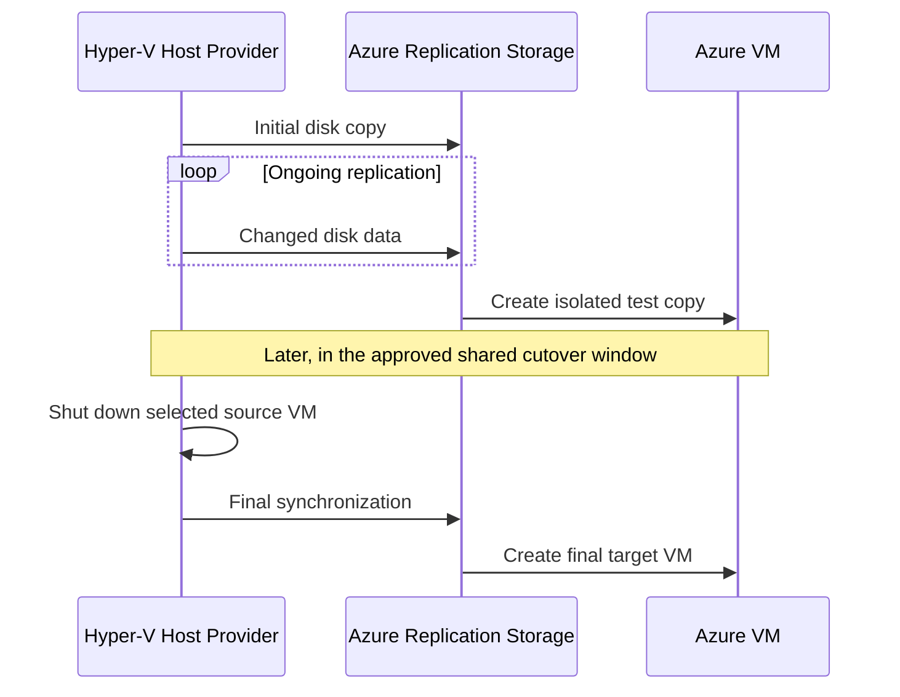

# Module 2: Agentless Migration — Hyper-V Web Workloads

| **Estimated Time** | 60–90 minutes, plus replication time |
|---------------------|---------------|
| **Level**           | Advanced — Cloud Solution Architect |
| **Prerequisites**   | [Module 1: Discovery & Assessment](Module-1-Discovery.md) completed |
| **CAF Phase**       | **Migrate** — Cloud Adoption Framework |

### Learning Objectives — Concepts

By the end of this module, you will understand host-based replication, target-network planning, isolated test migration, coordinated cutover, and rollback. You will configure **Web + Linux-Web together** through the Hyper-V provider, with a separate settings review for each VM. SQL + App use the modern physical-server replication appliance and guest Mobility Service in Module 3; never enable both methods for one source.

Complete **this module §§4–6**, then [Module 3 §§4–8](Module-3-Agent-Based-Migration.md#4-prerequisites) to configure replication for the second assigned pair. After both pairs are configured, return to **this module §§7–8** to review and test the frontend pair, then [Module 3 §§9–10](Module-3-Agent-Based-Migration.md#9-step-5--monitor-replication) to review and test SQL/App and the complete isolated application. Perform final migration only in [Module 3 §11's one coordinated cutover window](Module-3-Agent-Based-Migration.md#11-step-7--cutover-for-stateful-workloads), returning to this module's §§9–10 for its frontend phase. A frontend final cutover is **not** a prerequisite for starting Module 3.

---

## 1. Overview — Zero-Footprint Migration: When and Why

Agentless migration avoids installing a migration agent inside each source guest. As a Cloud Solution Architect, understanding what happens under the hood is essential for setting stakeholder expectations and designing migration waves. In this Hyper-V lab, the **Azure Site Recovery Provider and Recovery Services agent on HyperVHost** perform replication for **only Web and Linux-Web**. The discovery appliance inventories and assesses machines; it is **not a replication appliance**.

### How It Works Architecturally

1. **Initial replication** — The registered Hyper-V host provider coordinates copying the selected VM disks to Azure.
2. **Delta replication** — Changed disk data continues to replicate while source workloads run.
3. **Test migration** — Azure creates separate test copies in an isolated network while sources continue running.
4. **Final sync & cutover** — A planned migration shuts down the selected source VM, completes final synchronization, and creates its Azure target.

```text
Source guests (no guest migration agent)
    → Hyper-V host provider + Recovery Services agent
    → Azure replication storage / replica disks
    → Isolated test copies OR final Azure target VMs

Discovery appliance → Inventory and assessment (separate role)
```

#### Hyper-V Replication Flow



### RPO/RTO Characteristics

| Metric | Meaning | Planning Implication |
|--------|---------|----------------------|
| **RPO** | Acceptable age of recovered data | Review the actual latest recovery point; do not promise zero data loss |
| **RTO** | Acceptable service-restoration time | Include shutdown, final sync, provisioning, dependency updates, and validation |
| **Initial sync** | First copy of selected disks | Duration depends on disk size, churn, bandwidth, and service conditions |

### When to Choose Guest-Agentless Replication

- Stateless web servers, reverse proxies, and Linux servers with standard configurations are useful initial migration candidates.
- Avoiding guest migration software can simplify change approval, but the host still needs its provider.
- Stateful workloads need data-consistency and dependency planning, **not a different migration architecture merely because they hold state**. SQL and Tomcat deliberately use the modern physical-server/Mobility route in Module 3; that is a teaching choice, not a requirement imposed by statefulness.
- Source platform, supported configuration, recovery objectives, disk layout, and measured churn determine migration suitability. A web-server label alone is not a readiness test.

#### Hands-On Steps

**Local workstation — student notes:**

1.  In your student notes, distinguish the discovery appliance from the registered Hyper-V replication host.

2.  Identify the frontend pair: `OnPrem-Web` and `OnPrem-Linux-Web`.

**Expected Result:** You can explain which component discovers machines and which component replicates their disks.

**CSA Why:** A correct platform choice prevents applying a different source platform's workflow to Hyper-V.

---

## 2. Migration Runbook — CSA Artifact

A Cloud Solution Architect treats every migration as a **controlled operation**, not an ad-hoc activity. Before touching the portal, define the migration runbook in your student notes.

### Pre-Migration Checklist

- [ ] Module 1 assessment reviewed — compatibility and blockers understood
- [ ] Target resource group, VNet, subnet, and NSG planned
- [ ] Azure RBAC permissions confirmed for the project and target resources
- [ ] Source backup and rollback procedure available; a checkpoint alone is not a database backup
- [ ] Regional and VM-family quota checked for the actual selected sizes
- [ ] Required host-to-Azure and guest management outbound connectivity verified against the lab network plan
- [ ] All four application dependencies included in the isolated test and shared cutover

### Migration Window Planning

| Factor | Workshop (This Lab) | In Production |
|--------|-------------------|---------------|
| **Window type** | One coordinated four-VM window after the full test | Scheduled maintenance window |
| **Duration** | Estimate from observed replication and test timings | Include final sync, validation, and rollback allowance |
| **Business hours?** | Keep manual order entry paused during cutover | Agree service interruption with application owners |
| **Approval required?** | Record your go/no-go decision | Follow change-management approval |

### Communication Plan

| When | Who to Notify | Message |
|------|---------------|---------|
| **Before the window** | Application owner and operations | Scope, dependencies, expected interruption, rollback criteria |
| **T-1 hour** | Operations and on-call team | Replication readiness and planned start |
| **T-0** | Affected users | Order entry paused; migration starting |
| **T+complete** | Application owner | Azure targets created; validation in progress |
| **T+validated** | Affected users | Application accepted; traffic may resume |

### Success Criteria

- [ ] All four targets run in the selected target network with their intended OS and disks
- [ ] IIS and Nginx static pages return expected content
- [ ] The isolated full application test passes before final migration
- [ ] Target SQL data matches the captured cutover baseline before additional writes
- [ ] Tomcat SQL readiness, Nginx proxy, and one sample-order readback succeed
- [ ] Source VMs are retained shut down until acceptance and the agreed rollback window closes

#### Hands-On Steps

**Local workstation — student notes:**

1.  Record the source VM names, target names, selected region, sizes, resource group, and networks in your student notes.

2.  Set acceptable recovery-point age, downtime, validation criteria, and rollback triggers for this exercise.

3.  Reserve one application-wide window.

    Do not schedule the frontend pair as an independent final cutover.

**Expected Result:** Your notes contain an actionable four-VM plan, not just a list of migration jobs.

**CSA Why:** Teaching pairs make the exercise manageable; dependency groups determine the real service boundary.

---

## 3. Prerequisites

The source is a single, nonclustered **HyperVHost** Azure VM: Windows Server 2022, **Standard_E8s_v7**, Generation 2. Its nested guests are separate source machines, not additional Azure VM allocations.

| VM Name | OS | Role | Source IP |
|---------|----|------|-----------|
| `OnPrem-Web` | Windows Server 2022 | IIS static site, TCP 80 | `192.168.0.10` |
| `OnPrem-Linux-Web` | Ubuntu 24.04 | Nginx static site 80; application proxy 8080 | `192.168.0.12` |

The nested source network is `192.168.0.0/24` (host `.1`, discovery appliance `.20`). The source Azure VNet is `10.0.0.0/16`; these are different address layers.

#### Hands-On Steps

**Local workstation — Azure portal:**

1.  Confirm [Module 1](Module-1-Discovery.md) discovery and assessment are complete and all four source VMs appear in the correct Azure Migrate project.

**HyperVHost — Hyper-V Manager:**

2.  Confirm the source pair is running and you have approved access to the Hyper-V host and guests.

**Local workstation — Azure portal:**

3.  Confirm permission to prepare migration, register the host, create target networks, and migrate VMs.

**Local workstation — student notes:**

4.  For Azure test/target guests, plan **VM → Run command → RunPowerShellScript** on Windows or **RunShellScript** on Linux once the VM agent is ready.

    Alternatively, use already-approved RDP/SSH access. Run Command executes **inside the selected guest**, so localhost checks do not require a public IP. Your workstation is not assumed to reach `10.2.0.0/24`.

**Expected Result:** The right project, discovered sources, permissions, and guest-access method are known before replication setup.

**CSA Why:** Management access and application connectivity are separate requirements.

---

## 4. Step 1 — Prepare for Migration

Choose the actual target region before preparing the project's migration resources or registering the host. The target must be **different from the source HyperVHost VM's actual region** in this lab's regional design. **East US → West US 2 is an example only**, not an allocation or capacity guarantee. Project location and resource-group metadata location do not determine where the target VMs run.

### 4.1 Choose the Region and Compute Plan

#### Hands-On Steps

**Local workstation — Azure portal:**

1.  Open **Virtual machines → HyperVHost → Overview**.

2.  Read its actual **Location**.

3.  Select a different target region.

4.  Review the Module 1 assessment for that region.

    Assessment recommendations do not automatically bind this lab's chosen sizes.

5.  In **Subscriptions → Usage + quotas**, filter to the target region.

6.  Check **Total Regional vCPUs**, the selected **VM-family quota**, and VM-count allowance.

7.  Check SKU eligibility in the portal's size selector as well.

8.  Plan the complete application, including any test/target overlap:

| Exact Target VM Name | Historical Example — Requires Size Approval | vCPU / RAM | Historical Alternate — NOT a Preferred SKU |
|----------------------|--------------|------------|------------------------------------------|
| `OnPrem-Web` | `Standard_B2s` | 2 / 4 GB | `Standard_D2as_v5` — 2 / 8 GB |
| `OnPrem-SQL` | `Standard_B2ms` | 2 / 8 GB | `Standard_D2as_v5` — 2 / 8 GB |
| `OnPrem-Linux-Web` | `Standard_B1ms` | 1 / 2 GB | `Standard_D2as_v5` — 2 / 8 GB |
| `OnPrem-Linux-App` | `Standard_B1ms` | 1 / 2 GB | `Standard_D2as_v5` — 2 / 8 GB |

9.  Treat the inherited table as **historical examples only**, not approved lab defaults. All four actual sources have two vCPUs; the one-vCPU Linux examples need explicit assessment/support/downsize review before use.

10. Select and record the actual per-role sizes manually, with current OS/controller/migration support, memory needs, quota, eligibility, price and allocation review.

    **STOP** if unresolved; do not blindly select B1/B2 or prescribe an all-four D2 fallback. Calculate quota from the actual selections and simultaneous test/target overlap, without double-counting existing usage. A previous `Standard_D2als_v6` assessment recommendation is not a capacity guarantee.

11. Keep **Azure Hybrid Benefit / existing Windows Server license rights: No** unless you have confirmed eligible rights.

12. Review current portal VM/disk pricing for the actual region.

    No fixed lab price is assumed.

### 4.2 Build the Target Landing Zone

#### Hands-On Steps

**Local workstation — Azure portal:**

1.  Open **Resource groups → Create**.

2.  Select the lab subscription.

3.  Name the group using your **unique lab namespace** (the example `rg-ces-target-01` is used below).

    Confirm the name does not collide with any existing lab. Do not reuse another lab's group; substitute your actual new group/VNet/NSG names consistently.

4.  Choose the selected target region.

5.  Select **Review + create → Create**.

6.  Open **Virtual networks → Create**.

7.  Select `rg-ces-target-01`.

8.  Name it `vnet-ces-target-01`.

9.  Explicitly set the same target region.

10. On **IP addresses**, set address space `10.1.0.0/16`.

11. Edit subnet `default` to `10.1.0.0/24`.

12. Select **Review + create → Create**.

13. Open **Network security groups → Create**.

14. Create `nsg-ces-target-01` in the same group and region.

15. Open the NSG's **Inbound security rules → Add**.

16. Add the required TCP rules below, choosing unused priorities ahead of default rules.

    Restrict sources and destinations to the approved management/client ranges or application peers; do not expose the demo application or SQL to the Internet.

| Rule Purpose | Source | Destination / TCP Port |
|--------------|--------|------------------------|
| Windows management, if using RDP | Approved management range only | Windows guests / 3389 |
| Linux management, if using SSH | Approved management range only | Linux guests / 22 |
| Static web validation | Approved lab client range | Web and Linux-Web / 80 |
| SQL dependencies | Web and Linux-App private addresses | SQL / 1433 |
| Tomcat dependencies | Web and Linux-Web private addresses | Linux-App / 3000 |
| Proxy dependency | Linux-App private address | Linux-Web / 8080 |

17. Where guest IPs are not yet assigned, use the target subnet prefix for the internal application rules.

    Review their scope against the recorded peer addresses after VM creation. Do not add an Internet-wide application allow rule.

18. Under **NSG → Subnets → Associate**, choose `vnet-ces-target-01` and `default`.

19. Review effective subnet/NIC rules, including Azure's default VNet rules, against the lab network plan.

20. Review **VNet → Subnets**, routing, DNS, and the approved outbound path.

21. Verify the required connectivity against the lab network plan.

    Do **not** assume Azure default outbound access or that the lab created a NAT gateway. If the approved path is missing, pause before relying on it.

### 4.3 Open the Project and Prepare Hyper-V Migration

The canonical route in the [execution overview](https://learn.microsoft.com/azure/migrate/execute-server-migrations?view=migrate), updated 2026-07-02, is **Execute → Migrations → Start execution**. Some tutorial/screenshots use singular **Migration**. It has **Preparation, Testing, Completion** stages; initial **Start execution** enables replication, not cutover. No Wave is required.

#### Hands-On Steps

**Local workstation — student notes:**

1.  Before either group enables protection, obtain the instructor/resource owner's verification of the intended **project, Hyper-V provider registration, modern appliance registration, managed-vault associations and current mixed-method compatibility**.

    **STOP / DEFERRED** while unverified. The overview lists both methods but does not certify one shared vault. Do not force both into one vault, declare them incompatible, silently create separate projects, fill blank vault IDs, or patch resource bindings/scripts. Any architecture correction is separately approved owner work.

**Local workstation — Azure portal:**

2.  Open [Azure Portal](https://portal.azure.com) → **Azure Migrate → All projects**.

3.  Select the **fresh lab project** from Module 1 and verify subscription/resource ID.

4.  Confirm the four fresh source identities; all older protected labs remain untouched.

5.  Select **Execute → Migrations → Start execution**.

6.  Choose **Servers or virtual machines (VMs)** and target **Azure VM**.

7.  Select **From replication provider (Hyper-V)** and follow its provider-preparation link.

    Inventory/assessment entry is also documented, but use only the verified source identity **and Hyper-V architecture** for Web/Linux-Web; review each workload's readiness. A same-name SQL/App inventory record is not part of this protection group.

8.  Confirm **Hyper-V** as source virtualization and the different target region reviewed in §4.1.

9.  Inspect the lab migration resources and association evidence before accepting any locked region or existing preparation.

10. Select **Create resources** only if needed in this verified lab scope; wait for completion.

11. Keep the Migrate-managed vault and provider association recorded; do not create a separate ASR DR policy.

12. Continue to the provider download/registration steps below.

### 4.4 Download, Install, and Register the Host Provider

#### Hands-On Steps

**Local workstation — Azure portal:**

1.  In the same project's Hyper-V preparation page, download the **Azure Site Recovery Provider** installer.

2.  Download the **registration key**.

    Keep the key private.

**Local workstation — Remote Desktop Connection:**

3.  Connect to **HyperVHost itself**, not the discovery appliance and not a nested workload VM.

    If this host is already registered to this project and target region and is healthy, **reuse that registration** and continue to step 13.

**HyperVHost — File Explorer:**

4.  Copy the downloaded files to HyperVHost.

**HyperVHost — Azure Site Recovery Provider setup:**

5.  Run the provider installer **as Administrator**.

6.  Complete setup of the **Azure Site Recovery Provider** and **Azure Recovery Services agent** on this host, using the lab's approved proxy/outbound settings where needed.

7.  In the registration wizard, browse to the key downloaded from this project.

8.  Register the host.

9.  Confirm the project-associated registration and selected target region rather than using another lab's key.

**Local workstation — Azure portal:**

10. Return to the Azure Migrate preparation page.

11. Refresh the registered Hyper-V host list.

12. Complete **Finalize registration / Finalize discovery** if offered after the host is visible.

13. Confirm **HyperVHost** is connected and available as the source replication host.

14. Confirm that the intended nested VM names are available.

    The registered discovery appliance alone is not proof of replication readiness.

**Expected Result:** The target landing zone exists, the region and compute plan are recorded, and HyperVHost is registered with the correct Azure Migrate migration resources. The isolated test VNet is created separately in §8.1 before any test VM boots.

**CSA Why:** Host registration connects source replication to the correct project; landing-zone preparation controls where the recovered application will operate.

---

## 5. Step 2 — Configure Replication (Web and Linux-Web Pair)

Configure **both assigned frontend VMs in the same replication wizard**, reviewing the settings for each row before submission. Replication settings describe future Azure VMs; submitting the pair does not mean either initial disk copy is complete. IIS serves the Windows static site on 80. Nginx serves a separate static site on 80 and the Order Desk proxy on 8080; the proxy is validated with SQL/App later.

### 5.1 Start the Replication Wizard

#### Hands-On Steps

**Local workstation — Azure portal:**

1.  Open **Execute → Migrations → Start execution**; choose **Servers or virtual machines (VMs)** → **Azure VM**.

2.  Select **From replication provider (Hyper-V)**.

3.  Select the registered **HyperVHost** as the source host.

4.  Select **Next**.

### 5.2 Select the Virtual Machines

#### Hands-On Steps

**Local workstation — Azure portal:**

1.  Choose whether to import settings from the Module 1 assessment.

    If imported, review every setting; recommendations are not the selected lab plan by default.

2.  Select **both `OnPrem-Web` and `OnPrem-Linux-Web`** in this wizard.

3.  Match each name to its recorded source VM ID and **HyperVHost** association. Web is the Windows source at `192.168.0.10`; Linux-Web is the Ubuntu source at `192.168.0.12`.

4.  Confirm **SQL and Linux-App are not selected**. Those sources belong only to Module 3's modern physical/Mobility route.

5.  Select **Next** with exactly the two frontend records selected.

### 5.3 Configure Target Settings

#### Hands-On Steps

**Local workstation — Azure portal:**

1.  Select the lab subscription.

2.  Select **`rg-ces-target-01`**.

3.  Confirm the selected target region.

4.  Select the replication storage/cache account offered for this project's Hyper-V workflow, creating it through the wizard if required.

5.  Choose **`vnet-ces-target-01` → `default` (`10.1.0.0/24`)** as the final target network for **both** VMs.

6.  Continue to compute settings.

    Do not select the isolated test VNet as the final target.

### 5.4 Configure Each VM's Compute Settings

#### Hands-On Steps

**Local workstation — student notes / Azure portal:**

1.  Open the settings row for **each selected VM**. Copy the exact approved target SKU from §4.1 into your notes and select that SKU in the portal; the size descriptions below are instructions to use your actual recorded choice, not literal SKU values.

2.  Apply this per-VM mapping, checking the source identity before changing its settings:

| Source VM / Source IP | Source OS | Source vCPU / RAM | Exact Target Name / OS Type | Target Size to Select | OS / Boot Disk to Identify | Required Source Disk Set | Target Disk Type |
|-----------------------|-----------|-------------------|----------------------------|-----------------------|----------------------------|--------------------------|------------------|
| `OnPrem-Web` / `192.168.0.10` | Windows Server 2022 | 2 / 4 GB | `OnPrem-Web` / **Windows** | Exact Web SKU approved in §4.1 | Actual **40-GB** OS/boot disk; match its recorded disk ID | OS disk plus every other required disk actually present | **Standard SSD**, unless a reviewed alternative is approved |
| `OnPrem-Linux-Web` / `192.168.0.12` | Ubuntu 24.04 | 2 / 2 GB | `OnPrem-Linux-Web` / **Linux** | Exact Linux-Web SKU approved in §4.1 | Actual **30-GB** OS/boot disk; match its recorded disk ID | OS disk plus every other required disk actually present | **Standard SSD**, unless a reviewed alternative is approved |

3.  Set **Target VM name** and **OS type** separately for Web and Linux-Web. Preserve Ubuntu 24.04 on Linux-Web; do not copy Windows settings to its row.

4.  For each VM, identify the actual OS/boot disk and review source generation and supported target settings.

    Do not assume the first disk is the boot disk or change generation merely to match a size choice. If the observed disk layout differs from the recorded source, resolve the discrepancy before submission.

5.  Confirm the actual approved sizes meet each workload's assessed needs and current support/quota review. Do not treat a historical B2/D2 example or script menu as approval, or automatically downsize the two-vCPU Linux source to the historical one-vCPU example.

6.  On the Windows row, leave **existing-license / Azure Hybrid Benefit: No** unless eligible rights were confirmed. Do not apply a Windows licensing benefit to the Linux row.

### 5.5 Configure Each VM's Disk Settings

#### Hands-On Steps

**Local workstation — Azure portal:**

1.  Open **Disks** for Web and then Linux-Web within the same wizard.

2.  Include the mapped **40-GB Web** and **30-GB Linux-Web** OS/boot disks and **all other required source disks actually present** for the OS, application, or data.

3.  Match disk IDs, sizes, and volumes to the source inventory. Do not invent an additional data disk or omit a required volume.

4.  Select **Standard SSD** for the lab's target disks unless your assessment requires a reviewed alternative.

5.  Verify both VM rows have their complete disk selections before continuing.

    Disk tiers affect cost and performance independently of VM size.

### 5.6 Review and Start Replication for the Pair

#### Hands-On Steps

**Local workstation — Azure portal:**

1.  On the summary, review **both source records**: host/VM IDs, exact target names, region, resource group, final VNet/subnet, actual approved sizes, OS types, boot disks, licensing choice, and every required selected disk.

2.  Confirm exactly **Web + Linux-Web** use the Hyper-V provider. Do not add SQL or App to this request.

3.  Review **Tags**, then select **Review and start execution** / **Start execution** once for this two-VM selection. This begins initial replication in **Preparation**, not cutover.

4.  Open the resulting setup jobs and record the job IDs associated with **each** frontend. Review submission errors; do not submit a second wizard for a VM already configured by this request.

**Expected Result:** Replication setup has been submitted for **both frontend VMs**, with their own reviewed Windows/Linux settings. Initial synchronization and recovery-point readiness are reviewed after the second pair is configured.

**CSA Why:** Selecting a method pair together still requires independent identity, compute, licensing, and disk checks for every VM.

---

## 6. Step 3 — Confirm Both Frontend Replication Settings

Review the settings just submitted for the pair; **do not start another Linux-Web replication wizard**. These are confirmation steps for the two records created in §5.

### 6.1 Open Both Replication Records

#### Hands-On Steps

**Local workstation — Azure portal:**

1.  Open **Azure Migrate project → Execute → Migrations → Preparation**.

2.  Locate **`OnPrem-Web`** and **`OnPrem-Linux-Web`**, and open each record's configuration and related setup job.

3.  Confirm each record belongs to the §5 pair submission. If setup reports an error, resolve that reported issue without configuring a duplicate source record.

### 6.2 Confirm Source Identity and Method

#### Hands-On Steps

**Local workstation — Azure portal / student notes:**

1.  Match the two VM IDs and their **HyperVHost** association to your identity register.

2.  Confirm the method is **From replication provider (Hyper-V)** for both and neither source is also protected through Mobility.

3.  Confirm SQL and App remain excluded from this provider's replication selection.

### 6.3 Confirm Both Destination Mappings

#### Hands-On Steps

**Local workstation — Azure portal:**

1.  On each frontend record, confirm the lab subscription, chosen target region, **`rg-ces-target-01`**, replication storage, and final **`vnet-ces-target-01` → `default`**.

2.  Confirm neither record uses the isolated test VNet as its final destination.

### 6.4 Confirm Per-VM Compute and Boot Settings

#### Hands-On Steps

**Local workstation — Azure portal / student notes:**

1.  Compare each row with §5.4's mapping table and your actual approved SKU/disk-ID record.

2.  Require **`OnPrem-Web` / Windows / Web's approved size / its 40-GB OS disk**, and **`OnPrem-Linux-Web` / Linux / Linux-Web's approved size / its 30-GB OS disk**.

3.  Confirm generation and supported target settings were reviewed for each source, and Windows licensing benefit remains **No** unless eligible rights were confirmed.

### 6.5 Confirm Disk Inclusion and Continue With the Second Pair

#### Hands-On Steps

**Local workstation — Azure portal:**

1.  Review both complete disk sets, matching disk IDs and volumes to the source inventory and confirming the reviewed **Standard SSD** target disk choices or explicitly approved alternatives.

2.  Record both frontend setup-job IDs and their accepted target mappings in your student notes. A successful setup submission is not completed initial replication.

**Local workstation — course instructions:**

3.  Continue now to [Module 3 §§4–8](Module-3-Agent-Based-Migration.md#4-prerequisites): verify SQL/App prerequisites, prepare their sources and separate modern appliance, install/register supported Mobility Service, and submit replication for **SQL + App together**.

4.  After Module 3 §8.6 has submitted that pair, return to **this module §7**, then §8, to review and test the frontends. Keep all four source workloads serving; do not start test migration or final cutover at this handoff.

**Expected Result:** Both frontend replication records have the intended per-VM mappings, and you continue to configure SQL/App replication before testing either method pair.

**CSA Why:** Explicit confirmation preserves distinct VM settings while keeping the two replication methods and their source identities separate.

---

## 7. Step 4 — Monitor Replication

Return here **after Module 3 §8.6 has submitted SQL + App replication**, so both assigned replication groups are configured before test validation. The portal's Hyper-V migration details are the readiness evidence. Job submission, or a generic protection label by itself, does not establish a usable recovery point.

| Portal Observation | Meaning | Action |
|--------------------|---------|--------|
| Setup in progress | Replication configuration is being applied | Review job progress and errors |
| Initial sync in progress | Initial disk copy is incomplete | Wait and monitor the portal's progress |
| Initial sync completed, healthy replication, recent recovery point | Candidate for test migration | Review the timestamp and test readiness |
| Error, degraded health, missing/stale recovery point | Readiness not established | Review the reported issue; do not proceed |

### 7.1 View Replication Status

#### Hands-On Steps

**Local workstation — Azure portal:**

1.  Open **Azure Migrate project → Execute → Migrations**.

2.  Locate **`OnPrem-Web`** and **`OnPrem-Linux-Web`**.

### 7.2 Review Initial Synchronization

#### Hands-On Steps

**Local workstation — Azure portal:**

1.  Open each VM's replication details.

2.  Open the related **Jobs**.

3.  Check disk-copy progress and completion, not just the setup-job state.

    Initial sync can take longer than this module's active exercise time.

### 7.3 Check Replication Health

#### Hands-On Steps

**Local workstation — Azure portal:**

1.  Confirm each VM has healthy replication.

2.  Inspect its latest available recovery-point timestamp.

3.  Compare recovery-point age with the acceptable age recorded in §2.

4.  Review warnings or failed jobs before proceeding.

### 7.4 Confirm Test-Migration Readiness

#### Hands-On Steps

**Local workstation — Azure portal:**

1.  Confirm **both frontends** have completed initial sync, healthy replication, recovery points within your recorded age objective, and portal permission to start test migration. Do not start either test while the other frontend is not ready.

2.  Record health, initial-sync completion, and the reviewed recovery point in your student notes.

**Expected Result:** Both frontends have completed initial synchronization, healthy replication, and reviewed recovery points suitable for the separate test migration. This is not application acceptance or a zero-loss guarantee.

**CSA Why:** Readiness is observed in the migration service, not inferred from a submitted request.

### 7.5 Observe a Manual Source Disk Change During Delta Replication

Both methods can replicate writes while services are active. The frontend pair's mostly static content need not stay unchanged just because the method is guest-agentless.

#### Hands-On Steps

**Local workstation — student notes:**

1.  After initial synchronization, record a unique harmless marker text and UTC time for each source frontend.

**Source OnPrem-Web — elevated Windows PowerShell through HyperVHost / approved guest access:**

2.  Confirm the existing static file, then append one HTML comment, substituting your recorded unique marker:

    ```powershell
    Get-Item 'C:\inetpub\wwwroot\index.html'
    Add-Content -LiteralPath 'C:\inetpub\wwwroot\index.html' -Value '<!-- lab-delta: <your-unique-marker> -->'
    ```

**Source OnPrem-Linux-Web — approved SSH session via HyperVHost:**

3.  Confirm the existing static file, then append one HTML comment using its own unique marker:

    ```bash
    ls -l /var/www/html/index.html
    printf '%s\n' '<!-- lab-delta: <your-unique-marker> -->' | sudo tee -a /var/www/html/index.html >/dev/null
    ```

**Local workstation — Azure portal:**

4.  Leave IIS/Nginx and the four source workloads running; inspect healthy delta replication and a recovery point after the changes.

5.  In §8's isolated localhost static checks, inspect the returned HTML for each recorded marker in addition to the preserved branded content.

    Do not edit any packaged file under `scripts/`, `apps/`, `tools/` or `tests/`. These are manual changes to disposable **source guest static pages**, not workshop-code changes. No SQL state or service shutdown is required.

**Expected Result:** The test-copy HTML includes the known source marker at the reviewed point, demonstrating a disk change captured during active host-based delta replication. SQL/App source orders continue independently for Module 3.

**CSA Why:** A known disk marker provides observable delta evidence without pausing source service or confusing CPU activity with changed data.

---

## 8. Step 5 — Test Migration (CRITICAL)

Test migration creates separate copies while all four sources keep serving, including any already active synthetic orders. Isolation is required **before boot**: copied Windows generator startup tasks/Linux traffic services may auto-start against inherited source aliases. Copied local CPU workers are independent; expiry is not evidence they have stopped. This pair-only exercise validates **IIS and Nginx static HTTP on port 80**, not the complete Order Desk chain.

**Identity convention:** Names such as `OnPrem-Web-test` below are **test-role labels, not guaranteed generated names or suffixes**. Open the VM resource produced by the specific test job, record its actual unique name/resource ID/NIC/IP/VNet, and substitute that mapping everywhere. Both engines must support creating all four test peers in the same approved isolated VNet with noncolliding identities; if that cannot be confirmed, STOP before test boot.

### 8.1 Build the Isolated Test Network

If these resources were already created during Module 3 §6.2, open the recorded actual VNet, subnet, and NSG resource IDs; verify the selected target region, VNet/subnet address spaces, and NSG-to-subnet association against the approved plan before reusing them. Use the creation steps below only for missing resources; do not duplicate resources or adopt unverified ones. Whether creating or reusing, complete all rule, isolation, and effective-NSG checks in this section again before any test boot.

#### Hands-On Steps

**Local workstation — Azure portal:**

1.  Open **Virtual networks → Create** in **`rg-ces-target-01`**, using the same target region.

2.  Name it **`vnet-ces-test-01`**.

3.  Set address space **`10.2.0.0/16`**.

4.  Set subnet **`default` → `10.2.0.0/24`**.

5.  Select **Review + create → Create**.

6.  Create a separate **`nsg-ces-test-01`** in that region.

7.  Associate it with the test `default` subnet through **NSG → Subnets → Associate**.

**Local workstation — student notes / Azure portal:**

8.  Prepare the address values for the additional **test-network** table below. Keep §4.2's final-target rule table unchanged; these rules apply to **test copies only**.

    - **WebTest, SQLTest, AppTest, NginxTest** mean the actual test NIC IPv4 addresses, each scoped as `/32`, from the corresponding job's verified VM/NIC resource IDs. They are **not assigned addresses or names to guess**.
    - **WindowsTest** means WebTest + SQLTest; **LinuxTest** means NginxTest + AppTest.
    - **ApprovedMgmt** and **ApprovedClients** mean the actual instructor-approved management/client CIDRs that can already reach the isolated test network. Do not enter Internet/Any, a source-network range, or a final-target range in their place. Omit optional RDP/SSH rows if using only Run Command.
    - Before NICs exist, use **`10.2.0.0/24` temporarily in unresolved test-peer address fields**, including WindowsTest/LinuxTest destination fields. Do not use the whole test VNet, a source/final prefix, or fabricated `.10/.11/.12/.13` addresses. After each pair is created, tighten known fields to the recorded test `/32` peers; complete every peer field after all four NICs are known in Module 3 §10.1.
    - Every row uses **source port `*`**. Where a row lists two peers or ports, enter their actual values as an IP-address or port list supported by the portal. If separate rules are needed, choose distinct unused priorities between the surrounding rows and record them.

9.  Open **`nsg-ces-test-01` → Inbound security rules → Add**. For each **Inbound** row, enter its priority, name, source/destination IP scopes, source/destination ports, protocol, and action, then select **Add**.

10. Open **Outbound security rules → Add** and enter every **Outbound** row in the same way. The five explicit outbound peer permits match the five inbound application edges. Priorities are unique **within each direction**, in Azure's custom-rule range **100–4096**; lower numbers are evaluated first.

| Priority | Direction | Rule Name | Source / Source Ports | Destination | Destination Ports | Protocol | Action |
|----------|-----------|-----------|-----------------------|-------------|-------------------|----------|--------|
| 110 | Inbound | `Allow-Test-RDP` (optional) | ApprovedMgmt / `*` | WindowsTest | `3389` | TCP | Allow |
| 120 | Inbound | `Allow-Test-SSH` (optional) | ApprovedMgmt / `*` | LinuxTest | `22` | TCP | Allow |
| 130 | Inbound | `Allow-Test-Static` | ApprovedClients / `*` | WebTest, NginxTest | `80` | TCP | Allow |
| 200 | Inbound | `Allow-WebTest-SQLTest` | WebTest / `*` | SQLTest | `1433` | TCP | Allow |
| 210 | Inbound | `Allow-AppTest-SQLTest` | AppTest / `*` | SQLTest | `1433` | TCP | Allow |
| 220 | Inbound | `Allow-WebTest-AppTest` | WebTest / `*` | AppTest | `3000` | TCP | Allow |
| 230 | Inbound | `Allow-NginxTest-AppTest` | NginxTest / `*` | AppTest | `3000` | TCP | Allow |
| 240 | Inbound | `Allow-AppTest-NginxTest` | AppTest / `*` | NginxTest | `8080` | TCP | Allow |
| 300 | Inbound | `Deny-SourceGuests-Test` | `192.168.0.0/24` / `*` | `10.2.0.0/24` | `*` | Any | Deny |
| 310 | Inbound | `Deny-SourceVNet-Test` | `10.0.0.0/16` / `*` | `10.2.0.0/24` | `*` | Any | Deny |
| 320 | Inbound | `Deny-FinalVNet-Test` | `10.1.0.0/16` / `*` | `10.2.0.0/24` | `*` | Any | Deny |
| 200 | Outbound | `Allow-WebTest-SQLTest-Out` | WebTest / `*` | SQLTest | `1433` | TCP | Allow |
| 210 | Outbound | `Allow-AppTest-SQLTest-Out` | AppTest / `*` | SQLTest | `1433` | TCP | Allow |
| 220 | Outbound | `Allow-WebTest-AppTest-Out` | WebTest / `*` | AppTest | `3000` | TCP | Allow |
| 230 | Outbound | `Allow-NginxTest-AppTest-Out` | NginxTest / `*` | AppTest | `3000` | TCP | Allow |
| 240 | Outbound | `Allow-AppTest-NginxTest-Out` | AppTest / `*` | NginxTest | `8080` | TCP | Allow |
| 300 | Outbound | `Deny-Test-SourceGuests` | `10.2.0.0/24` / `*` | `192.168.0.0/24` | `*` | Any | Deny |
| 310 | Outbound | `Deny-Test-SourceVNet` | `10.2.0.0/24` / `*` | `10.0.0.0/16` | `*` | Any | Deny |
| 320 | Outbound | `Deny-Test-FinalVNet` | `10.2.0.0/24` / `*` | `10.1.0.0/16` | `*` | Any | Deny |

11. Review **all effective subnet and NIC NSG rules**, not just this table. The custom source/final denies at 300–320 must take effect before Azure's default **AllowVnetInBound / AllowVnetOutBound (65000)**, including any prefixes represented by the VirtualNetwork service tag. Remove or correct conflicting higher-precedence permits through the approved network plan; do not create an exception that reconnects test guests to source/final peers.

    The table is **not a complete allow-list or proof of isolation by itself**. Default VNet permits can still allow other test-to-test traffic, and default **AllowInternetOutBound (65001)** remains unless the approved egress policy controls it. A new VNet or an NSG allow rule also does not supply an outbound route. Do not add a broad Internet permit or claim that only the listed flows are possible.

12. Preserve the lab network plan's **approved Azure platform, VM-agent/Run Command, DNS and management outbound connectivity**. Confirm its exact allowed endpoints/service tags, ports and explicit outbound method with the owner; do not assume default outbound access or that a NAT gateway exists.

    If an approved platform/management custom permit is required, use an unused priority ahead of the applicable deny and the exact approved destination/ports; it must **not** exempt the blocked source/final prefixes. Do not add a blanket outbound deny that breaks the VM agent, or open public application/SQL ingress to regain access. If no compatible approved access/outbound plan exists, STOP before test boot.

13. **Before either test VM boots**, inspect **VNet → Peerings**, **DNS servers**, subnet route tables, and effective network rules against the approved plan. Record the VNet/subnet/NSG IDs and the review in your student notes.

    There must be **no peering, VPN/route path, or source/private-production DNS reachability** to the source or final networks. Do not configure source DNS for test guests. Recheck the same conditions before Module 3 starts the second test pair.

14. Use portal Run Command when each guest agent is ready, or existing approved private RDP/SSH access.

    Do not add a public IP or connect test and source networks just to run a localhost check. The pre-boot network boundary remains in force while copied generators are stopped inside the guests.

**Expected Result:** The separate test subnet has recorded management/client and five-edge application rules, explicit all-port/all-protocol source/final denies, and a reviewed route/DNS/egress plan before any test boot. Unknown peer fields are scoped only to the temporary test subnet until actual NIC mappings are available.

**CSA Why:** Effective defaults, routes and DNS can widen reachability beyond a few custom permits; isolation must protect sources before copied startup workers can be disarmed.

### 8.2 Start Test Migration for Both Frontends

#### Hands-On Steps

**Local workstation — Azure portal:**

1.  Recheck §7's **completed initial sync, healthy replication and fresh acceptable recovery points for both frontends**, and §8.1's pre-boot isolation. Confirm SQL/App replication was already submitted in Module 3 §8.6.

2.  In **Execute → Migrations**, select **`OnPrem-Web` → Testing → Start test migration**.

3.  Choose **`vnet-ces-test-01` → `default`** and review the offered Web recovery point, including the §7.5 marker.

4.  Submit **Test migration** for Web and record its job ID.

5.  **Immediately repeat the test-migration action for `OnPrem-Linux-Web`**, selecting that source record's **Testing → Start test migration**. Choose the **same test VNet/subnet** and review its own recovery point before submitting.

    If the portal exposes only a single-VM action, perform these two individual submissions consecutively. Do not wait for Web to finish, inspect its guest, or assume an unsupported bulk action is available before submitting Linux-Web.

6.  Record the Linux-Web test job ID. With **both jobs submitted**, open **Jobs** and monitor both to completion. Resolve any reported error before validating the pair.

7.  Open each VM resource through its **specific completed test-job output**. Record the actual generated VM name, VM resource ID, NIC resource ID, test VNet/subnet, and private IP for both roles in your notes.

    Never infer a `-test` suffix, reuse an unsuffixed source/final VM, or copy source address endings into the test map.

8.  As each guest agent becomes available, use the **stop/disarm portions** of §8.3's Windows block and §8.5's Linux block on their respective test copies. Require known traffic generators stopped/disabled and copied CPU workers stopped/disarmed or absent on **both frontends before either static HTTP validation**. Do not stop IIS or Nginx.

9.  Tighten §8.1's known WebTest/NginxTest address fields to the actual test `/32` NIC addresses. Leave only unresolved SQLTest/AppTest fields temporarily scoped to `10.2.0.0/24`; complete those mappings in Module 3 §10.1 before cross-tier traffic.

**Expected Result:** Both frontend test jobs were submitted before monitoring or individual guest validation; their actual test identities are recorded and both copied generator/CPU controls have been checked.

**CSA Why:** A paired test uses two independently verified job outputs, not an assumed naming pattern or a successful first VM alone.

### 8.3 Validate the Windows IIS Test VM

#### Hands-On Steps

**Local workstation — Azure portal:**

1.  On **`OnPrem-Web-test`**, open **Run command → RunPowerShellScript**, or an elevated PowerShell session through approved RDP.

**OnPrem-Web-test — Run Command (RunPowerShellScript) or elevated PowerShell:**

2.  Disable and stop only the known inherited traffic task if it exists; leave IIS and other application services running:

    ```powershell
    foreach ($taskName in 'LabOrderDeskTraffic','LabCpuSimulation') {
        $task = Get-ScheduledTask -TaskName $taskName -ErrorAction SilentlyContinue
        if ($task) {
            Disable-ScheduledTask -TaskName $taskName | Out-Null
            Stop-ScheduledTask -TaskName $taskName
        }
    }
    Get-ScheduledTask -TaskName LabOrderDeskTraffic,LabCpuSimulation -ErrorAction SilentlyContinue |
        Select-Object TaskName,State,@{N='Enabled';E={$_.Settings.Enabled}}
    Get-Service -Name W3SVC
    $response = Invoke-WebRequest -Uri http://localhost:80 -UseBasicParsing
    $response.StatusCode
    $response.Content -match 'TD SYNNEX \| Windows Web'
    ```

3.  Record the result in your student notes.

    Do not generate orders or test cross-tier application writes in this pair-only test.

**Expected Result:** IIS is running; localhost port 80 returns HTTP 200 and the Windows Web content check is `True` on the **test** copy.

### 8.4 Confirm the Linux-Web Test Mapping

#### Hands-On Steps

**Local workstation — Azure portal:**

1.  Open the **Linux-Web test job already submitted in §8.2**. Do not start a second test migration here.

2.  Confirm successful completion and open its actual VM output using the recorded resource ID.

3.  Verify its **`vnet-ces-test-01` → `default`** NIC and actual private IP against the pair's recorded map.

4.  Confirm its known copied traffic/CPU controls from §8.5 have been applied before proceeding to static validation.

**Expected Result:** The Linux-Web VM being validated is the second output of the paired submission, with the correct isolated-network identity.

### 8.5 Validate the Linux Nginx Test VM

#### Hands-On Steps

**Local workstation — Azure portal:**

1.  On **`OnPrem-Linux-Web-test`**, use **Run command → RunShellScript** or approved SSH.

    Portal shell runs as root; `sudo` commands below are also usable through SSH.

**OnPrem-Linux-Web-test — Run Command (RunShellScript) or SSH session:**

2.  Stop/disable the known traffic service only if present, then check the static site:

    ```bash
    if systemctl cat contoso-orderdesk-traffic.service >/dev/null 2>&1; then
      sudo systemctl disable --now contoso-orderdesk-traffic.service
    fi
    if systemctl cat lab-cpu-simulation.service >/dev/null 2>&1; then
      sudo systemctl stop lab-cpu-simulation.service
      if systemctl is-enabled --quiet lab-cpu-simulation.service; then
        sudo systemctl disable lab-cpu-simulation.service
      fi
    fi
    systemctl show contoso-orderdesk-traffic.service lab-cpu-simulation.service \
      --property=Id,LoadState,ActiveState,MainPID,UnitFileState
    systemctl is-active nginx
    curl --fail --silent --show-error -o /dev/null -w '%{http_code}\n' http://localhost:80
    curl --fail --silent --show-error http://localhost:80 | grep -F 'TD SYNNEX | Linux Web'
    ```

3.  Do not claim a successful port-8080 proxy or SQL-backed Order Desk test yet.

    The SQL/App replication pair is already configured; its test copies are added after returning to Module 3 §§9–10.

**Expected Result:** Nginx is active and its port-80 static site returns HTTP 200 with Linux Web content. The full application test is still pending.

### 8.6 Retain for the Full Test or Clean Up Test Migrations

#### Hands-On Steps

**Local workstation — Azure portal:**

1.  Retain these two isolated copies, with generators disabled and CPU workers stopped, for the immediate return to [Module 3 §§9–10](Module-3-Agent-Based-Migration.md#9-step-5--monitor-replication). SQL/App replication was configured before this frontend test; next review that pair and submit **both** of its test migrations before validating SQL individually.

2.  Record their exact names, IDs, and test private IPs.

3.  If ending this session, in **Azure Migrate → Execute → Migrations**, select each of these two source records.

4.  Select **Testing → Clean up test migration**.

5.  Confirm **Testing is complete. Delete test virtual machine**.

6.  Review the resources.

7.  Select **Clean up test**.

8.  Inspect names and resource IDs before cleanup.

    Delete **only the actual test resources identified by that job and their recorded resource IDs**; do not delete unsuffixed live targets, source originals, or a resource group containing other workloads.

9.  If cleaned up, recreate these **same two** test migrations through §8.2’s paired submissions and reapply their guest controls before Module 3 §10.1 completes the four-VM test set.

10. After cleanup, confirm continuing source replication in the portal. Keep all four sources serving during this test phase; proceed to **Module 3 §9**, not final frontend migration.

**Expected Result:** Either the identified pair is retained safely for the immediate full test, or only its test resources are removed and replication continues. Pair-only results do not authorize cutover.

**CSA Why:** An isolated VM boot proves less than an isolated, correctly rewired application test.

---

## 9. Step 6 — Cutover Planning & Execution

The four VMs form one connected business system: **Nginx:8080 → Tomcat:3000 → SQL:1433**, plus the app's optional HTTP generator to Nginx and Windows Web's optional SQL/App background traffic. The teaching pair is not an independent final migration wave.

> **HOLD POINT — Do not perform final frontend cutover yet.** Complete [Module 3 §§9–10](Module-3-Agent-Based-Migration.md#9-step-5--monitor-replication) and its **full four-VM isolated test** first. Replication for both pairs was configured before the frontend test; return there without migrating the frontends. The actions below are performed **once**, as the frontend phase of [Module 3 §11's shared cutover window](Module-3-Agent-Based-Migration.md#11-step-7--cutover-for-stateful-workloads), after SQL and App target preparation. Do not leave migrated frontends dependent on unreachable source SQL/App peers.

### 9.1 Cutover Checklist

#### Hands-On Steps

**Local workstation — Azure portal:**

1.  Confirm all four source records have healthy replication, acceptable recovery-point age, and a successful full isolated application test.

2.  Clean up all four test migrations before final migration.

3.  Agree the shared window and rollback triggers.

4.  Keep original source VMs for rollback.

5.  In Module 3 §11, stop new manual order writes.

6.  Disable/stop the known source generators.

7.  Capture the final source data baseline.

8.  In Module 3 §11.2, first verify **AutomaticStartAction Nothing for exactly the four source VM IDs**, stopped/disabled source generators and the final data baseline; then perform the modern physical SQL/App phases.

    Do not stop SQL, Tomcat, or Nginx merely to stop traffic.

9.  Verify target network rules for the five dependency edges and the approved management path.

    Public DNS/FQDN updates are needed only if the lab actually uses them.

### 9.2 IP Address Management Strategy

| Strategy | Workshop Action | Consideration |
|----------|-----------------|---------------|
| **Reassign private IPs** | Record actual target `10.1.0.0/24` NIC addresses | They are not the nested source `192.168.0.x` addresses |
| **Managed lab aliases** | Update the four application aliases on all four targets using Module 3 §10.4 | Use actual final target IPs, never test IPs |
| **Private DNS / client DNS** | Update existing approved records if used | A new public endpoint is not required |

### 9.3 Execute Migration — OnPrem-Web (Shared Window Only)

#### Hands-On Steps

**Local workstation — Azure portal:**

1.  After the SQL and App phases in Module 3 §11, select exactly **`OnPrem-Web`** in **Execute → Migrations → Completion → Migrate**.

2.  Confirm the reviewed target mapping.

3.  Choose **Shut down virtual machines and perform a planned migration with no data loss: Yes**.

4.  Review and select **Migrate**.

    The portal performs planned source shutdown and final synchronization; monitor its job rather than treating submission as completion.

### 9.4 Execute Migration — OnPrem-Linux-Web (Same Shared Window)

#### Hands-On Steps

**Local workstation — Azure portal:**

1.  Select exactly **`OnPrem-Linux-Web` → Completion → Migrate**.

2.  Review target settings.

3.  Choose **Shut down virtual machines and perform a planned migration with no data loss: Yes**.

4.  Submit.

5.  Keep order entry closed until all targets are rewired and the full target validation passes.

### 9.5 Monitor Migration Progress

#### Hands-On Steps

**Local workstation — Azure portal:**

1.  Open the project's **Jobs**.

2.  Require successful planned-shutdown/final-synchronization jobs for both frontend migrations, accepting changes through the final boundary; review health/freshness, not only a target boot or submitted click. STOP if shutdown or final synchronization is uncertain.

**HyperVHost — Hyper-V Manager:**

3.  Verify the exact mapped Hyper-V source VM IDs are **OFF** with **AutomaticStartAction Nothing**. Do not force power-off as a substitute for a successful final-sync job.

**Local workstation — Azure portal:**

4.  In **Virtual machines**, inspect the unsuffixed **`OnPrem-Web`** and **`OnPrem-Linux-Web`** in the target group.

5.  Confirm their resource IDs, location, size, running state, and attached disks.

6.  Record actual target NIC private IPs.

7.  With all four targets created, perform Module 3 §11's all-target alias update, Tomcat restart, and Nginx configuration test/reload before functional traffic.

**Expected Result:** During the one shared window, the frontends join the migrated SQL/App targets. Source copies remain shut down and retained; application traffic is not restored until full validation succeeds.

**CSA Why:** Planned shutdown and final sync protect the selected source's last changes; coordinated dependencies restore the service.

---

## 10. Step 7 — Post-Migration Validation

VM running state and static HTTP success are necessary but insufficient. Complete this frontend validation together with Module 3's SQL integrity, readiness, proxy, and sample-order checks. Backup and ongoing monitoring configuration belong to Module 5.

### 10.1 Verify VMs Are Running

#### Hands-On Steps

**Local workstation — Azure portal:**

1.  In the target resource group, inspect the exact unsuffixed frontend VMs, their actual private IPs, OS types, selected sizes, and required disks.

2.  Use their portal Run Command or already-approved private RDP/SSH access.

    Do not assume your workstation can route to them.

### 10.2 Application-Level Smoke Tests — IIS

#### Hands-On Steps

**Target OnPrem-Web — Run Command (RunPowerShellScript) or elevated PowerShell:**

1.  Run the §8.3 IIS service and localhost checks **inside target `OnPrem-Web`**, not the retained source or a test copy.

2.  Leave the known traffic task disabled while final data/application validation is in progress.

**Expected Result:** Target IIS is running and its expected static page returns HTTP 200.

### 10.3 Application-Level Smoke Tests — Nginx

#### Hands-On Steps

**Target OnPrem-Linux-Web — Run Command (RunShellScript) or SSH session:**

1.  Run the §8.5 static checks **inside target `OnPrem-Linux-Web`**.

2.  After the Module 3 alias update, run `sudo nginx -t && sudo systemctl reload nginx` there.

    The existing 8080 upstream uses `onprem-app`; reloading resolves its new target address.

**Expected Result:** Static port 80 is unchanged; the separate proxy is ready for Module 3's full-chain validation.

### 10.4 Network Connectivity Verification

#### Hands-On Steps

**Target VMs — Run Command or approved RDP/SSH:**

1.  Validate only the relevant dependency edges using [Module 3 §10.5](Module-3-Agent-Based-Migration.md#105-validate-the-full-four-vm-application), substituting final target copies: Web → SQL:1433, Web → App:3000, App → SQL:1433, App → Nginx:8080, and Nginx → App:3000.

2.  Complete health, SQL readiness, existing-order comparison, and **one** sample-order create/readback in the shared procedure.

    Do not run a second write merely because the checks are referenced here.

### 10.5 Security Posture Verification

#### Hands-On Steps

**Local workstation — Azure portal:**

1.  Review effective NSG rules and guest firewalls for those edges and approved management access.

2.  Confirm SQL and the unauthenticated demo application have no Internet exposure.

3.  Confirm no unnecessary public IP was introduced.

4.  Confirm disk protection meets the lab policy.

### 10.6 DNS Update & Validation

#### Hands-On Steps

**Target VMs — Run Command or approved RDP/SSH:**

1.  Confirm the lab aliases on **all four targets** map to actual target private IPs, preserving unrelated hosts-file entries.

**Approved client — DNS and browser:**

2.  If an existing approved client DNS/FQDN is used, update it.

3.  Test from that approved client path.

4.  Otherwise, record private-IP/localhost results.

    Public DNS is not required.

### 10.7 Record Acceptance and Continue

#### Hands-On Steps

**Local workstation — student notes:**

1.  Record frontend results and the shared application/data acceptance in your student notes.

2.  Continue to [Module 5: Post-Migration Optimization](Module-5-Post-Migration.md) for monitoring, backup, and ongoing optimization after acceptance.

    Retain the rollback window agreed for the complete system.

**Expected Result:** Target frontends serve expected static content, and the complete target application passes the single shared validation before traffic is released.

**CSA Why:** A green homepage does not prove database freshness or a correctly repointed proxy.

---

## 11. Rollback Strategy

A CSA always has a rollback plan — and knows exactly when to trigger it. These frontends participate in the same stateful service as SQL and Tomcat; do not roll back only one teaching pair without checking its dependencies.

| Trigger | Example Threshold to Agree Before Cutover | Action |
|---------|------------------------------------------|--------|
| Application errors | Sustained HTTP errors beyond the agreed tolerance | Pause traffic; evaluate coordinated rollback |
| Performance degradation | Response times materially worse than captured baseline | Compare against the agreed recovery window |
| Data integrity issues | Missing or inconsistent committed data | Keep writes stopped; investigate and reconcile |
| Dependency failure | App cannot reach SQL or proxy peers | Do not accept the migration |

#### Hands-On Steps

**Target VMs — Run Command or approved RDP/SSH:**

1.  Stop new order entry.

2.  Disable/stop the known Azure-side generators.

3.  Preserve the target state for analysis.

4.  Determine whether **any target writes** occurred.

5.  If so, follow [Module 3 §13](Module-3-Agent-Based-Migration.md#13-rollback-strategy-for-stateful-workloads): reconcile target data with the recovery destination before restoring service.

    Starting stale source SQL is not a safe rollback.

6.  If no target writes occurred and the agreed rollback decision is made, keep Azure copies from serving traffic.

**HyperVHost — Hyper-V Manager:**

7.  Start source SQL, App, and frontends in dependency order through **Hyper-V Manager** on HyperVHost.

8.  Restore source-side alias/client routing to the captured source mapping.

9.  Validate the whole source application.

10. Only then reopen order entry.

    Keep a single writable environment.

11. Retain the shut-down source originals until application acceptance and the agreed rollback window closes (often 48–72 hours, adjusted to policy).

    Do not delete originals as part of test cleanup or immediate cutover.

**Expected Result:** The service is restored to one validated environment without silently discarding target transactions.

**CSA Why:** Returning traffic is easy; preserving the newest business data is the actual rollback requirement.

---

## Key Takeaways

1. **Guest-agentless does not mean host-software-free.** HyperVHost's registered provider replicates only the frontend pair here; the other pair uses Mobility.
2. **A test migration is a separate portal action.** Static frontend checks are not full application acceptance.
3. **Teaching pairs are not cutover boundaries.** Complete Module 3's four-VM test before the shared final window.
4. **Use actual NIC addresses.** Source, test, and final target addresses are different; repoint every application peer.
5. **Retain source VMs and protect target writes.** Rollback must account for the data created after cutover.

---

## Next Steps

After **§6**, complete [Module 3 §§4–8](Module-3-Agent-Based-Migration.md#4-prerequisites) to submit the SQL/App replication pair through its separate modern appliance and guest Mobility Service. Then return here for **§§7–8**, submit **both frontend tests before validation**, and retain their isolated outputs. Return to [Module 3 §§9–10](Module-3-Agent-Based-Migration.md#9-step-5--monitor-replication) to submit **both SQL/App tests before SQL validation**, complete the four-VM application test, and clean up all four test migrations. Remain at the **§9 hold point** until [Module 3 §11](Module-3-Agent-Based-Migration.md#11-step-7--cutover-for-stateful-workloads) opens the single coordinated window. Perform this module's frontend cutover and final validation only in that shared window, after SQL and App.
