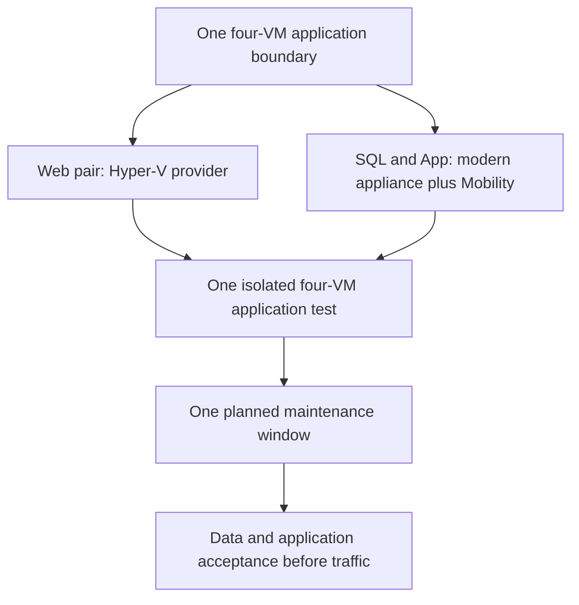
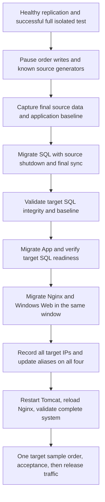

# Module 3: Agent-Based Migration — SQL/Tomcat and Coordinated Cutover

| **Estimated Time** | 75–90 minutes of student activity, plus separately approved appliance preparation, replication, and full-system testing |
|---------------------|---------------|
| **Level**           | Advanced — Cloud Solution Architect |
| **Prerequisites**   | [Module 1](Module-1-Discovery.md) completed; [Module 2 §§4–6](Module-2-Agentless-Migration.md#4-step-1--prepare-for-migration) frontend replication configured; separate modern appliance and support prerequisites in §§4–7 |
| **CAF Phase**       | **Migrate** — Cloud Adoption Framework |

### Learning Objectives — Concepts

By the end of this module, you will distinguish disk-block replication from application requests, deploy/register a separate supported replication appliance manually, install/register supported guest Mobility Service, validate the four isolated test peers across **both** engines, and coordinate **one planned business maintenance window**. Initial and delta replication do not require a business outage. SQL + App are the assigned modern physical/Mobility pair; Web + Linux-Web remain exclusively on the Hyper-V provider.

Enter here after [Module 2 §§4–6](Module-2-Agentless-Migration.md#4-step-1--prepare-for-migration) configured the frontend pair. Complete **this module §§4–8** to configure replication for **SQL + App together**, then return to [Module 2 §§7–8](Module-2-Agentless-Migration.md#7-step-4--monitor-replication) to review and test **both frontends**. Return here for **§§9–10** to review and test **both SQL/App VMs**, validate SQL and the complete four-VM isolated application, and clean up all test copies. Only then perform **§11's one coordinated cutover**, SQL first; invoke Module 2's frontend cutover inside that same window, not as an earlier prerequisite.

---

## 1. Overview — Replication for Mission-Critical Workloads

When a workload has state — a database with open transactions, a file server with active writes, an application maintaining sessions — the migration plan must account for data freshness and a controlled write boundary. Replication alone does not prove application consistency, preserve RAM/sessions, or guarantee zero data loss.

### How It Works Architecturally

This lab deliberately treats **`OnPrem-SQL` and `OnPrem-Linux-App` as physical servers** for Azure Migrate. A **Mobility Service inside each of these two guests** tracks changed disk blocks and sends them through a **separate modern Windows Server 2022 replication appliance** to Azure. The Module 1 `MigrateAppl` remains discovery/assessment only. The Module 2 Hyper-V provider replicates **only Web and Linux-Web**. Do not select SQL/App under that provider or dual-protect a VM.

**The replication pipeline:**

1. **Prepare and register the modern appliance** — Use this fresh lab project's physical-server preparation flow and separately approved hosting; never reuse a source VM or the discovery appliance.
2. **Install/register supported Mobility Service** — Use the registered appliance's matching installer/configuration and approved credentials on SQL and App only.
3. **Initial replication** — Copy every required OS/application/database disk while the four sources keep serving.
4. **Delta replication** — Track changed blocks, not HTTP requests, SQL log shipping, open transaction memory, or CPU utilization. Source-to-appliance control uses TCP 443 and data uses TCP 9443; appliance-to-Azure uses TCP 443 under the current documented network requirements. These are scoped data-path requirements, **not an old appliance management URL**.
5. **Test and final migration** — Boot separate isolated test peers first. At the later shared final boundary, freeze writers, drain work, verify the supported final-sync/source-shutdown procedure for each engine, and validate all targets before releasing traffic.

```text
Web + Linux-Web → Hyper-V host provider ─────────────┐
                                                   ├→ Azure replica disks → isolated tests / final targets
SQL + App → guest Mobility → modern replication appliance ┘
Discovery appliance → inventory / assessment only
```

### RPO/RTO Characteristics

| Metric | Meaning | Implication |
|--------|---------|-------------|
| **RPO** | Acceptable age of recovered data | Inspect actual points and final accepted changes; neither engine promises zero RPO |
| **RTO** | Acceptable restoration time | Include the planned outage, both engines, boot, SQL checks, alias updates, and acceptance |
| **Initial sync** | First copy of all required disks | Depends on disk size, bandwidth, and ongoing churn; sources remain active |
| **Ongoing overhead** | Tracking/transmitting changed blocks | Observe guest/appliance/network load; a busy CPU alone is not changed-disk evidence |

### When Stateful Planning Matters

- SQL stores the real business orders in `ContosoApp`; the application VM stores its OS, application code/configuration and logs. The HTTP generator's location is **not** the reason to choose a migration method.
- Both host-based and Mobility-based replication can handle active stateful disk writes where supported. This pairing is for comparing two hands-on methods, not a rule that databases require agents.
- A booted VM or healthy replication label is not proof of consistent, current business data.
- Contoso Order Desk is a small unauthenticated Java/JSP order form and API. Customer records support basic sample requests; customer/employee login profiles or an employee portal are illustrative business scenarios, **not implemented features**.

#### Hands-On Steps

**Local workstation — student notes:**

1.  Identify **`OnPrem-SQL`** and **`OnPrem-Linux-App`**, their fresh source IDs, and their physical-server replication architecture in the lab identity register.

2.  Record that SQL holds Orders/Customers, while App holds the runtime/configuration/logs and issues JDBC reads/writes.

3.  Record which frontends and background generators can reach SQL through the five edges in §3.

**Expected Result:** You can explain the two replication data paths and why disk replication still needs database/application validation.

**CSA Why:** Method selection, disk churn, and application-consistency planning answer different questions.

---

## 2. Agentless vs. Agent-Based — Decision Matrix

Compare **supported source configurations and operational requirements**, not a rule that statefulness forces an agent. Neither method is a separate application boundary in this lab.

| Criteria | Module 2 — Hyper-V Host Replication | Module 3 — Modern Physical-Server Route |
|----------|------------------------------------|------------------------------------------|
| **Assigned sources** | Web + Linux-Web only | SQL + Linux-App only, treated as physical |
| **Replication software** | Provider / Recovery Services agent on HyperVHost | Mobility Service in each of the two guests + separate modern replication appliance |
| **Discovery appliance** | Inventory/assessment, not replication | Same independent discovery role; cannot be reused as replication appliance |
| **Data tracked** | Selected VM disk changes | Selected guest disk blocks; not HTTP or SQL log shipping |
| **Guest change approval** | No guest migration agent | Required before Mobility installation, including supported privileged installation access |
| **Readiness** | Supported Hyper-V/source/target configuration | Exact OS + running kernel + Mobility version + storage/boot tuple and approved appliance hosting |
| **Data consistency / RPO** | Inspect points, validate business data | Same requirement; no zero-loss guarantee |
| **Portal source** | **From replication provider (Hyper-V)** | **From a replication appliance (Physical or others)**, or verified inventory/assessment route |
| **Final cutover** | Separate frontend jobs inside the shared window | Separate SQL/App jobs in that **same** planned window; not one cross-engine atomic job |

> **CSA Decision Rule:** Never enable both replication architectures for the same source VM. If an existing registration, duplicate inventory identity, or wrong-source selection cannot be conclusively resolved, STOP and use a clean source deployment; no automated binding-clearing or registered-appliance clone is provided.



#### Hands-On Steps

**Local workstation — student notes:**

1.  Mark Web/Linux-Web as **Hyper-V** and SQL/App as **modern physical/Mobility**, with each verified source identity and project/appliance association.

2.  Mark all four as **one connected application**, with no frontend final cutover until SQL/App preparation and the full test succeed.

**Expected Result:** Two different hands-on replication methods are planned without dual protection or independent application waves.

**CSA Why:** An explicit architecture and identity register prevents silently selecting the Hyper-V discovery record for a physical-route migration.

---

## 3. Stateful Workload Migration Strategy

SQL, App and both frontends form **one application boundary**, with one coordinated cutover in [§11](#11-step-7--cutover-for-stateful-workloads). Source orders continue during initial/delta replication until the planned write freeze. Test copies remain isolated, with copied generators disarmed before functional traffic in [§10](#10-step-6--test-migration).

### Application-Consistent Recovery: Why It Matters

| Recovery Type | What It Represents | SQL Validation Implication |
|---------------|--------------------|---------------------------|
| **Crash-consistent** | Disk state similar to an unexpected power loss | SQL may perform crash recovery; verify database state, integrity, and data freshness |
| **Application-consistent** | A recovery point coordinated with application quiescence where supported | Still validate committed data and application behavior; do not infer this from a generic health label |
| **Planned final migration** | Writes paused, selected sources shut down, final synchronization completed | Compare the recovered database with the final source baseline before additional writes |

A replication-health or recovery-point label does **not** guarantee application consistency or current business data. RPO/RTO are objectives, not zero-loss or zero-downtime promises.

### SQL Server Migration Considerations

SQL planning covers every data/log disk, the existing recovery model, an independent backup and a captured committed-data baseline. Online state, integrity and data freshness still require validation; a booted VM is insufficient.

### Tomcat / Application Server Considerations

Protected JNDI credentials, the SQL alias and Tomcat's JDBC pool must remain coherent after an address change. Nginx's 8080 upstream must resolve the new App peer. Actual backup, data-check, repoint and restart/reload commands belong in [§5](#5-step-1--prepare-the-stateful-source-workloads), [§10](#10-step-6--test-migration) and [§11](#11-step-7--cutover-for-stateful-workloads), not a second checklist here.

### Application Dependency Map

The five-edge map is already documented in [Module 1 §6](Module-1-Discovery.md#step-6-dependency-analysis) and [README — Lab Traffic](../README.md#lab-traffic). The full isolated test and final acceptance cover all four VMs, across both replication methods.

---

## 4. Prerequisites

| Source VM | OS | Role | Source IP |
|-----------|----|------|-----------|
| `OnPrem-SQL` | Windows Server 2022 | SQL Server 2022 Express, `ContosoApp`, TCP 1433 | `192.168.0.11` |
| `OnPrem-Linux-App` | Ubuntu 24.04 | Tomcat 10.1 / OpenJDK 17 JSP Order Desk, TCP 3000 | `192.168.0.13` |

The same single, nonclustered Windows Server 2022 **Standard_E8s_v7**, Generation 2 **HyperVHost** hosts this pair and the Module 2 pair. The source nested network is `192.168.0.0/24` (host `.1`, discovery appliance `.20`), separate from the source Azure VNet `10.0.0.0/16`.

#### Hands-On Steps

1.  **Local workstation — Azure portal:** Confirm Module 1 discovery and assessment completed in the intended Azure Migrate project.

2.  **Local workstation — Azure portal:** Confirm Module 2 §6 configured **both Web + Linux-Web replication records**, including setup jobs and per-VM mappings. Frontend testing and cutover are **not** entry prerequisites.

3.  **HyperVHost — Hyper-V Manager:** Confirm SQL and App are running, with approved guest access and existing authorized SQL access. Keep §2's source identities and method assignments; do not dual-protect either VM.

4.  **Local workstation — Azure portal:** Confirm target/test networks and a **separate modern replication appliance** are available, or will be prepared and verified in §§6–7 before use. The discovery appliance is not a substitute.

5.  **Instructor confirmation:** Confirm the provided build matches the [instructor-qualified baseline](../README.md#instructor-preparation--qualify-the-provided-baseline). If qualification or the match is unconfirmed, or the image/kernel, agent, storage or architecture changed, **STOP and ask the instructor before agent installation or replication**.

**Execution location:** Azure-copy commands run inside the explicitly selected guest through **VM → Run command → RunPowerShellScript / RunShellScript** after guest-agent readiness, or approved RDP/SSH. SQL checks use existing tooling, authorized access and the approved **trusted local SQL connection**. Missing access/tooling/trust requires its owner; no permission grant, certificate change, trust bypass or password exposure is a student prerequisite.

**Expected Result:** The five entry checks are confirmed; §§6–7 complete network/appliance preparation before use. Detailed build qualification belongs to the instructor, not a repeated student support-matrix investigation.

---

## 5. Step 1 — Prepare the Stateful Source Workloads

A useful data baseline records **current** application state. Customers/Orders may already contain activity; the original seed counts are not acceptance criteria. Initial replication can run while the source application is active. The nondisruptive test uses captured committed IDs and an explicitly understood recovery-point difference while source writes continue; exact frozen equality is reserved for final cutover.

### 5.1 Capture SQL State and Data Baseline

#### Hands-On Steps

**HyperVHost — RDP client / Hyper-V Manager VMConnect:**

1.  After connecting to the lab HyperVHost, open **source `OnPrem-SQL` (`192.168.0.11`)** using approved guest RDP/VMConnect and SQL access. The nested NAT address is not assumed reachable from your workstation.

    These are source checks, not commands for the student workstation.

**Source OnPrem-SQL — PowerShell / SSMS:**

2.  In a local PowerShell session with the existing SqlServer tooling and authorized Windows identity, run:

    ```powershell
    Get-Service -Name 'MSSQL$SQLEXPRESS'
    Invoke-Sqlcmd -ServerInstance '.\SQLEXPRESS' -Database ContosoApp -Query @'
    SELECT name, state_desc, recovery_model_desc
    FROM sys.databases WHERE name = N'ContosoApp';
    '@
    Invoke-Sqlcmd -ServerInstance '.\SQLEXPRESS' -Database ContosoApp -Query @'
    SELECT (SELECT COUNT_BIG(*) FROM dbo.Customers) AS Customers,
           (SELECT COUNT_BIG(*) FROM dbo.Orders) AS Orders;
    '@
    Invoke-Sqlcmd -ServerInstance '.\SQLEXPRESS' -Database ContosoApp -Query @'
    SELECT TOP (5) OrderID, CustomerID, ProductName, Quantity, OrderDate
    FROM dbo.Orders ORDER BY OrderID DESC;
    '@
    ```

    In SSMS, the same SQL can be run in a query window connected to `ContosoApp` with the existing authorized identity.

3.  Record the timestamp, counts, and recent order IDs/times in your student notes.

4.  Using the existing SQL backup procedure or **SSMS → Databases → ContosoApp → Tasks → Back Up**, take a full source database backup to the approved backup location.

    A VM replica or checkpoint is not the independent SQL backup.

5.  Verify the backup succeeded.

6.  Retain the backup's location in your notes.

**Local workstation — student notes:**

7.  Keep all four source VMs and business application serving, including previously enabled synthetic orders, during initial/delta replication and testing.

8.  Record this source baseline as a **time-stamped lower-bound data reference**, not a frozen final count.

**Source OnPrem-SQL — PowerShell / SSMS:**

9.  Retain the captured order IDs/times and counts with the backup evidence, without changing the database recovery model or reseeding it.

**Local workstation — Azure portal:**

10. Once replication is enabled in §8, inspect the selected test recovery point and its relationship to that capture.

11. Prefer a healthy point after the capture; record its timestamp and any observed lag.

    Source writes may continue. In the recovered copy, account for the captured committed IDs and subsequent changes visible at that point; do not require equality with a later live source count. If the point predates your reference or a committed order cannot be accounted for, investigate and record the limitation rather than calling data validation passed. Exact final-source/target equality is required only at §11's planned write freeze.

### 5.2 Confirm the Existing Application Runtime

#### Hands-On Steps

**Source OnPrem-Linux-App — SSH session:**

1.  Through approved SSH to **source `OnPrem-Linux-App` (`192.168.0.13`)**, run:

    ```bash
    java -version
    systemctl is-active contoso-orderdesk
    curl --fail --silent --show-error http://localhost:3000/api/health
    curl --fail --silent --show-error http://localhost:3000/api/ready
    curl --fail --silent --show-error http://localhost:3000/api/orders
    ```

2.  Confirm Java 17, the existing Tomcat-backed service, healthy runtime, SQL readiness, and current Orders/Customers data.

    Do not display the protected JNDI descriptor or copy credentials into your notes.

**Local workstation — student notes:**

3.  Record all source disks needed for OS, SQL data/logs, and application files.

    Preserve the existing runtime rather than reinstalling or replacing it.

**Expected Result:** The source SQL/App state and current data baseline are recorded, an independent SQL backup is available, and the preserved runtime is understood.

**CSA Why:** You cannot validate recovered data against a baseline you never captured.

---

## 6. Step 2 — Confirm Target Compute, Networks, and Dependencies

Target planning is shared across the whole application. The target region must differ from the source HyperVHost VM's actual region in this lab. **East US → West US 2 is only an example**; neither eligibility, quota headroom, nor an assessment recommendation guarantees allocation.

| Role / Exact Final Target Name | Selection evidence required |
|--------------------------------|-----------------------------------|
| IIS — `OnPrem-Web` | Actual assessment + Windows source/target support + regional capacity/quota |
| SQL — `OnPrem-SQL` | SQL performance/data-disk needs + Windows/Mobility route support + capacity/quota |
| Nginx — `OnPrem-Linux-Web` | Two-vCPU source configuration + Hyper-V target support + capacity/quota |
| Tomcat — `OnPrem-Linux-App` | Two-vCPU source configuration + exact Linux/Mobility/storage support + capacity/quota |

No fixed all-four SKU is prescribed here. The historical B1/B2 table in Module 2 is **not approved lab sizing**; resolve its one-vCPU Linux examples against the actual two-vCPU sources. A previous IaaS export recommended `Standard_D2als_v6` for all four, but that is an assessment result, not a lab default, availability promise, or instruction to change a script menu. Record the actual reviewed size for each role before enabling replication.

| Network | Address Space | Subnet | Use |
|---------|---------------|--------|-----|
| Source Azure VNet | `10.0.0.0/16` | Existing lab design | Hosts the nested source environment |
| `vnet-ces-target-01` | `10.1.0.0/16` | `default`, `10.1.0.0/24` | Final targets |
| `vnet-ces-test-01` | `10.2.0.0/16` | `default`, `10.2.0.0/24` | Isolated test copies only |

### 6.1 Confirm Region, Quota, and Compute Choice

#### Hands-On Steps

**Local workstation — Azure portal:**

1.  Read **Virtual machines → HyperVHost → Location**.

2.  Confirm the chosen target is a different actual region.

3.  In **Subscriptions → Usage + quotas**, check target-region total vCPU quota, VM-family quota, and VM-count allowance.

4.  Confirm eligibility in the VM size selector.

5.  Select each role's target size manually only after reviewing its actual source requirements, assessment, chosen replication architecture and current portal eligibility.

6.  Record the actual per-role choices and sum their vCPUs/VM count, including any simultaneous test/target overlap and existing allocations without double-counting.

    No inherited B1/B2 or all-four D2 example is automatically selected. **STOP** if the size/support/capacity review is incomplete; quota is not an allocation reservation.

7.  Review assessment recommendations without assuming they override the manually approved lab choices.

8.  Review current portal pricing for selected VM/disk sizes.

    No fixed cost or capacity promise applies.

9.  Keep **Azure Hybrid Benefit / existing Windows Server license rights: No** unless eligible rights have been confirmed.

### 6.2 Confirm the Landing Zone and Test Isolation

#### Hands-On Steps

**Local workstation — Azure portal:**

1.  Open **Resource groups → `rg-ces-target-01`**.

2.  Confirm the target VNet/subnet and associated NSG are in the selected target region.

    If missing, perform [Module 2 §4.2's manual creation steps](Module-2-Agentless-Migration.md#42-build-the-target-landing-zone).

3.  Confirm **`vnet-ces-test-01`** and its test NSG exist in the same region.

    If missing, perform [Module 2 §8.1's manual creation/isolation steps](Module-2-Agentless-Migration.md#81-build-the-isolated-test-network) before booting any test copy.

4.  Inspect test **Peerings**, DNS servers, subnet routes, and NSG rules.

    There must be no source/live-target peering, VPN/route path, or source DNS reachability.

5.  Confirm test outbound denies cover `192.168.0.0/24`, `10.0.0.0/16`, and `10.1.0.0/16` ahead of default rules.

6.  Verify approved host/guest outbound connectivity against the lab network plan.

    Do not assume Azure default outbound access or that a NAT gateway exists. Keep the approved platform/management path available without reconnecting test and source networks.

7.  Review the five dependency edges from §3 in both the test and final networks, plus local IIS/Nginx 80, Nginx proxy 8080, Tomcat 3000, and SQL 1433 listeners.

    Restrict application and SQL access to approved private peers; do not expose the demo to the Internet.

**Expected Result:** The selected compute plan, target networks, isolation, outbound access, and required dependency paths are ready for this application's test and final migration.

**CSA Why:** A valid VM size and a running database do not compensate for the wrong network or region.

---

## 7. Step 3 — Deploy and Register the Modern Replication Appliance

The current [physical-server tutorial](https://learn.microsoft.com/azure/migrate/tutorial-migrate-physical-virtual-machines?view=migrate), updated 2026-06-27, uses the **simplified/modern agent-based experience**. The classic agent-based appliance retired on 2026-09-30; that retirement does **not** retire the Classic Azure VM assessment in Module 1. Do not substitute an old Windows Server 2016/configuration-server/MySQL recipe, a guessed download URL, or the discovery appliance installer.

Before enabling this pair's protection, recheck Module 2 §4.3's **project-association prerequisite**: the owner must verify project/provider/appliance/managed-vault compatibility for both methods. The presence of both source choices is not shared-vault certification. Do not force associations, guess blank IDs, silently create separate projects, or patch scripts.

### 7.1 Verify Separate Hosting and Prepare the Physical-Server Route

#### Hands-On Steps

**Local workstation — student notes:**

1.  Reopen Module 0 §3.6's approved machine record and §4's support tuple.

2.  Verify a separate, unreplicated **Windows Server 2022** machine with at least **8 CPUs, 16 GB memory, 80-GB OS disk and separate 620-GB data disk**, sufficient free capacity and the current published prerequisites.

    This minimum is not the higher-scale 16-CPU/32-GB tier. The appliance OS must not have the Hyper-V role. This guest-role restriction is not proof that every hypervisor/cloud placement is prohibited or supported.

3.  Obtain approval for the **actual hosting placement** against the current documentation and instructor/support review before installation. Do not assume Azure-hosted or nested placement is supported merely because Windows Server 2022 can boot there; verify the particular placement rather than declaring all such placements unsupported.

    **STOP** if placement, storage backing, quota, licensing, network reachability or cost approval is missing. The original host's 512-GB OS disk and 100-GB discovery partition do not supply a 620-GB data disk. Do not change the host, its disks, deployment scripts, or source workload allocations to make space. Never reuse `MigrateAppl`, SQL, App, or a registered-appliance clone.

**Local workstation — Azure portal:**

4.  Open the fresh lab project and verify its subscription/resource ID.

5.  Select **Execute → Migrations → Start execution**.

6.  Select **Servers or virtual machines (VMs)** and target **Azure VM**.

7.  Under **Other sources**, select **From a replication appliance (Physical or others)** and follow the portal's appliance setup link.

    The overview uses **Migrations**; some tutorial/screenshots use singular **Migration**. Match the actual equivalent operation, not a guessed legacy menu.

8.  Confirm virtualization type **Physical**, the reviewed target region, and the region confirmation.

9.  Select **Create resources** only after checking the fresh lab scope and region.

    This prepares project-managed migration resources, including the background recovery vault. The region is then locked. Do not create a separate ASR DR policy or rebind an existing protected environment.

### 7.2 Install and Register the Appliance

#### Hands-On Steps

**Separate approved replication-appliance machine — elevated PowerShell / installer UI:**

1.  Download the current appliance package from the **actual project's setup link**.

2.  Verify the publisher/signature and any currently published hash using the official instructions; extract to the approved appliance location.

3.  Follow the current vendor **PowerShell appliance setup** instructions and run the supplied **`DRInstaller.ps1` as Administrator on this separate machine**.

    This is the Microsoft appliance installer, not a workshop `migrate-step` helper. No copied installer command, fixed binary URL, execution-policy bypass, or lab script modification is supplied here. If the signed installer/prerequisites cannot run under approved policy, **STOP for the owner**, not a security workaround.

**Replication appliance — Microsoft Azure Appliance Configuration Manager:**

4.  Let prerequisite checks and component status load, resolve approved prerequisite issues, then select **Continue**.

5.  Select the approved **FQDN or NAT IP** connectivity choice; verify source guests can reach that actual endpoint and the appliance can reach required Azure endpoints. Save and continue.

6.  Enter a unique **Friendly name of appliance** and the **Azure Migrate replication appliance key** obtained from this project's portal setup page.

    This is not a legacy shared passphrase. Keep key/configuration files and all credentials private.

7.  Select **Login** and complete the Azure authentication tab/device-code flow before its five-minute code expires.

8.  Verify the displayed **Subscription, Resource Group, and Recovery Services Vault** belong to this fresh lab project; then continue.

9.  Under **Provide Physical Server Details**, select **Add Credentials** where approved: record OS, credential friendly name, and the actual source username/password in the protected UI.

    Current push installation requires a source **Windows administrator** and source **Linux root** credential. Existing SSH/sudo inventory access does not by itself prove push eligibility. **STOP** if these privileges are not approved; do not enable root/password SSH, relax UAC/firewalls, or change security policy merely for push. Use the supported manual-agent option below only if its separately approved privileges and procedure are available.

10. Select **Add Server**, entering each exact SQL/App **source IP/FQDN** and the approved credential account as required by the selected installation route.

11. Confirm fresh identities and source access; exclude HyperVHost, `MigrateAppl`, the replication appliance itself, Web, and Linux-Web.

**Local workstation — Azure portal:**

12. Confirm this modern appliance is registered and healthy in the intended project/region, with its current component versions.

13. Record its identity, versions, registration status and the verified SQL/App source associations without secrets.

### 7.3 Choose a Supported Mobility Installation Route

#### Hands-On Steps

**Local workstation — student notes:**

1.  Recheck the exact OS/kernel/Mobility support evidence from §4 before any guest installation.

2.  Select **push installation** in §8 only if the documented Windows administrator/Linux root privileges, scoped connectivity and change approval are satisfied.

3.  Otherwise, use **manual installation** only from the registered modern appliance and the current [Mobility Service instructions](https://learn.microsoft.com/azure/site-recovery/vmware-physical-mobility-service-overview), updated 2026-10-15.

**Source OnPrem-SQL — approved local administrator / installer UI (manual option):**

4.  Obtain the appliance-matched Windows installer using the current documented transfer method and verify its publisher/version.

5.  Open the installer, select **Install**, and obtain that source machine's **Machine Details** string from its configurator.

**Replication appliance — Configuration Manager (manual option):**

6.  Open **Mobility service configuration details**, supply that machine's details string, and select **Download configuration file**.

**Source OnPrem-SQL — Unified Agent configurator (manual option):**

7.  Supply the resulting **machine-specific configuration file** and select **Register**. Confirm successful registration to this appliance.

**Source OnPrem-Linux-App — approved privileged SSH session (manual option):**

8.  Open the current official article's **Linux manual installation** instructions and choose the exact supported OS/agent package matching this appliance.

9.  Follow that current terminal-based install, machine-details/configuration generation, and registration sequence with the approved privilege model.

    **STOP** if the precise package, command arguments, machine-specific configuration or privileges cannot be verified. Do not use the Windows GUI sequence for Linux, guess an old binary URL/CLI/passphrase, or force an unsupported agent/kernel combination. This guide deliberately does not invent a version-dependent Linux command block.

**Local workstation — Azure portal / replication appliance:**

10. Verify the actual Mobility version, source identity, registered appliance and successful agent connection for both SQL and App. If using push, perform this verification after §8 enables replication.

**Expected Result:** The separate modern appliance and selected supported agent-install route meet the recorded prerequisites; otherwise stop before installation/replication and refer the unresolved condition to its owner. Discovery, appliance registration, guest-agent registration and successful disk replication are distinct checks.

**CSA Why:** Correct modern registration and approved guest privileges prevent mixing a retired workflow, the wrong appliance, or a duplicate source record with a successful migration.

---

## 8. Step 4 — Configure Replication

SQL and Tomcat use the **modern physical-server/Mobility path**, not the registered Hyper-V provider. Select every disk needed for the existing database and application; replication preserves disk state rather than rebuilding an app. Keep all four sources serving throughout initial/delta replication. No workshop `migrate-step1`–`migrate-step6` script is part of this manual sequence.

### 8.1 Start the Replication Wizard

#### Hands-On Steps

**Local workstation — Azure portal:**

1.  Open the verified lab project → **Execute → Migrations → Start execution**.

2.  Choose **Servers or virtual machines (VMs)** → **Azure VM**.

3.  Select **From a replication appliance (Physical or others)** and the registered modern appliance from §7.

4.  Alternatively, use **From all inventory** or **From an assessment** only when the displayed record/architecture can be verified as this physical-route SQL/App source; select the corresponding Physical discovery appliance when prompted.

    The Hyper-V discovery inventory may contain a same-name record. It is not permission to select **From replication provider (Hyper-V)** for this pair. **STOP on ambiguous identity, duplicate selection, wrong architecture or unresolved readiness**; do not try different records until something executes.

### 8.2 Select Virtual Machines

#### Hands-On Steps

**Local workstation — Azure portal:**

1.  Select exactly **`OnPrem-SQL`** and **`OnPrem-Linux-App`**.

2.  On **Workloads**, verify the two fresh source identities, source addresses, physical replication architecture and correct **replication-appliance** dropdown; review each readiness finding.

3.  Review imported assessment values if used, then the supported **Target VM security type**, approved **Guest credentials** for push, or the already verified manual-agent registration. Do not silently accept a security change or grant extra privileges.

4.  For **manual installation**, require verified agent registration now. For **push**, record installation as **approved / pending initial execution**, not already complete; installation occurs after §8.6 submission. Require support, credential and readiness gates before **Next**, and verify successful installation/registration in the resulting jobs before treating replication as active.

### 8.3 Configure Target Settings

#### Hands-On Steps

**Local workstation — Azure portal:**

1.  Select the lab subscription.

2.  Select **`rg-ces-target-01`**.

3.  Confirm the project's prepared target region.

4.  Select its offered replication storage/cache account, creating it through the wizard only if required.

5.  Choose final target **`vnet-ces-target-01` → `default` (`10.1.0.0/24`)**.

    The isolated `10.2` network is selected later for test migration, not as the final target.

### 8.4 Configure Each VM's Compute Settings

#### Hands-On Steps

**Local workstation — student notes / Azure portal:**

1.  Open the compute row for **each of the two selected physical-route sources**. Copy each actual target SKU approved in §6 into your notes and choose that exact SKU in the portal; the table's size descriptions are not literal values to enter.

2.  Apply the individual mappings below, matching source identity/IP and modern appliance before editing a row:

| Source VM / Source IP | Source OS | Source vCPU / RAM | Exact Target Name / OS Type | Target Size to Select | OS / Boot Disk to Identify | Required Source Disk Set | Target Disk Type |
|-----------------------|-----------|-------------------|----------------------------|-----------------------|----------------------------|--------------------------|------------------|
| `OnPrem-SQL` / `192.168.0.11` | Windows Server 2022 | 2 / 4 GB | `OnPrem-SQL` / **Windows** | Exact SQL SKU approved in §6 | Actual **40-GB** OS/boot disk; match its recorded disk ID | OS disk and every actual disk/volume holding SQL data or logs | **Standard SSD**, unless a reviewed alternative is approved |
| `OnPrem-Linux-App` / `192.168.0.13` | Ubuntu 24.04 | 2 / 2 GB | `OnPrem-Linux-App` / **Linux** | Exact App SKU approved in §6 | Actual **30-GB** OS/boot disk; match its recorded disk ID | OS disk and every other required disk actually present for application/configuration/logs | **Standard SSD**, unless a reviewed alternative is approved |

3.  Set SQL's target name **`OnPrem-SQL`**, OS **Windows**, and approved SQL size. Review its assessed memory, storage, performance, source/target support and current regional/family quota/capacity.

4.  Set App's target name **`OnPrem-Linux-App`**, OS **Linux**, and approved App size, preserving Ubuntu 24.04 and the existing Tomcat/OpenJDK runtime.

5.  Do not blindly downsize either two-vCPU source. Neither `Standard_D2als_v6` from an assessment export nor an old all-four `Standard_D2as_v5` example is a required SKU or capacity reservation.

6.  Identify **each actual OS/boot disk** by its recorded ID and boot/volume layout, and review supported target settings for its source generation. Resolve any mismatch with the 40-GB/30-GB inventory before submission; do not guess that the first disk is the OS disk.

7.  Keep Windows **Azure Hybrid Benefit / existing-license rights: No** unless eligible rights have been confirmed. Do not apply a Windows benefit to the Linux row.

### 8.5 Configure Each VM's Disk Settings

#### Hands-On Steps

**Local workstation — Azure portal / source inventory:**

1.  Open the disk selections for **SQL and App** within this same wizard. Include SQL's **40-GB** and App's **30-GB** OS/boot disks.

2.  Reconcile **all required source disks and volumes** against §§4–5's inventory. Include every actual SQL data/log location and App file/configuration/log location; if these reside on the OS disk, include that disk without inventing a separate data disk. Verify and include additional disks only where they actually exist and are required.

3.  Choose **Standard SSD** for the lab's target disks unless an assessment-driven alternative has been agreed. Record the selected disk IDs, sizes and target types for both rows.

4.  Confirm no required data/log disk was excluded and no required filesystem depends on an omitted disk.

    Do not move SQL files or logs to an ephemeral disk as part of this exercise.

### 8.6 Review and Start Replication for the Pair

#### Hands-On Steps

**Local workstation — Azure portal:**

1.  Review **both SQL + App records**: source identities/IPs, physical/Mobility architecture, modern appliance, exact target names, region, **`rg-ces-target-01`**, final **`vnet-ces-target-01` → `default`**, OS types, actual approved sizes, boot disks, Windows licensing choice, and all required selected disks.

2.  Confirm neither SQL nor App is enabled under the Hyper-V provider, and Web/Linux-Web are excluded from this modern appliance request.

3.  Review **Tags**, then select **Review and start execution** / **Start execution** for this two-VM selection, as shown in the current portal.

    This enables **initial replication**, not final migration or business cutover. Both sources remain serving; do not pause source orders or stop SQL/Tomcat for initial/delta replication.

4.  Open the resulting **Preparation** jobs and record the setup job associated with each VM. Verify successful Mobility installation/registration and the intended appliance association as those stages complete; resolve reported errors before treating replication as active.

5.  Confirm Module 2 §6 already recorded the two frontend replication jobs. If not, complete **Module 2 §§5–6**, selecting the Hyper-V provider for **only Web + Linux-Web**, before starting any test migration.

**Local workstation — course instructions:**

6.  With **both replication groups configured**, return now to [Module 2 §§7–8](Module-2-Agentless-Migration.md#7-step-4--monitor-replication). Review both frontend recovery points, submit both frontend test migrations consecutively, and validate/retain their isolated copies.

7.  After that frontend test, return to **this module §9**, then §10, to review SQL/App readiness and submit **both SQL + App tests before individual SQL validation**. Do not proceed directly to final cutover.

**Expected Result:** SQL/App replication setup jobs are submitted with their own approved mappings, while the frontend pair is already configured. Both groups are configured before testing; a submitted job is not evidence that initial sync has completed.

**CSA Why:** The paired request preserves each workload's complete disk/runtime mapping without confusing replication submission with recovery-point readiness.

---

## 9. Step 5 — Monitor Replication

Return here **after Module 2 §§7–8 has reviewed and tested the frontend pair**, retaining or deliberately recreating its isolated outputs as directed there. Replication for SQL/App was already submitted in §8. Replication readiness comes from each **modern physical-route** workload's **Preparation** details, installed agent/appliance versions, jobs, and actual recovery points—not a generic protection label or successful submission. The frontend Hyper-V records must be reviewed separately in the same project's **Execute → Migrations** view.

| Observation | Meaning | Student Action |
|-------------|---------|----------------|
| Setup job in progress | Host/VM configuration still being applied | Review job progress and reported errors |
| Initial synchronization in progress | Full disk copy not finished | Wait and observe progress |
| Initial sync complete, health good, recent recovery point | Candidate for test migration | Review timestamp and portal test readiness |
| Error, warning, degraded health, stale/missing point | Readiness not established | Review the reported issue before proceeding |

### 9.1 View Replication Status

#### Hands-On Steps

**Local workstation — Azure portal:**

1.  Open **Azure Migrate project → Execute → Migrations**.

2.  Select **`OnPrem-SQL`** and **`OnPrem-Linux-App`**.

3.  Inspect their individual details.

4.  Inspect their related **Jobs**.

### 9.2 Review Initial Synchronization

#### Hands-On Steps

**Local workstation — Azure portal:**

1.  Wait for the initial copy of every selected required disk to finish.

2.  Review failed or stalled jobs in the portal.

    Do not proceed solely because the enable-replication request was accepted.

### 9.3 Review Health and Recovery Points

#### Hands-On Steps

**Local workstation — Azure portal:**

1.  Confirm healthy replication for each VM.

2.  Inspect the latest available recovery-point timestamp for each VM.

3.  Compare recovery-point age to the objective recorded in your notes.

    For the nondisruptive test, use a healthy point related to §5.1's captured committed IDs/counts. Prefer a point after that reference; source orders continue, so later live counts may be higher.

4.  Review the test-migration readiness shown for each source record.

5.  Resolve reported readiness blockers before starting a separate test migration.

### 9.4 Confirm the Full Test Group Is Ready

#### Hands-On Steps

**Local workstation — Azure portal:**

1.  Confirm **both SQL + App** have completed initial sync on every selected disk, healthy replication, fresh recovery points within the recorded objective, and portal test readiness **before starting either test**.

2.  Confirm the Module 2 pair also has completed initial sync and acceptable health/points, and its test outputs are retained in the isolated network or will be recreated through Module 2 §8.2 before the full test.

3.  Record the reviewed health/recovery-point information for all four sources in your student notes.

**Expected Result:** SQL and App, together with the frontend pair, have completed initial sync, healthy replication, and reviewed recovery points for the full isolated test. Application consistency and cutover acceptance remain to be demonstrated.

**CSA Why:** The slowest or least-ready dependency determines the application's test readiness.

---

## 10. Step 6 — Test Migration

A stateful test validates data integrity and the entire application, not just successful boot. Before **any** test copy boots, verify no test peering/route/DNS path to source or final SQL/App peers, and confirm both engines can create their test peers in the **same approved isolated VNet**. Inherited Windows startup tasks/Linux traffic services may auto-start against old aliases; network isolation protects the source before guest controls are available. Local CPU workers need a separate check, not an assumption about expiry.

Names ending in `-test` below are **illustrative role labels only**. Use the unique generated name and **resource ID produced by each actual test job**, never a guessed suffix or an unsuffixed source/final VM. Record all four test names/IDs/NIC IPs; verify all four alias mappings on all four guests **before any cross-tier request or controlled write**. If isolation, unique identities or common-VNet support cannot be verified, **STOP / DEFERRED**.

### 10.1 Start Both SQL/App Tests and Complete the Four-VM Test Set

#### Hands-On Steps

**Local workstation — Azure portal:**

1.  Reconfirm **both SQL + App** meet §9's completed initial sync, healthy replication and fresh acceptable recovery-point requirements. Recheck §6.2 and [Module 2 §8.1's pre-boot isolation/rules](Module-2-Agentless-Migration.md#81-build-the-isolated-test-network) before **either** second-pair test boots.

    Use the same **`vnet-ces-test-01` → `default` (`10.2.0.0/24`)** for every test copy. Keep source/final-prefix denies effective, source/private-production DNS unreachable, and no source/final peering or route path.

2.  Confirm **both frontend test outputs** from Module 2 are retained with their exact VM/NIC IDs and test IPs, network generators disabled and copied CPU workers stopped/disarmed.

    If they were cleaned up, recreate **only those two tests** through [Module 2 §8.2's paired submissions](Module-2-Agentless-Migration.md#82-start-test-migration-for-both-frontends), repeat its guest controls and static validation, then return here. Never substitute unsuffixed live/source VMs.

3.  In **Execute → Migrations**, select **`OnPrem-SQL` → Testing → Start test migration**. Review its offered recovery point against §5.1's captured SQL reference, select **`vnet-ces-test-01` → `default`**, submit, and record the SQL test job ID.

4.  **Immediately repeat the action for `OnPrem-Linux-App` → Testing → Start test migration**. Review App's own offered point, select the **same test VNet/subnet**, submit, and record the App test job ID.

    Where the portal offers only a single-VM action, submit these two jobs consecutively. Do not wait for SQL, enter its guest, or validate its data before submitting App; no bulk test action is assumed.

5.  After **both jobs are submitted**, open **Jobs** and monitor both to completion. Resolve reported job errors before continuing with guest validation.

6.  Open **both actual test-job outputs**. Verify the generated VM resource IDs and isolated VNet/subnet against their jobs, then use **Networking → NIC → IP configurations** to record each actual test private IP and NIC resource ID.

7.  Complete the four-role map using the verified frontend and SQL/App outputs. Do not infer generated names or Azure addresses from the source `.10/.11/.12/.13` endings.

8.  In **`nsg-ces-test-01`**, replace every remaining temporary `10.2.0.0/24` **peer permit** field from Module 2 §8.1 with the actual test `/32` peers. Check the five matching inbound/outbound edges and management/client destinations against the recorded NIC IDs. Keep the all-port/all-protocol source/final deny rows scoped to the test subnet.

    Review effective subnet/NIC rules and guest-firewall paths before any cross-tier request. The custom peer permits do not remove default VNet/Internet permits; the approved isolation and egress plan must still hold.

9.  Use each test VM's portal Run Command when its agent is ready, or existing approved RDP/SSH access. Apply the following controls on **all four test copies before functional requests or SQL/application validation**.

    Private test addresses are not assumed reachable from your workstation. Pre-boot network isolation remains in force while these copied workers are stopped.

**Windows test VMs (`OnPrem-Web-test`, `OnPrem-SQL-test`) — Run Command (RunPowerShellScript) or elevated PowerShell:**

10. Before any functional traffic or test writes, disable/stop only the known inherited generator inside each Windows test VM:

    ```powershell
    $task = Get-ScheduledTask -TaskName 'LabOrderDeskTraffic' -ErrorAction SilentlyContinue
    if ($task) {
        Disable-ScheduledTask -TaskName 'LabOrderDeskTraffic' | Out-Null
        Stop-ScheduledTask -TaskName 'LabOrderDeskTraffic'
    }
    ```

**Linux test VMs — Run Command (RunShellScript) or SSH session:**

11. Disable/stop only the known inherited generator inside **both Linux test VMs**, including the App output already created by §10.1’s paired submissions:

    ```bash
    if systemctl cat contoso-orderdesk-traffic.service >/dev/null 2>&1; then
      sudo systemctl disable --now contoso-orderdesk-traffic.service
    fi
    ```

    Leave **SQL, `contoso-orderdesk` (Tomcat), Nginx and IIS running**. Do not disable broad groups of services or stop the application just to stop a generator.

**All four test guests — approved guest task/service controls:**

12. Inspect and stop any **copied CPU worker** independently of network traffic. Its bounded expiry/no-reboot-resume policy is not proof it is already stopped.

**Windows test guests — Run Command (RunPowerShellScript) or elevated PowerShell:**

13. Stop/disarm the exact existing CPU task only, if present:

    ```powershell
    $cpuTask = Get-ScheduledTask -TaskName 'LabCpuSimulation' -ErrorAction SilentlyContinue
    if ($cpuTask) {
        Disable-ScheduledTask -TaskName 'LabCpuSimulation' | Out-Null
        Stop-ScheduledTask -TaskName 'LabCpuSimulation'
    }
    Get-ScheduledTask -TaskName LabOrderDeskTraffic,LabCpuSimulation -ErrorAction SilentlyContinue |
        Select-Object TaskName,State,@{N='Enabled';E={$_.Settings.Enabled}}
    Get-CimInstance Win32_Process -Filter "Name='powershell.exe'" |
        Where-Object { $_.CommandLine -match 'C:\\LabCpuSimulation\\windows-cpu\.ps1.*-Mode Worker' } |
        Select-Object ProcessId,Name
    ```

**Linux test guests — Run Command (RunShellScript) or SSH session:**

14. Stop the exact CPU unit if loaded; disarm a persistent enabled unit only if present:

    ```bash
    if systemctl cat lab-cpu-simulation.service >/dev/null 2>&1; then
      sudo systemctl stop lab-cpu-simulation.service
      if systemctl is-enabled --quiet lab-cpu-simulation.service; then
        sudo systemctl disable lab-cpu-simulation.service
      fi
    fi
    systemctl show contoso-orderdesk-traffic.service lab-cpu-simulation.service \
      --property=Id,LoadState,ActiveState,MainPID,UnitFileState
    ```

15. Confirm network generators are stopped/disabled and CPU workers have no running task/service process on **all four test copies**. If a known worker remains, STOP before validation; do not kill unrelated processes. Do not renew, restart or auto-resume CPU simulation on test/target copies.

**Expected Result:** Both SQL/App test migrations were submitted before monitoring or SQL validation; all four actual test identities are mapped, temporary peer permits are tightened, and copied generators/CPU workers are stopped or absent.

**CSA Why:** A complete isolated test set and controlled workers protect the source and make subsequent database/application results attributable to deliberate test actions.

### 10.2 Validate SQL Server on the Test VM

#### Hands-On Steps

**Local workstation — Azure portal:**

1.  Open the verified SQL **test-job output**, using its recorded actual name and resource ID.

2.  Confirm its test VNet/resource ID.

**OnPrem-SQL-test — Run Command (RunPowerShellScript) or PowerShell through RDP:**

3.  Run the following **inside that test SQL guest**, using its portal Windows Run Command where already authorized for SQL, or local PowerShell through approved RDP with the existing SQL-authorized account:

    ```powershell
    Get-Service -Name 'MSSQL$SQLEXPRESS'
    Get-NetTCPConnection -LocalPort 1433 -State Listen | Select-Object LocalAddress, LocalPort
    Invoke-Sqlcmd -ServerInstance '.\SQLEXPRESS' -Database ContosoApp -Query @'
    SELECT name, state_desc, recovery_model_desc
    FROM sys.databases WHERE name = N'ContosoApp';
    '@
    Invoke-Sqlcmd -ServerInstance '.\SQLEXPRESS' -Database ContosoApp -Query "DBCC CHECKDB (N'ContosoApp') WITH NO_INFOMSGS;"
    Invoke-Sqlcmd -ServerInstance '.\SQLEXPRESS' -Database ContosoApp -Query @'
    SELECT (SELECT COUNT_BIG(*) FROM dbo.Customers) AS Customers,
           (SELECT COUNT_BIG(*) FROM dbo.Orders) AS Orders;
    '@
    Invoke-Sqlcmd -ServerInstance '.\SQLEXPRESS' -Database ContosoApp -Query @'
    SELECT TOP (5) OrderID, CustomerID, ProductName, Quantity, OrderDate
    FROM dbo.Orders ORDER BY OrderID DESC;
    '@
    ```

4.  Confirm `ContosoApp` is online.

5.  Confirm integrity checks report no errors.

6.  Account for the captured committed IDs and counts against the **selected recovery point before creating any test order**. If the point follows the capture, the recovered count must not be below the captured committed lower bound, and the known IDs must be present; explain later source changes rather than requiring equality to a moving live count.

    Captured IDs may no longer be in the newest five rows. In the existing authorized local SQL query window, replace the placeholder with the **actual comma-separated numeric IDs captured in §5.1** and query them explicitly:

    ```sql
    SELECT OrderID, CustomerID, ProductName, Quantity, OrderDate
    FROM dbo.Orders
    WHERE OrderID IN (<actual-captured-ID-list>)
    ORDER BY OrderID;
    ```

    Require each captured committed row to be accounted for at the chosen point; do not interpret a missing TOP-five row as deletion. If source activity continued after the point, distinguish later source changes from missing recovered data.

7.  Do not assume Customers/Orders still contain their initial seed counts.

    Do not seed, recreate, or reset the recovered database to make a check pass.

**Expected Result:** The test SQL instance listens on 1433, `ContosoApp` is online and intact, and recovered data is accounted for against the captured baseline.

### 10.3 Check the App Test VM's Runtime Readiness

#### Hands-On Steps

**Local workstation — Azure portal:**

1.  Open the **App test job already submitted with SQL in §10.1**. Do not submit another App test migration here.

2.  Verify successful completion and open its actual VM output using the recorded generated name and resource ID.

3.  Confirm its **`vnet-ces-test-01` → `default`** NIC/resource ID and actual private IP match the completed four-role map.

4.  Confirm §10.2's SQL integrity/data checks passed, all four test generators/CPU workers remain stopped, and §10.1 tightened peer permits against the actual NIC mapping.

**OnPrem-Linux-App-test — Run Command (RunShellScript) or SSH session:**

5.  Check the preserved local runtime without making a cross-tier request:

    ```bash
    java -version
    systemctl is-active contoso-orderdesk
    curl --fail --silent --show-error http://localhost:3000/api/health
    ```

6.  Expect Java 17, active `contoso-orderdesk` and local runtime health. If the service cannot start, inspect its reported error without reinstalling the runtime or exposing the protected JNDI descriptor.

7.  Continue to §10.4 to update **all four aliases on all four guests**, restart the JDBC pool and reload Nginx. Only then use §10.5's **`/api/ready`**, existing-order and proxy checks to prove SQL/application readiness.

    Local `/api/health` is not SQL readiness. Do not start order writes or a generator here, and do not repoint a test guest to source/final SQL to make readiness pass.

**Expected Result:** The already-created App test VM has the intended isolated identity and preserved local runtime; cross-tier readiness follows the complete test-only alias update, not a second test submission.

### 10.4 Repoint the Test Peers Before Functional Traffic

#### Hands-On Steps

**Local workstation — Azure portal:**

1.  Confirm all four actual test-job outputs are present in the **same isolated** test VNet, every copied generator/CPU worker is stopped, and §10.1’s actual-NIC peer-rule review is complete.

2.  Complete the actual-IP role map before updating aliases:

| Role | Test-Role Label (record actual generated name/ID) | Alias to Use on All Four Guests |
|------|---------------|--------------------------------|
| Windows frontend | `OnPrem-Web-test` | `onprem-web` → actual Web **test** private IP |
| SQL | `OnPrem-SQL-test` | `onprem-sql` → actual SQL **test** private IP |
| App | `OnPrem-Linux-App-test` | `onprem-app` → actual App **test** private IP |
| Nginx | `OnPrem-Linux-Web-test` | `onprem-nginx` → actual Nginx **test** private IP |

**All four test guests — hosts file:**

3.  Update only these **four managed aliases on all four test guests**, preserving unrelated hostnames, comments, and entries.

    Never map a test guest back to a source SQL/App/Nginx address.

**Windows test guests — RDP session (Notepad as Administrator):**

4.  With approved **RDP**, on each Windows test guest open **Notepad as Administrator**.

5.  Open `C:\Windows\System32\drivers\etc\hosts` (select All files).

6.  Remove only the four managed alias tokens from old mappings.

    Retain any other aliases on those lines.

7.  Add one mapping per managed alias using your actual test peer IPs.

8.  Save the file without adding `.txt`.

**Windows test guests — Run Command (RunPowerShellScript):**

9.  If using **portal Windows Run Command instead**, paste this targeted update into **each Windows test VM's RunPowerShellScript** after replacing all four placeholders.

    It changes only the named aliases and keeps unrelated entries/comments:

    ```powershell
    $map = @{
        'onprem-web'   = '<actual-Web-test-private-IP>'
        'onprem-sql'   = '<actual-SQL-test-private-IP>'
        'onprem-app'   = '<actual-App-test-private-IP>'
        'onprem-nginx' = '<actual-Nginx-test-private-IP>'
    }
    foreach ($ip in $map.Values) { [void][Net.IPAddress]::Parse($ip) }
    $path = "$env:windir\System32\drivers\etc\hosts"
    $lines = foreach ($line in [IO.File]::ReadAllLines($path)) {
        $parts = $line -split '#', 2
        $fields = @($parts[0].Trim() -split '\s+' | Where-Object { $_ })
        if ($fields.Count -gt 1 -and @($fields[1..($fields.Count-1)] | Where-Object { $map.ContainsKey($_) }).Count) {
            $keep = @($fields[1..($fields.Count-1)] | Where-Object { -not $map.ContainsKey($_) })
            $comment = if ($parts.Count -eq 2) { '#' + $parts[1] } else { '' }
            if ($keep.Count) { $fields[0] + "`t" + ($keep -join ' ') + ' ' + $comment }
            elseif ($comment) { $comment }
        } else { $line }
    }
    $lines = @($lines) + @($map.Keys | Sort-Object | ForEach-Object { $map[$_] + "`t" + $_ })
    [IO.File]::WriteAllLines($path, [string[]]$lines, [Text.UTF8Encoding]::new($false))
    Clear-DnsClientCache
    ```

**Linux test guests — SSH session:**

10. With approved **SSH**, use `sudoedit /etc/hosts` on each Linux test guest, applying the same four-alias-only change and preserving unrelated entries.

**Linux test guests — Run Command (RunShellScript) or SSH session:**

11. Alternatively, use the following **RunShellScript** block on each Linux test VM (also works through SSH with sudo) after substituting all four actual peer IPs:

    ```bash
    sudo python3 - <<'PY'
    from pathlib import Path
    from ipaddress import ip_address
    mapping = {
        'onprem-web': '<actual-Web-test-private-IP>',
        'onprem-sql': '<actual-SQL-test-private-IP>',
        'onprem-app': '<actual-App-test-private-IP>',
        'onprem-nginx': '<actual-Nginx-test-private-IP>',
    }
    for value in mapping.values():
        assert ip_address(value).version == 4
    path = Path('/etc/hosts')
    result = []
    for line in path.read_text().splitlines():
        body, sep, comment = line.partition('#')
        fields = body.split()
        if len(fields) > 1 and any(name.lower() in mapping for name in fields[1:]):
            kept = [name for name in fields[1:] if name.lower() not in mapping]
            if kept:
                result.append(fields[0] + '\t' + ' '.join(kept) + (' #' + comment if sep else ''))
            elif sep:
                result.append('#' + comment)
        else:
            result.append(line)
    result += [value + '\t' + name for name, value in mapping.items()]
    path.write_text('\n'.join(result) + '\n')
    PY
    ```

**Each test guest — Run Command, PowerShell, or SSH session:**

12. Check resolution locally: on Windows run `[Net.Dns]::GetHostAddresses('onprem-sql')`.

13. On Windows, repeat for `onprem-web`, `onprem-app` and `onprem-nginx`.

14. On Linux run `getent hosts onprem-web onprem-sql onprem-app onprem-nginx`.

15. Compare to the **test** role map.

**OnPrem-Linux-App-test — Run Command (RunShellScript) or SSH session:**

16. Run `sudo systemctl restart contoso-orderdesk` to discard its old JDBC pool.

    Keep the traffic service disabled. Do not display or edit the protected JNDI credentials; the SQL alias change is sufficient.

**OnPrem-Linux-Web-test — Run Command (RunShellScript) or SSH session:**

17. Run `sudo nginx -t && sudo systemctl reload nginx`.

    Its existing 8080 proxy uses `onprem-app`; reloading resolves the updated upstream. Leave the static port-80 site unchanged.

### 10.5 Validate the Full Four-VM Application

#### Hands-On Steps

**OnPrem-Web-test — Run Command (RunPowerShellScript) or approved RDP PowerShell:**

1.  Use RunPowerShellScript or approved RDP PowerShell:

    ```powershell
    Get-Service W3SVC
    (Invoke-WebRequest http://localhost:80 -UseBasicParsing).StatusCode
    Test-NetConnection -ComputerName onprem-sql -Port 1433 -InformationLevel Quiet
    Test-NetConnection -ComputerName onprem-app -Port 3000 -InformationLevel Quiet
    ```

    Expect running IIS, HTTP 200, and `True` for **Web → SQL:1433** and **Web → App:3000**.

2.  Recheck the expected Windows Web static content as in Module 2.

**OnPrem-Linux-App-test — Run Command (RunShellScript) or SSH session:**

3.  Use RunShellScript or approved SSH:

    ```bash
    java -version
    systemctl is-active contoso-orderdesk
    curl --fail --silent --show-error http://localhost:3000/api/health
    curl --fail --silent --show-error http://localhost:3000/api/ready
    curl --fail --silent --show-error http://localhost:3000/api/orders
    curl --fail --silent --show-error http://onprem-nginx:8080/api/ready
    ```

    Expect Java 17 and the preserved Tomcat 10.1 service. `/api/health` reports live runtime (`healthy`, Contoso Order Desk, source server identity, timestamp); **`/api/ready` proves SQL reachability**. Orders lists existing data and counts. The proxy request checks **App → Nginx:8080 → App:3000 → SQL:1433**. Health alone is not SQL readiness.

**OnPrem-Linux-Web-test — Run Command (RunShellScript) or SSH session:**

4.  Run:

    ```bash
    systemctl is-active nginx
    curl --fail --silent --show-error http://localhost:80 | grep -F 'TD SYNNEX | Linux Web'
    curl --fail --silent --show-error http://onprem-app:3000/api/health
    curl --fail --silent --show-error http://localhost:8080/api/ready
    ```

    Expect the unchanged static port-80 page, App health, and SQL-ready proxy on 8080. This checks **Nginx → App:3000** without an all-to-all port scan.

**OnPrem-Linux-App-test — browser or Run Command (RunShellScript) / SSH session:**

5.  With generators still disabled, compare pre-write SQL counts/recent orders from §10.2 and the API's `count` / `customerCount`.

6.  Open `http://localhost:3000` through a browser **inside the App guest if available**, or view its HTML with `curl` there.

    It should identify **Contoso Order Desk**. No public endpoint is needed.

7.  Take an existing `customerId` from the preceding `/api/orders` response.

8.  Create **one** manual sample order only after those comparisons, replacing the placeholder below with that `customerId`.

    The POST goes through Nginx, creates a real row, and returns the created `orderId`:

    ```bash
    curl --fail --silent --show-error --include http://onprem-nginx:8080/api/orders \
      --data-urlencode 'customerId=<existing-customer-id>' \
      --data-urlencode 'productName=<your-unique-test-marker>' \
      --data-urlencode 'quantity=1' \
      --data-urlencode 'unitPrice=9.99'
    curl --fail --silent --show-error http://onprem-nginx:8080/api/orders
    ```

9.  Expect HTTP **201**, status `created`, returned order ID/unique marker in readback, API total `count` increased by **one**, and `customerCount` unchanged while generators remain disabled. The `orders` array is at most 20 recent rows, not the total count.

    On timeout or uncertain response, read the API and query SQL for the unique marker/ID first; **do not blindly retry**. Every successful POST adds another order.

**OnPrem-SQL-test — Run Command (RunPowerShellScript) or PowerShell through RDP:**

10. Confirm that new order/count locally in test SQL using the §10.2 query.

**Local workstation — student notes:**

11. Record SQL integrity, the baseline comparison, five dependency edges, and the single sample-order readback in your student notes.

    These test writes belong only to disposable test SQL, not the source or final target.

**Expected Result:** All four isolated copies work together with correct test-only aliases. SQL data is validated before a single deliberate test write; direct runtime health, SQL readiness, the Nginx proxy, and create/readback all pass.

### 10.6 Clean Up All Four Test Migrations

#### Hands-On Steps

**Local workstation — Azure portal:**

1.  After recording the successful full test, open **Azure Migrate → Execute → Migrations**.

2.  For **each of the four source records**, select **Testing → Clean up test migration**.

3.  Confirm testing is complete.

4.  Review the test resources.

5.  Check exact names and **resource IDs** before deleting.

    Remove only that job's **`-test` copies and associated test resources**, never unsuffixed live targets, source originals, or an entire shared resource group.

6.  Select **Clean up test**.

7.  Confirm test cleanup completes.

8.  Confirm continuing source replication remains healthy.

9.  Recheck final target settings before cutover.

**Source guests — approved guest PowerShell / SSH session:**

10. Confirm all four sources are still serving and their previously active synthetic orders continue. No source write pause was required for this isolated test. Do not resume copied test generators or restart/renew CPU workers.

**Local workstation — student notes:**

11. Record that source data can change again; capture a **new final baseline** in §11.2.

**Expected Result:** All four test copies are cleaned up through the portal after a recorded full application pass; source replication continues for the final window.

**CSA Why:** A successful isolated application test gives evidence without risking source writes; controlled cleanup prevents test/live confusion.

---

## 11. Step 7 — Cutover for Stateful Workloads

Cutover is **one planned maintenance window for the four-VM application**, with separate modern-physical SQL/App jobs and Hyper-V frontend jobs—not an atomic cross-engine transaction or a frontend-only wave. Temporary business downtime is expected from write freeze through accepted target activation; neither zero downtime nor session/RAM preservation is promised. Sequence per-VM actions and validate each dependency. Keep manual order entry and all generators stopped until the complete target system passes the pre-write go/no-go checks.

The current physical tutorial (2026-06-27) offers **Completion → Migrate → Yes** for **“Shut down virtual machines and perform a planned migration with no data loss”**, and describes source shutdown plus on-demand replication of subsequent changes. The option label describes the planned path; it does not replace source-fencing and data-freshness checks or guarantee zero data loss. For **each** engine require a successful final-sync job, fresh accepted changes and the **actual source VM OFF**, followed by target business-data comparison. If shutdown/final sync cannot be verified, **STOP**; do not force host power-off and then expect a powered-off guest agent to upload a final delta, or substitute ASR failover instructions.

### 11.1 Cutover Sequence for the Application



### 11.2 Pre-Migration Checklist and Final Write Boundary

#### Hands-On Steps

**Local workstation — Azure portal:**

1.  Confirm the full four-VM isolated test passed.

2.  Confirm all four test migrations were cleaned up.

3.  Confirm all four source records have healthy replication and acceptable recovery points.

**Local workstation — student notes:**

4.  Confirm the independent source SQL backup and rollback criteria.

5.  Notify users of the shared window.

6.  Stop new manual order entry through both the direct App and proxy paths.

    Do not admit other clients during validation.

**Source Windows guests — approved guest PowerShell:**

7.  Inside each source Windows guest with the known task (normally Windows Web), disable and stop only the generator:

    ```powershell
    $task = Get-ScheduledTask -TaskName 'LabOrderDeskTraffic' -ErrorAction SilentlyContinue
    if ($task) {
        Disable-ScheduledTask -TaskName 'LabOrderDeskTraffic' | Out-Null
        Stop-ScheduledTask -TaskName 'LabOrderDeskTraffic'
    }
    ```

**Source Linux guests — SSH session:**

8.  Inside each source Linux guest with the known traffic unit (normally App), run:

    ```bash
    if systemctl cat contoso-orderdesk-traffic.service >/dev/null 2>&1; then
      sudo systemctl disable --now contoso-orderdesk-traffic.service
    fi
    ```

**Source guests — approved guest PowerShell / SSH session:**

9.  Keep **SQL, Tomcat, and Nginx running** while writes drain.

    These commands are not a general service shutdown.

10. Confirm the known tasks/services are disabled/stopped.

11. Confirm manual clients are no longer creating orders.

**Source OnPrem-SQL — PowerShell / SSMS:**

12. After in-flight writes finish, rerun §5.1's SQL query **on source SQL**.

13. Record the **final source** timestamp, counts, and recent orders, plus application readiness.

    This is the baseline for final target comparison, not the earlier disposable test state.

14. Retain or refresh the independent backup according to the agreed procedure.

**HyperVHost — elevated Windows PowerShell:**

15. Verify you are on the **fresh lab source host** recorded in Module 0, not an existing lab. Before any final source shutdown, disarm future host-boot starts for **exactly these four workload VMs**:

    ```powershell
    Get-VM -Name OnPrem-Web,OnPrem-SQL,OnPrem-Linux-Web,OnPrem-Linux-App |
        Select-Object Name,VMId,State,AutomaticStartAction
    Get-VM -Name OnPrem-Web,OnPrem-SQL,OnPrem-Linux-Web,OnPrem-Linux-App |
        Set-VM -AutomaticStartAction Nothing
    Get-VM -Name OnPrem-Web,OnPrem-SQL,OnPrem-Linux-Web,OnPrem-Linux-App |
        Select-Object Name,VMId,State,AutomaticStartAction
    ```

16. Match all four VM IDs to the lab identity register and require **AutomaticStartAction = Nothing** for every one before proceeding.

    Module 0's successful deployment normally assigns a future-host-boot start policy. A later HyperVHost reboot must not resurrect retired writers. This manual VM policy action does **not** modify a workshop script. Do not rerun deployment, host configuration, migrate helpers, traffic helpers, or source startup automation after this boundary. Do not change the appliances' policies or unrelated VMs.

**Source guests — approved task/service controls:**

17. Stop/disarm any known still-active local CPU workers using §10.1's exact CPU task/unit controls **on source guests**, and verify stopped/absent. Do not assume expiry or restart/renew them. Source network generators must already be stopped/disabled from Steps 7–11; application services remain running until their planned migration shutdown.

**Local workstation — Azure portal:**

18. Confirm both engines still have healthy replication and fresh points after the write freeze; review pending data/jobs and each planned source-shutdown/final-sync behavior before opening a Migrate pane.

19. Confirm final target routing/NSG/guest firewall paths for the five edges and approved management access, with pre-boot containment preventing **inherited source aliases or copied generators from reaching source SQL/App**. Deny source nested/source-VNet prefixes and do not create an interim hybrid path.

    Target peers must become mutually routable only in the intended final network; no user/order ingress opens until every target is valid. Do not introduce a public endpoint.

20. If an existing client DNS record is used, plan its update within this window. No Azure DNS zone is automatically created by this project.

21. Record the go/no-go approval, planned temporary interruption, rollback owner and the point at which target writes would require reconciliation. If any gate is unresolved, keep sources serving or in the approved maintenance state and STOP; do not force a migration.

### 11.3 Migrate SQL First

#### Hands-On Steps

**Local workstation — Azure portal:**

1.  In **Azure Migrate → Execute → Migrations**, select exactly **`OnPrem-SQL` → Completion → Migrate**.

2.  Review the final mapping: **`OnPrem-SQL`**, target region, `rg-ces-target-01`, final `10.1` VNet/subnet, chosen SQL size, and all required disks.

3.  Select **Shut down virtual machines and perform a planned migration with no data loss: Yes**.

4.  Review the settings.

5.  Select **Migrate**.

    Let the planned migration perform source shutdown and final synchronization; do not choose an option that bypasses the final source write boundary.

6.  In **Jobs**, wait for successful completion.

**HyperVHost — Hyper-V Manager:**

7.  Verify the **mapped SQL source VM ID is OFF**, with `AutomaticStartAction Nothing`, on the lab HyperVHost.

    If it remains running or shutdown/final sync failed, STOP. Do not treat an accepted click or target boot as source-fencing evidence.

**Local workstation — Azure portal:**

8.  Inspect the SQL migration/final synchronization job and accepted recovery-point/data freshness; require successful completion covering the final write boundary, then verify final target **`OnPrem-SQL`** is running in the correct target group.

9.  Preserve the existing Windows/SQL OS, do not select an optional OS upgrade, and use capacity reservations only if separately approved. Record the target's actual resource ID; no size choice guarantees allocation.

### 11.4 Validate Target SQL Before Dependent Migration

#### Hands-On Steps

**Local workstation — Azure portal:**

1.  Open target **`OnPrem-SQL`**.

2.  Confirm its resource ID, region, selected size, OS, and disks.

3.  Record its **actual `10.1` private IP** from its NIC.

    Do not reuse the test IP.

4.  Use portal Windows Run Command with existing SQL permission, or approved RDP/SSMS as in §10.2.

**Target OnPrem-SQL — Run Command (RunPowerShellScript) or RDP/SSMS:**

5.  Run the SQL service/listener and integrity/data query **on this target**.

6.  Before any new target writes, require `ContosoApp` online, no `DBCC CHECKDB` errors, and counts/recent orders matching the **final source baseline** from §11.2.

    Keep order entry and generators stopped. If not accounted for, do not proceed with acceptance or dependent traffic.

### 11.5 Migrate and Stage the App

#### Hands-On Steps

**Local workstation — Azure portal:**

1.  Select exactly **`OnPrem-Linux-App` → Completion → Migrate**.

2.  Review its final target mapping and disks.

3.  Select **Shut down virtual machines and perform a planned migration with no data loss: Yes**.

4.  Submit the migration.

5.  Wait for successful completion.

**HyperVHost — Hyper-V Manager:**

6.  Confirm the mapped source App VM ID is **OFF**, with `AutomaticStartAction Nothing`. Require a successful modern-physical final-sync job accepting changes through the final boundary; STOP on uncertain shutdown/synchronization, not a force-off workaround.

**Local workstation — Azure portal:**

7.  Confirm target **`OnPrem-Linux-App`** is running with Ubuntu 24.04, the selected size, and required disks.

8.  Record its actual target private IP.

**Target OnPrem-Linux-App — Run Command (RunShellScript) or SSH session:**

9.  Through target App **RunShellScript** or approved SSH, repeat §10.1's known network-generator and CPU controls **on this final target**; require stopped/disarmed or absent before requests.

10. Check `java -version`.

11. Check `systemctl is-active contoso-orderdesk`.

12. Stage App-to-SQL resolution before dependent frontend work: use the §10.4 Linux alias-update block **on target App**, with its `mapping` dictionary containing **only `onprem-sql` set to the actual target SQL IP** for this intermediate step.

    Alternatively, through approved SSH use `sudoedit /etc/hosts` to change only that alias, preserving all other entries. No SQL credential change is needed.

13. Restart `contoso-orderdesk`.

14. Check **target App** localhost `/api/health` and `/api/ready`.

    Require SQL readiness before moving on. The generator stays disabled; do not use the still-unrepointed proxy yet.

### 11.6 Migrate Frontends in This Same Window

#### Hands-On Steps

**Local workstation — Azure portal:**

1.  Perform [Module 2 §9.3–§9.5](Module-2-Agentless-Migration.md#93-execute-migration--onprem-web-shared-window-only) for **`OnPrem-Web`** and **`OnPrem-Linux-Web`** now.

2.  For each, choose planned **source shutdown: Yes**.

3.  Confirm the actual mapping.

4.  Wait for its completed migration job.

**HyperVHost — Hyper-V Manager:**

5.  Verify all four source VMs are shut down and retained.

**Local workstation — Azure portal:**

6.  Verify all four unsuffixed targets are running in the selected target group/network.

7.  Record each target VM's actual NIC private IP, name, and resource ID.

**Target frontends — Run Command or approved RDP/SSH:**

8.  On **all four final targets**, repeat §10.1's exact network-generator/CPU stop/disarm and verification controls before functional traffic. Then inspect Windows/Linux frontend static pages locally using Module 2 §10.

    Leave generators and manual order entry stopped.

### 11.7 Repoint All Final Target Dependencies

#### Hands-On Steps

**All four target guests — Run Command or approved RDP/SSH:**

1.  With all four targets created, repeat §10.4's four-alias update **on all four unsuffixed target guests**, substituting the actual **final target** Web/SQL/App/Nginx private IPs for every placeholder.

    This replaces the intermediate App SQL mapping as well. Test `10.2` and source `192.168.0.x` addresses must not remain as these dependency aliases.

2.  Use the same viable guest-access methods: portal Run Command, or approved RDP with elevated Notepad / SSH with `sudoedit`.

    Preserve unrelated hosts entries/comments and keep the protected JNDI descriptor unchanged.

3.  Check local resolution on each target against the final target role map.

**Target OnPrem-Linux-App — Run Command (RunShellScript) or SSH session:**

4.  Run `sudo systemctl restart contoso-orderdesk` to discard any old JDBC pool.

**Target OnPrem-Linux-Web — Run Command (RunShellScript) or SSH session:**

5.  Run `sudo nginx -t && sudo systemctl reload nginx` to resolve its updated upstream.

    Do not change the port-80 static site.

### 11.8 Validate End-to-End and Accept the Migration

#### Hands-On Steps

**All four target guests — Run Command or approved RDP/SSH:**

1.  Repeat **only the read-only** service, SQL, static, five-edge, readiness and existing-order checks from §10.5 **on the four final targets** with their final IP map. **Do not repeat §10.5's POST here**; the single final-target marker write is Step 4 below.

2.  Confirm IIS/Nginx static pages, SQL integrity/baseline, the five dependency edges, App health, SQL readiness, existing orders, and the 8080 proxy.

3.  Compare pre-write target SQL/API counts to the final source baseline first.

**Target OnPrem-Linux-App — Run Command (RunShellScript) or SSH session:**

4.  After all read-only results and the pre-write go/no-go are accepted, deliberately create/read back **one target sample order**, using the same form-urlencoded POST procedure with a unique recorded marker product name. This is the only target POST in this validation; do not repeat the test procedure's POST as well.

    The earlier test order was disposable and is not part of the final source baseline.

5.  Confirm HTTP 201, returned ID/marker in API and SQL readback, total Orders increased by one and Customers unchanged while generators/manual clients remain stopped. A timeout/uncertain POST must be investigated with read-only API/SQL queries before any further write—never blindly retry.

**Local workstation — student notes:**

6.  Record acceptance and observed interruption in your student notes.

**Approved client — DNS and browser:**

7.  Only after acceptance, restore the approved user/client route to this target environment.

8.  End the maintenance window.

9.  If an existing DNS/FQDN is used, update and validate it from an approved client.

    Private/localhost checks do not require public DNS.

**Target guests — Run Command or approved RDP/SSH:**

10. Leave optional generators disabled unless deliberately needed.

    If resuming a generator that was previously active, use the ordinary guest task/service controls only after final aliases and readiness pass; do not activate traffic on a source or test copy.

**HyperVHost — Hyper-V Manager:**

11. Keep source originals shut down through the agreed rollback window.

    Ongoing backup, monitoring, and optimization are separate [Module 5](Module-5-Post-Migration.md) work.

**Expected Result:** All four final targets serve one validated application in the target network. SQL matches the final source baseline before the deliberate target write; all source copies remain shut down and retained, with no competing writable system.

**CSA Why:** The shared write boundary, dependency ordering, and explicit acceptance turn VM migrations into a controlled service migration.

### 11.9 Record Completion Separately From Traffic Acceptance

#### Hands-On Steps

**Local workstation — Azure portal / student notes:**

1.  Record both engines' final job/synchronization evidence, actual four source OFF states, final data comparison and the single accepted target marker order.

2.  Inspect each workload's **Completion** stage. **Complete migration** is a separate action that stops replication/cleans migration state; it is not application acceptance, source backup or permission to delete source VMs.

3.  Perform that action only when the application owner approves it and it is consistent with the agreed rollback/retention plan; otherwise record it **deferred**. Keep the original sources shut down and retained.

**Expected Result:** Migration lifecycle completion is explicitly recorded without confusing it with writer release, ongoing DR, or premature source deletion.

---

## 12. Migration at Scale — CSA Guidance

This section addresses what changes when you move from four VMs to hundreds. It does not add infrastructure to this lab.

### Migration Waves

Organize migrations into waves, but keep tightly coupled dependencies in the same coordinated cutover group.

| Wave | Example Scope | Criteria |
|------|---------------|----------|
| **Wave 0 — Representative Group** | Small representative group | Low-risk, well-understood dependencies and recovery procedures |
| **Wave 1 — Quick Wins** | Independent applications | Proven runbook, clear ownership, limited external dependencies |
| **Wave 2 — Stateful Groups** | Database and dependent application tiers together | Tested consistency, write pause, and data-aware rollback |
| **Wave 3 — Complex** | Remaining dependency groups | Resolve constraints before scheduling the window |

### Bandwidth Planning

Estimate the sustained transfer rate from measured churn, then allow for initial replication, protocol overhead, contention, and safety margin:

```text
Average changed-data rate (bytes/second)
    = Total measured changed bytes per day / 86,400

For 100 VMs with 10 GB/day each:
    1,000 GB/day must be replicated, before overhead and initial-copy demand.
```

Observed lag and recovery-point age matter more than theoretical line speed. Review host-provider throughput, source load, and network capacity; the approved modern appliance is a required second-method component, not a generic throughput fix.

### Network Path Selection

| Path | Characteristics | Planning Consideration |
|------|-----------------|------------------------|
| **Approved Internet path** | Variable bandwidth/latency | Validate required connectivity and effective sustained throughput |
| **VPN / private connectivity** | Depends on the actual design | Do not accidentally reconnect isolated test and source networks |
| **ExpressRoute** | Dedicated connectivity option | Evaluate business requirements and measured demand, not a fixed VM-count rule |

#### Hands-On Steps

**Local workstation — student notes:**

1.  In your student notes, estimate a larger dependency group's daily churn.

2.  Estimate its required sustained rate.

3.  Identify which observations from this lab would affect its wave size, window, and rollback allowance.

    No new network service or server is deployed here.

**Expected Result:** You can scale the planning model without splitting a connected application into incompatible cutover waves.

**CSA Why:** Wave boundaries should reduce risk while preserving application dependencies.

---

## 13. Rollback Strategy for Stateful Workloads

Rollback is more complex once Azure has accepted new transactions. You cannot simply boot an older source SQL VM and silently discard target writes. Even the deliberate final target sample order is a target write that must be considered.

| Trigger | Example Threshold to Agree Before Cutover | Action |
|---------|------------------------------------------|--------|
| Database corruption | Any integrity-check error | Stop writes; preserve evidence and assess recovery |
| Application errors | Sustained failures beyond agreed tolerance | Hold acceptance and evaluate rollback |
| Performance degradation | Unacceptable increase over captured baseline | Compare repair time with rollback allowance |
| Data integrity issues | Missing/incorrect committed data | Do not reopen either environment before reconciliation |
| Dependency failure | Required SQL/App/proxy edge unavailable | Keep traffic paused until resolved or rolled back |

### 13.1 Decide Whether Target Writes Occurred

#### Hands-On Steps

**Target VMs — Run Command or approved RDP/SSH:**

1.  Stop new order entry.

2.  Disable/stop the known Azure-side generators using the ordinary guest controls from §11.2.

3.  Preserve target VM/database state.

    Do not delete targets to simplify rollback.

**Local workstation — student notes:**

4.  Compare the final source baseline with target order IDs/counts and the student action log.

5.  Determine whether the sample order or any other target transactions occurred.

6.  Keep only one environment writable.

7.  Record the rollback decision and data owner approval.

### 13.2 Restore Service Without Losing New Data

#### Hands-On Steps

**Target VMs — Run Command or approved RDP/SSH:**

1.  **Branch before proceeding:** Steps 2–6 apply **only if §13.1 proved NO target writes**. If **any target write** occurred, including the acceptance marker, **skip Steps 2–6** and complete Step 7's reconciliation/restore decision **before any source restart**. Keep the alternative database nonwritable and preserve source `AutomaticStartAction Nothing`.

    For the verified no-target-write branch, keep Azure clients/generators stopped and fence the Azure application/database from serving writes before starting the source.

**HyperVHost — Hyper-V Manager:**

2.  Then use **Hyper-V Manager on HyperVHost** to start source SQL.

3.  Validate source SQL.

4.  Start App.

5.  Start the frontends.

**Source guests — approved guest PowerShell / SSH session:**

6.  Confirm source aliases and original client routing from your recorded source map before admitting traffic.

**Local workstation — student notes:**

7.  **If target writes occurred**, first agree and complete the application-specific reconciliation or restore plan.

    Preserve a target backup/export, account for new transactions, and verify the chosen recovery destination contains the accepted business data. The supported action may be a forward fix rather than reverting. Do not restore clients to stale source SQL while deciding what to do.

**Chosen recovery environment guests — Run Command or approved RDP/SSH:**

8.  After the chosen data state is validated, update the appropriate aliases/client routing.

9.  Restart App to discard old JDBC connections.

10. Test/reload Nginx where its upstream changed.

11. Validate the full service before reopening writes.

**Local workstation — student notes:**

12. Retain the stopped alternative environment for analysis/retry.

    Do not delete source originals until acceptance and the rollback window have closed.

### 13.3 Retain the Rollback Window

#### Hands-On Steps

**Local workstation — student notes:**

1.  Agree a retention window in the student plan (often **48–72 hours**, adjusted for policy and cost).

2.  Keep source VMs shut down after successful cutover and retain the independent backup until the application owner accepts the service and authorizes decommissioning.

3.  Record the final decision in your student notes.

    Test cleanup is never permission to delete the source originals.

**Expected Result:** Rollback restores a single validated service and explicitly accounts for all accepted target writes, rather than merely restarting stale sources.

**CSA Why:** Preserving the latest committed business data is the central stateful rollback requirement.

---

## Key Takeaways

1. **Two methods, one application.** Web/Linux-Web use the host provider; SQL/App use the separate modern appliance and Mobility. Statefulness alone does not mandate either method.
2. **Test the full isolated application.** Recreate cleaned-up frontend test copies if needed; never substitute live VMs.
3. **Health is not SQL readiness.** Validate database integrity, data freshness, the proxy, and one deliberate order readback.
4. **Use one coordinated cutover window.** Pause writes, capture the final baseline, migrate dependencies in order, and repoint all targets before acceptance.
5. **Use actual private IPs.** Replacing source addresses with test addresses is temporary; final targets require their own actual peer mappings.
6. **Rollback after target writes requires reconciliation.** Retain source originals and backups until acceptance and the agreed window close.

---

## Next Steps

After shared-window acceptance, the expected final mapping is:

| VM | Migration Path | Teaching Module | Workload |
|----|----------------|-----------------|----------|
| `OnPrem-Web` | Hyper-V host provider | 2 | Windows IIS static frontend |
| `OnPrem-Linux-Web` | Hyper-V host provider | 2 | Ubuntu 24.04 Nginx static site and proxy |
| `OnPrem-SQL` | Modern physical / Mobility | 3 | SQL Server 2022 Express / ContosoApp |
| `OnPrem-Linux-App` | Modern physical / Mobility | 3 | Ubuntu 24.04 Tomcat 10.1 / OpenJDK 17 Order Desk |

Continue to **[Module 4: Azure Site Recovery Comparison](Module-4-ASR-Comparison.md)** for the conceptual comparison, then **[Module 5: Post-Migration Optimization](Module-5-Post-Migration.md)** for monitoring, backup, and optimization. No disaster-recovery deployment is part of this migration module.
