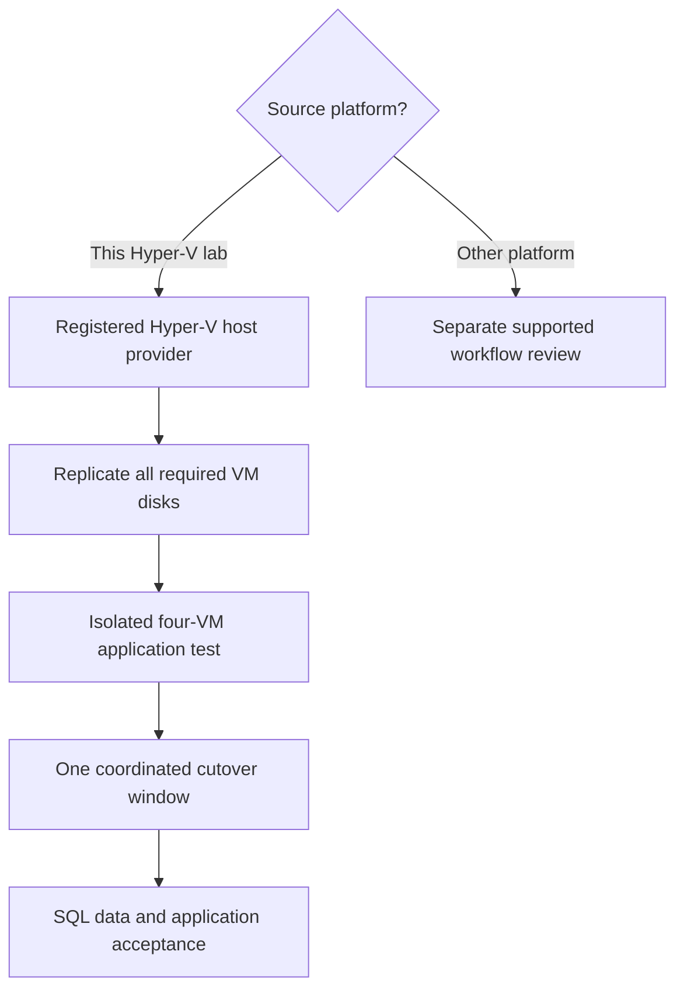
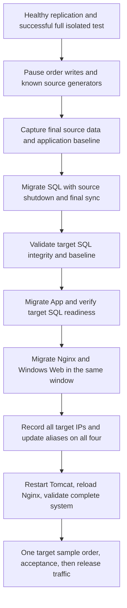

# Module 3: Stateful Workload Migration (SQL/Tomcat)

| **Estimated Time** | 75–90 minutes, plus replication and full-system test time |
|---------------------|---------------|
| **Level**           | Advanced — Cloud Solution Architect |
| **Prerequisites**   | [Module 1: Discovery & Assessment](Module-1-Discovery.md) completed; Hyper-V provider ready or registered in §7 |
| **CAF Phase**       | **Migrate** — Cloud Adoption Framework |

### Learning Objectives — Concepts

By the end of this module, you will understand database consistency, recovery-point selection, dependency-aware testing, coordinated cutover, and stateful rollback. You will replicate SQL and Tomcat, validate all four isolated test VMs, and perform one shared four-VM cutover. Module 2's completed frontend cutover is **not** a prerequisite. All four guests use the **same Hyper-V host replication provider**; SQL statefulness does not change the migration method.

---

## 1. Overview — Replication for Mission-Critical Workloads

### Concepts

When a workload has state — a database with open transactions, a file server with active writes, an application maintaining sessions — the migration plan must account for data freshness and a controlled write boundary. Replication alone does not prove application consistency or guarantee zero data loss.

### How It Works Architecturally

For this lab, the **Azure Site Recovery Provider and Recovery Services agent on HyperVHost** replicate the SQL and Tomcat VM disks to Azure, just as they do for the IIS and Nginx pair. There is **no guest Mobility Service installation and no new replication appliance**. The Module 1 discovery appliance supplies discovery/assessment, not the replication data path.

**The replication pipeline:**

1. **Host registration** — HyperVHost connects to the migration resources prepared from the correct Azure Migrate project and target region.
2. **Initial replication** — The selected VM disks are copied to Azure replication storage.
3. **Ongoing replication** — The host provider sends changed disk data while source workloads run.
4. **Test migration** — Separate copies boot in the isolated test VNet, allowing data and application testing without connecting them to source peers.
5. **Planned cutover** — New writes are paused, the selected source VMs are shut down through the portal's planned migration, final synchronization completes, and the Azure targets are validated.

```text
SQL VM + Tomcat VM (no guest migration agent)
    → HyperVHost provider + Recovery Services agent
    → Azure replica disks
    → Isolated test copies OR final target VMs
```

### RPO/RTO Characteristics

| Metric | Meaning | Implication |
|--------|---------|-------------|
| **RPO** | Acceptable age of recovered data | Review actual recovery-point age and final synchronization; no automatic zero-loss promise |
| **RTO** | Acceptable restoration time | Include shutdown, final sync, boot, SQL checks, alias updates, and full application validation |
| **Initial sync** | First copy of all required disks | Depends on disk size, bandwidth, and ongoing churn |
| **Ongoing overhead** | Work needed to track and transmit changes | Observe the actual host and network rather than assuming a fixed CPU percentage |

### When Stateful Planning Matters

- Databases and applications with transaction logs require a known final write boundary.
- A VM that boots is not necessarily a consistent, current database.
- Recovery objectives must be agreed and measured; neither a workload label nor the replication method guarantees a particular RPO/RTO.
- The appropriate migration method follows the supported source platform. In this Hyper-V lab, statefulness adds validation and coordination, not another appliance or guest migration agent.

**Hands-On — Student Actions**

1. Identify **`OnPrem-SQL`** and **`OnPrem-Linux-App`** in your Module 1 inventory.
2. Record where the business data is stored and which frontends and background generators can reach it.

**Expected Result:** You can explain why the same Hyper-V replication path needs additional stateful validation.

**CSA Why:** Method selection and application-consistency planning answer different questions.

---

## 2. Agentless vs. Agent-Based — Decision Matrix

### Concepts

A CSA compares migration methods by **supported source platform and recovery needs**, not by a rule that every database needs a guest migration agent. The table is conceptual comparison; the student actions in this module remain Hyper-V host replication.

| Criteria | This Lab: Hyper-V Host Replication | A Separate Guest-Agent-Based Source Scenario |
|----------|-----------------------------------|--------------------------------------------|
| **Source software** | Provider and Recovery Services agent on the Hyper-V host | Supported guest migration software and its supported replication infrastructure |
| **Guest footprint** | No guest migration agent on any of the four VMs | Guest software changes need approval |
| **Workload choice** | IIS, Nginx, SQL, and Tomcat use the same path | Source support and requirements determine suitability |
| **Data consistency** | Review recovery points and validate SQL after boot | Still requires application-specific validation |
| **RPO/RTO** | Measured objectives, not guarantees | Also measured objectives, not guarantees |
| **Dependencies** | Test and cut over the whole application together | Dependency coordination remains necessary |
| **Rollback** | Retain sources; reconcile any target writes | Data reconciliation is still required |
| **Workshop action** | Select **Yes, with Hyper-V** | No deployment or installation in this exercise |

> **CSA Decision Rule:** First choose the supported workflow for the actual source platform. Then design the recovery objectives, consistency checks, and application migration group. A stateful workload does not automatically change the Hyper-V source selection.



**Hands-On — Student Actions**

1. In your notes, mark the migration method for **all four VMs** as Hyper-V host-provider replication.
2. Distinguish the two teaching pairs from the single connected application migration group.

**Expected Result:** SQL and Tomcat are planned under Hyper-V, with no alternate guest-agent workflow selected.

**CSA Why:** An explicit source-platform decision prevents unnecessary guest changes.

---

## 3. Stateful Workload Migration Strategy

### Concepts

Before touching the portal, a CSA defines the **stateful migration strategy**. Databases and dependent applications require coordinated cutover; migrating the frontends while their SQL/App dependencies remain unreachable does not restore the service.

### Application-Consistent Recovery: Why It Matters

| Recovery Type | What It Represents | SQL Validation Implication |
|---------------|--------------------|---------------------------|
| **Crash-consistent** | Disk state similar to an unexpected power loss | SQL may perform crash recovery; verify database state, integrity, and data freshness |
| **Application-consistent** | A recovery point coordinated with application quiescence where supported | Still validate committed data and application behavior; do not infer this from a generic health label |
| **Planned final migration** | Writes paused, selected sources shut down, final synchronization completed | Compare the recovered database with the final source baseline before additional writes |

Do not assume every available recovery point is application-consistent. Inspect what the Hyper-V migration service actually offers. RPO/RTO values are objectives, not a guarantee of no downtime or no data loss.

### SQL Server Migration Considerations

| Concern | Strategy |
|---------|----------|
| **Transaction log handling** | Pause new writes and let in-flight work finish before the final source baseline and planned migration |
| **Post-migration integrity** | Run `DBCC CHECKDB` on `ContosoApp`; confirm it is online |
| **Connection strings** | Preserve the private JNDI descriptor; repoint `onprem-sql` to the actual SQL peer address |
| **Database files** | Include every VM disk holding SQL data or logs; do not move data to a temporary disk |
| **Recovery model and backups** | Record the existing recovery model and retain an independent source backup |
| **Data freshness** | Compare captured Customers/Orders counts and recent order IDs/times, not an assumed initial seed count |

### Tomcat / Application Server Considerations

| Concern | Strategy |
|---------|----------|
| **Runtime** | Preserve Ubuntu 24.04, Tomcat 10.1, OpenJDK 17, and the `contoso-orderdesk` systemd service |
| **Database configuration** | Keep protected JNDI credentials intact; do not print or replace them for an address change |
| **Name resolution** | Update the three known lab aliases on all four test/target guests, preserving unrelated hosts entries |
| **JDBC connections** | Restart `contoso-orderdesk` after alias changes to discard the old pool |
| **Proxy upstream** | Test/reload Nginx after repointing `onprem-app`, so its 8080 upstream resolves the new App address |
| **Background traffic** | Stop/disable only known generators while validating and cutting over; leave SQL/Tomcat/Nginx running |

### Application Dependency Map

| Initiator | Dependency | Purpose |
|-----------|------------|---------|
| Windows Web | SQL TCP 1433 | Optional background SQL traffic |
| Windows Web | App TCP 3000 | Optional background HTTP traffic |
| Linux-App | SQL TCP 1433 | Order Desk database reads/writes |
| Linux-App | Nginx TCP 8080 | Optional HTTP traffic generator |
| Nginx | App TCP 3000 | Reverse proxy to the Order Desk |

**Hands-On — Student Actions**

1. Record these five edges in your student notes and identify their matching NSG/guest firewall paths.
2. Plan the isolated test for **all four VMs**, even though this module enables replication only for SQL and App.
3. Plan one final cutover window, with SQL target validation first, App next, then the frontends and complete address repointing.

**Expected Result:** The database baseline, required disks, dependency edges, and shared cutover order are defined.

**CSA Why:** A data-aware dependency plan is more useful than independent VM success indicators.

---

## 4. Prerequisites

### Concepts

| Source VM | OS | Role | Source IP |
|-----------|----|------|-----------|
| `OnPrem-SQL` | Windows Server 2022 | SQL Server 2022 Express, `ContosoApp`, TCP 1433 | `192.168.0.11` |
| `OnPrem-Linux-App` | Ubuntu 24.04 | Tomcat 10.1 / OpenJDK 17 JSP Order Desk, TCP 3000 | `192.168.0.13` |

The same single, nonclustered Windows Server 2022 **Standard_E8s_v7**, Generation 2 **HyperVHost** hosts this pair and the Module 2 pair. The source nested network is `192.168.0.0/24` (host `.1`, discovery appliance `.20`), separate from the source Azure VNet `10.0.0.0/16`.

**Hands-On — Student Actions**

1. Confirm Module 1 discovery and assessment completed in the intended Azure Migrate project.
2. Confirm the SQL and App source VMs are running and you have approved guest access.
3. Confirm provider registration to this project and target region, or complete §7 before replication. **Reuse an existing correct registration.** Module 2 frontend cutover is not required.
4. Confirm the target landing zone and isolated test VNet described in §6. If they do not exist, build them through the linked manual portal steps before use.
5. For Azure copies, use **VM → Run command → RunPowerShellScript** (Windows) or **RunShellScript** (Linux) once the guest agent is ready, or already-approved RDP/SSH access. Each command executes **inside the explicitly selected guest**. A public IP is not assumed, and your workstation need not reach test private addresses.
6. For SQL commands, use the existing local SQL tooling and an authorized Windows identity: the lab's existing Run Command identity where already permitted, or the approved SQL account through RDP/SSMS. Do not grant new permissions or expose SQL passwords to make a check work.

**Expected Result:** The project, sources, management path, and existing SQL access are confirmed without an additional appliance or guest migration software.

**CSA Why:** Prerequisites should enable this source platform's migration, not introduce a different architecture.

---

## 5. Step 1 — Prepare the Stateful Source Workloads

### Concepts

A useful data baseline records **current** application state. Customers/Orders may already contain activity; the original seed counts are not acceptance criteria. Initial replication can run while the source application is active. A repeatable test-data comparison needs a known no-write interval or an explicitly understood recovery-point difference.

### Hands-On — Student Actions

### 5.1 Capture SQL State and Data Baseline

1. Connect to **source `OnPrem-SQL` (`192.168.0.11`)** using approved RDP/SQL access. These are source checks, not commands for the student workstation.
2. In a local PowerShell session with the existing SqlServer tooling and authorized Windows identity, run:

```powershell
Get-Service -Name 'MSSQL$SQLEXPRESS'
Invoke-Sqlcmd -ServerInstance '.\SQLEXPRESS' -TrustServerCertificate -Database ContosoApp -Query @'
SELECT name, state_desc, recovery_model_desc
FROM sys.databases WHERE name = N'ContosoApp';
'@
Invoke-Sqlcmd -ServerInstance '.\SQLEXPRESS' -TrustServerCertificate -Database ContosoApp -Query @'
SELECT (SELECT COUNT_BIG(*) FROM dbo.Customers) AS Customers,
       (SELECT COUNT_BIG(*) FROM dbo.Orders) AS Orders;
'@
Invoke-Sqlcmd -ServerInstance '.\SQLEXPRESS' -TrustServerCertificate -Database ContosoApp -Query @'
SELECT TOP (5) OrderID, CustomerID, ProductName, Quantity, OrderDate
FROM dbo.Orders ORDER BY OrderID DESC;
'@
```

3. Record the timestamp, counts, and recent order IDs/times in your student notes. In SSMS, the same SQL can be run in a query window connected to `ContosoApp` with the existing authorized identity.
4. Using the existing SQL backup procedure or **SSMS → Databases → ContosoApp → Tasks → Back Up**, take a full source database backup to the approved backup location, verify success, and retain its location in your notes. A VM replica or checkpoint is not the independent SQL backup.
5. For a repeatable isolated test, agree a short no-write period before choosing its recovery point: pause manual order entry and stop/disable the known source generators using §11.2's guest commands. Recapture this baseline, wait for a healthy recovery point after it, and keep source writes paused until the test's initial data comparison is done. The source VMs and application services remain running. If you instead test an older point while source activity continues, record the time difference and explain any data difference; do not compare blindly to a later live count.

### 5.2 Confirm the Existing Application Runtime

1. Through approved SSH to **source `OnPrem-Linux-App` (`192.168.0.13`)**, run:

```bash
java -version
systemctl is-active contoso-orderdesk
curl --fail --silent --show-error http://localhost:3000/api/health
curl --fail --silent --show-error http://localhost:3000/api/ready
curl --fail --silent --show-error http://localhost:3000/api/orders
```

2. Confirm Java 17, the existing Tomcat-backed service, healthy runtime, SQL readiness, and current Orders/Customers data. Do not display the protected JNDI descriptor or copy credentials into your notes.
3. Record all source disks needed for OS, SQL data/logs, and application files. Preserve the existing runtime rather than reinstalling or replacing it.

**Expected Result:** The source SQL/App state and current data baseline are recorded, an independent SQL backup is available, and the preserved runtime is understood.

**CSA Why:** You cannot validate recovered data against a baseline you never captured.

---

## 6. Step 2 — Confirm Target Compute, Networks, and Dependencies

### Concepts

Target planning is shared across the whole application. The target region must differ from the source HyperVHost VM's actual region in this lab. **East US → West US 2 is only an example**; neither eligibility, quota headroom, nor an assessment recommendation guarantees allocation.

| Role / Exact Final Target Name | Eligible Sizes | vCPU / Minimum RAM | Selection Order |
|--------------------------------|--------------|------------|-------------------------|
| IIS — `OnPrem-Web` | B2 or D2 | 2 / 4 GiB | Ascending regional Windows PAYG compute cost |
| SQL — `OnPrem-SQL` | B2 or D2 | 2 / 8 GiB | Ascending regional Windows PAYG compute cost |
| Nginx — `OnPrem-Linux-Web` | B2 or D2 | 2 / 2 GiB | Ascending regional Linux PAYG compute cost |
| Tomcat — `OnPrem-Linux-App` | B2 or D2 | 2 / 2 GiB | Ascending regional Linux PAYG compute cost |

| Network | Address Space | Subnet | Use |
|---------|---------------|--------|-----|
| Source Azure VNet | `10.0.0.0/16` | Existing lab design | Hosts the nested source environment |
| `rg-ces-target-01-vnet` | `10.1.0.0/16` | `default`, `10.1.0.0/24` | Final targets |
| `vnet-migrate-test` | `10.2.0.0/16` | `default`, `10.2.0.0/24` | Isolated test copies only |

### Hands-On — Student Actions

### 6.1 Confirm Region, Quota, and Compute Choice

1. Read **Virtual machines → HyperVHost → Location** and confirm the chosen target is a different actual region.
2. In **Subscriptions → Usage + quotas**, check target-region total vCPU quota, VM-family quota, and VM-count allowance. Confirm eligibility in the VM size selector.
3. In the portal, filter current subscription-eligible B-series v2 and supported D-series v4/v5 B2/D2 candidates using Module 2 Section 4.1's RAM and eligibility checks. Review known OS-specific regional USD/hour pay-as-you-go compute prices in ascending order, then choose and record an eligible size for each role yourself, not an automatic cheapest choice. Missing prices mean incomplete cost ranking: record **Price unavailable** separately and choose explicitly only with verified eligibility and combined quota, without claiming cheapest. Missing SKU/eligibility information or unknown quota is not approval. One complete set totals 8 vCPUs; full test/target overlap totals 16. Check aggregate quota for all four selected sizes by actual family and count existing allocations without double-counting them.
4. Review assessment recommendations without assuming they override the chosen lab plan. Review current portal pricing for selected VM/disk sizes; no fixed cost or capacity promise applies.
5. Keep **Azure Hybrid Benefit / existing Windows Server license rights: No** unless eligible rights have been confirmed.

### 6.2 Confirm the Landing Zone and Test Isolation

1. In **Resource groups → `rg-ces-target-01`**, confirm the target VNet/subnet and associated NSG are in the selected target region. If missing, perform [Module 2 §4.2's manual creation steps](Module-2-Agentless-Migration.md#42-build-the-target-landing-zone).
2. Confirm **`vnet-migrate-test`** and its test NSG exist in the same region. If missing, perform [Module 2 §8.1's manual creation/isolation steps](Module-2-Agentless-Migration.md#81-build-the-isolated-test-network) before booting any test copy.
3. Inspect test **Peerings**, DNS servers, subnet routes, and NSG rules. There must be no source/live-target peering, VPN/route path, or source DNS reachability. Confirm test outbound denies cover `192.168.0.0/24`, `10.0.0.0/16`, and `10.1.0.0/16` ahead of default rules.
4. Verify approved host/guest outbound connectivity against the lab network plan. Do not assume Azure default outbound access or that a NAT gateway exists. Keep the approved platform/management path available without reconnecting test and source networks.
5. Review the five dependency edges from §3 in both the test and final networks, plus local IIS/Nginx 80, Nginx proxy 8080, Tomcat 3000, and SQL 1433 listeners. Restrict application and SQL access to approved private peers; do not expose the demo to the Internet.

**Expected Result:** The selected compute plan, target networks, isolation, outbound access, and required dependency paths are ready for this application's test and final migration.

**CSA Why:** A valid VM size and a running database do not compensate for the wrong network or region.

---

## 7. Step 3 — Confirm Hyper-V Provider Registration

### Concepts

The registration belongs to **HyperVHost**, not to each guest. Reuse the provider registered in Module 2 when it matches this project and target region. The discovery appliance's registration is not proof that the replication host is registered.

### Hands-On — Student Actions

### 7.1 Reuse a Correct Existing Registration

1. Open **Azure Migrate → All projects → your Module 1 project**. Confirm its subscription.
2. Open **Migration and modernization / Server Migration → Prepare migration / Discover** and select **Yes, with Hyper-V**.
3. Inspect the registered Hyper-V hosts and selected target region. If **HyperVHost** is connected to this project and region, reuse it. Confirm `OnPrem-SQL` and `OnPrem-Linux-App` are available as source VMs.

### 7.2 Register the Host if Not Already Ready

1. In that project's Hyper-V preparation flow, select the region confirmed in §6. Select **Create resources** if required and wait for migration preparation to complete. Do not create a separate recovery vault, policy, or disaster-recovery configuration.
2. Download the **Azure Site Recovery Provider** installer and the **registration key from this Azure Migrate project**. Keep the key private.
3. Connect to **HyperVHost** using approved host management access. Run the installer **as Administrator**, complete the **Azure Site Recovery Provider** and **Azure Recovery Services agent** installation, and use the approved outbound/proxy settings.
4. In the registration wizard, select this project's registration key and complete registration to its prepared migration resources and selected target region.
5. Return to the portal, refresh the host list, and complete **Finalize registration / Finalize discovery** if offered. Confirm the connected host and exact source VM names before replication.

**Expected Result:** A single correct HyperVHost registration is reused or completed; both stateful source VMs are available without changing their guest migration software or deploying another appliance.

**CSA Why:** Registration confirms the replication source and destination association before disk replication is enabled.

---

## 8. Step 4 — Configure Replication

### Concepts

SQL and Tomcat remain on the Hyper-V host-provider path. Select all VM disks needed for the existing SQL database and Java application; replication does not rebuild the application for you.

### Hands-On — Student Actions

### 8.1 Start the Replication Wizard

1. In the project's migration tool, select **Replicate**.
2. Select **Yes, with Hyper-V**, then the registered **HyperVHost**. Select **Next**.

### 8.2 Select Virtual Machines

1. Select exactly **`OnPrem-SQL`** and **`OnPrem-Linux-App`**, confirming their source host identities.
2. If importing assessment settings, review them against the selected lab compute/network plan; otherwise configure manually. Select **Next**.

### 8.3 Configure Target Settings

1. Select the lab subscription and **`rg-ces-target-01`**.
2. Confirm the project's prepared target region and select its offered replication storage/cache account, creating it through the wizard only if required.
3. Choose final target **`rg-ces-target-01-vnet` → `default` (`10.1.0.0/24`)**. The isolated `10.2` network is selected later for test migration, not as the final target.

### 8.4 Configure Compute Settings

1. For **SQL**, set target name **`OnPrem-SQL`**, OS **Windows**, and your recorded eligible **B2 or D2 size (2 vCPU, at least 8 GiB RAM)**.
2. For **App**, set target name **`OnPrem-Linux-App`**, OS **Linux**, and your recorded eligible **B2 or D2 size (2 vCPU, at least 2 GiB RAM)**.
3. Confirm both choices match the recorded plan from Section 6.1 and remain eligible in the portal.
4. Identify each VM's correct **OS/boot disk**, review supported target settings for its source generation, and keep Windows licensing benefit **No** unless rights are confirmed.

### 8.5 Configure Disk Settings

1. Select **all required source VM disks** for both machines, including SQL data/log disks and App files as well as the OS disks.
2. Choose the reviewed target disk types; use **Standard SSD** for the lab unless an assessment-driven alternative has been agreed. Do not move SQL files or logs to an ephemeral disk as part of this exercise.

### 8.6 Review and Start Replication

1. Review source host/VMs, exact target names, region, resource group, VNet/subnet, OS types, sizes, boot disks, and every required selected disk.
2. Select **Replicate** and open the resulting jobs.
3. If the Module 2 frontends are not yet replicating, perform its §§5–7 now. That does not require frontend cutover.

**Expected Result:** SQL and App replication setup jobs are submitted with the reviewed settings. A submitted job is not evidence that the initial sync has completed.

**CSA Why:** Correct disk inclusion is essential to preserve the existing database and application runtime.

---

## 9. Step 5 — Monitor Replication

### Concepts

Replication readiness comes from the Hyper-V migration details in the portal, not from a generic protection label or a successful job submission.

| Observation | Meaning | Student Action |
|-------------|---------|----------------|
| Setup job in progress | Host/VM configuration still being applied | Review job progress and reported errors |
| Initial synchronization in progress | Full disk copy not finished | Wait and observe progress |
| Initial sync complete, health good, recent recovery point | Candidate for test migration | Review timestamp and portal test readiness |
| Error, warning, degraded health, stale/missing point | Readiness not established | Review the reported issue before proceeding |

### Hands-On — Student Actions

### 9.1 View Replication Status

1. Open **Azure Migrate project → Migration and modernization → Replicating servers**.
2. Select **`OnPrem-SQL`** and **`OnPrem-Linux-App`** and inspect their individual details and related **Jobs**.

### 9.2 Review Initial Synchronization

1. Wait for the initial copy of every selected required disk to finish.
2. Review failed or stalled jobs in the portal; do not proceed solely because the enable-replication request was accepted.

### 9.3 Review Health and Recovery Points

1. Confirm healthy replication and inspect the latest available recovery-point timestamp for each VM.
2. Compare recovery-point age to the objective recorded in your notes. For the repeatable baseline test, use a healthy point after the no-write source baseline was captured.
3. Review the test-migration readiness shown for each source record. Resolve reported readiness blockers before starting a separate test migration.

### 9.4 Confirm the Full Test Group Is Ready

1. Confirm **all four** source VMs, including the Module 2 pair, have completed initial sync and are ready for the intended isolated test.
2. Record the reviewed health/recovery-point information in your student notes.

**Expected Result:** SQL and App, together with the frontend pair, have completed initial sync, healthy replication, and reviewed recovery points for the full isolated test. Application consistency and cutover acceptance remain to be demonstrated.

**CSA Why:** The slowest or least-ready dependency determines the application's test readiness.

---

## 10. Step 6 — Test Migration

### Concepts

A stateful test validates data integrity and the entire application, not just successful boot. Before test copies boot, the test network must be isolated from source/live networks and source DNS. Inherited generators may auto-start against old aliases; network isolation protects the source before you can stop them inside each test guest.

### Hands-On — Student Actions

### 10.1 Test Migrate OnPrem-SQL and Complete the Four-VM Test Set

1. Reconfirm the **pre-boot isolation** in §6.2. Use the same **`vnet-migrate-test` → `default` (`10.2.0.0/24`)** for every test copy.
2. In **Replicating servers**, select **`OnPrem-SQL` → Test migration**, review the offered recovery point against your baseline, select the test network, and submit. Wait for its job to complete.
3. Reuse **`OnPrem-Web-test`** and **`OnPrem-Linux-Web-test`** retained from Module 2. If they were cleaned up, recreate **those two test migrations only** through Module 2 §8. Do not substitute their unsuffixed live VMs.
4. In each Azure VM's **Networking → NIC → IP configurations**, record its **actual test private IP**, exact name, and resource ID in a four-role map in your notes. Do not infer Azure addresses from the source `.10/.11/.12/.13` endings.
5. Use each test VM's portal Run Command when its agent is ready, or existing approved RDP/SSH access. Private test addresses are not assumed reachable from your workstation.
6. Before any functional traffic or test writes, disable/stop only the known inherited generators in each applicable test copy:

**Windows — run inside each Windows test VM (`OnPrem-Web-test`, `OnPrem-SQL-test`):**

```powershell
$task = Get-ScheduledTask -TaskName 'LabOrderDeskTraffic' -ErrorAction SilentlyContinue
if ($task) {
    Disable-ScheduledTask -TaskName 'LabOrderDeskTraffic' | Out-Null
    Stop-ScheduledTask -TaskName 'LabOrderDeskTraffic'
}
```

**Linux — run inside each Linux test VM, including App immediately after §10.3 creates it:**

```bash
if systemctl cat contoso-orderdesk-traffic.service >/dev/null 2>&1; then
  sudo systemctl disable --now contoso-orderdesk-traffic.service
fi
```

Leave **SQL, `contoso-orderdesk` (Tomcat), and Nginx running**. Do not disable broad groups of services or stop the application just to stop a generator.

### 10.2 Validate SQL Server on the Test VM

1. Open exactly **`OnPrem-SQL-test`** and confirm its test VNet/resource ID.
2. Run the following **inside that test SQL guest**, using its portal Windows Run Command where already authorized for SQL, or local PowerShell through approved RDP with the existing SQL-authorized account:

```powershell
Get-Service -Name 'MSSQL$SQLEXPRESS'
Get-NetTCPConnection -LocalPort 1433 -State Listen | Select-Object LocalAddress, LocalPort
Invoke-Sqlcmd -ServerInstance '.\SQLEXPRESS' -TrustServerCertificate -Database ContosoApp -Query @'
SELECT name, state_desc, recovery_model_desc
FROM sys.databases WHERE name = N'ContosoApp';
'@
Invoke-Sqlcmd -ServerInstance '.\SQLEXPRESS' -TrustServerCertificate -Database ContosoApp -Query "DBCC CHECKDB (N'ContosoApp') WITH NO_INFOMSGS;"
Invoke-Sqlcmd -ServerInstance '.\SQLEXPRESS' -TrustServerCertificate -Database ContosoApp -Query @'
SELECT (SELECT COUNT_BIG(*) FROM dbo.Customers) AS Customers,
       (SELECT COUNT_BIG(*) FROM dbo.Orders) AS Orders;
'@
Invoke-Sqlcmd -ServerInstance '.\SQLEXPRESS' -TrustServerCertificate -Database ContosoApp -Query @'
SELECT TOP (5) OrderID, CustomerID, ProductName, Quantity, OrderDate
FROM dbo.Orders ORDER BY OrderID DESC;
'@
```

3. Confirm `ContosoApp` is online, integrity checks report no errors, and its captured counts/recent order IDs match the baseline appropriate to the selected recovery point **before creating any test order**. If source activity continued after that point, distinguish the later source changes from missing recovered data.
4. Do not assume Customers/Orders still contain their initial seed counts. Do not seed, recreate, or reset the recovered database to make a check pass.

**Expected Result:** The test SQL instance listens on 1433, `ContosoApp` is online and intact, and recovered data is accounted for against the captured baseline.

### 10.3 Test Migrate OnPrem-Linux-App

1. Select **`OnPrem-Linux-App` → Test migration** in the same project.
2. Choose **the same `vnet-migrate-test` → `default`**, review the recovery point, submit, and wait for the completed job.
3. Open exactly **`OnPrem-Linux-App-test`**, confirm its resource ID and test network, and add its actual private IP to the four-role map.
4. Through its portal Linux Run Command or approved SSH, disable/stop its known traffic generator using §10.1. Do not start order writes yet.

### 10.4 Repoint the Test Peers Before Functional Traffic

1. Confirm all four `-test` VMs are present in the **same isolated** test VNet. Complete the actual-IP role map before updating aliases:

| Role | Exact Test VM | Alias to Use on All Four Guests |
|------|---------------|--------------------------------|
| Windows frontend | `OnPrem-Web-test` | Record its private IP for management/static checks |
| SQL | `OnPrem-SQL-test` | `onprem-sql` → actual SQL **test** private IP |
| App | `OnPrem-Linux-App-test` | `onprem-app` → actual App **test** private IP |
| Nginx | `OnPrem-Linux-Web-test` | `onprem-nginx` → actual Nginx **test** private IP |

2. Update only these **three managed aliases on all four test guests**, preserving unrelated hostnames, comments, and entries. Never map a test guest back to a source SQL/App/Nginx address.
3. With approved **RDP**, on each Windows test guest open **Notepad as Administrator**, then open `C:\Windows\System32\drivers\etc\hosts` (select All files). Remove only the three managed alias tokens from old mappings, retain any other aliases on those lines, and add one mapping per managed alias using your actual test peer IPs. Save the file without adding `.txt`.
4. If using **portal Windows Run Command instead**, paste this targeted update into **each Windows test VM's RunPowerShellScript** after replacing all three placeholders. It changes only the named aliases and keeps unrelated entries/comments:

```powershell
$map = @{
    'onprem-sql'   = '<actual-SQL-test-private-IP>'
    'onprem-app'   = '<actual-App-test-private-IP>'
    'onprem-nginx' = '<actual-Nginx-test-private-IP>'
}
foreach ($ip in $map.Values) { [void][Net.IPAddress]::Parse($ip) }
$path = "$env:windir\System32\drivers\etc\hosts"
$lines = foreach ($line in [IO.File]::ReadAllLines($path)) {
    $parts = $line -split '#', 2
    $fields = @($parts[0].Trim() -split '\s+' | Where-Object { $_ })
    if ($fields.Count -gt 1 -and @($fields[1..($fields.Count-1)] | Where-Object { $map.ContainsKey($_) }).Count) {
        $keep = @($fields[1..($fields.Count-1)] | Where-Object { -not $map.ContainsKey($_) })
        $comment = if ($parts.Count -eq 2) { '#' + $parts[1] } else { '' }
        if ($keep.Count) { $fields[0] + "`t" + ($keep -join ' ') + ' ' + $comment }
        elseif ($comment) { $comment }
    } else { $line }
}
$lines = @($lines) + @($map.Keys | Sort-Object | ForEach-Object { $map[$_] + "`t" + $_ })
[IO.File]::WriteAllLines($path, [string[]]$lines, [Text.UTF8Encoding]::new($false))
Clear-DnsClientCache
```

5. With approved **SSH**, use `sudoedit /etc/hosts` on each Linux test guest, applying the same three-alias-only change and preserving unrelated entries. Alternatively, use the following **RunShellScript** block on each Linux test VM (also works through SSH with sudo) after substituting all three actual peer IPs:

```bash
sudo python3 - <<'PY'
from pathlib import Path
from ipaddress import ip_address
mapping = {
    'onprem-sql': '<actual-SQL-test-private-IP>',
    'onprem-app': '<actual-App-test-private-IP>',
    'onprem-nginx': '<actual-Nginx-test-private-IP>',
}
for value in mapping.values():
    assert ip_address(value).version == 4
path = Path('/etc/hosts')
result = []
for line in path.read_text().splitlines():
    body, sep, comment = line.partition('#')
    fields = body.split()
    if len(fields) > 1 and any(name.lower() in mapping for name in fields[1:]):
        kept = [name for name in fields[1:] if name.lower() not in mapping]
        if kept:
            result.append(fields[0] + '\t' + ' '.join(kept) + (' #' + comment if sep else ''))
        elif sep:
            result.append('#' + comment)
    else:
        result.append(line)
result += [value + '\t' + name for name, value in mapping.items()]
path.write_text('\n'.join(result) + '\n')
PY
```

6. Check resolution locally: on Windows run `[Net.Dns]::GetHostAddresses('onprem-sql')`, then repeat for `onprem-app` and `onprem-nginx`; on Linux run `getent hosts onprem-sql onprem-app onprem-nginx`. Compare to the **test** role map.
7. **Inside `OnPrem-Linux-App-test`**, run `sudo systemctl restart contoso-orderdesk` to discard its old JDBC pool. Keep the traffic service disabled. Do not display or edit the protected JNDI credentials; the SQL alias change is sufficient.
8. **Inside `OnPrem-Linux-Web-test`**, run `sudo nginx -t && sudo systemctl reload nginx`. Its existing 8080 proxy uses `onprem-app`; reloading resolves the updated upstream. Leave the static port-80 site unchanged.

### 10.5 Validate the Full Four-VM Application

1. **Inside Windows Web test**, use RunPowerShellScript or approved RDP PowerShell:

```powershell
Get-Service W3SVC
(Invoke-WebRequest http://localhost:80 -UseBasicParsing).StatusCode
Test-NetConnection -ComputerName onprem-sql -Port 1433 -InformationLevel Quiet
Test-NetConnection -ComputerName onprem-app -Port 3000 -InformationLevel Quiet
```

   Expect running IIS, HTTP 200, and `True` for **Web → SQL:1433** and **Web → App:3000**. Recheck the expected Windows Web static content as in Module 2.

2. **Inside Linux-App test**, use RunShellScript or approved SSH:

```bash
java -version
systemctl is-active contoso-orderdesk
curl --fail --silent --show-error http://localhost:3000/api/health
curl --fail --silent --show-error http://localhost:3000/api/ready
curl --fail --silent --show-error http://localhost:3000/api/orders
curl --fail --silent --show-error http://onprem-nginx:8080/api/ready
```

   Expect Java 17 and the preserved Tomcat 10.1 service. `/api/health` reports live runtime (`healthy`, Contoso Order Desk, source server identity, timestamp); **`/api/ready` proves SQL reachability**. Orders lists existing data and counts. The proxy request checks **App → Nginx:8080 → App:3000 → SQL:1433**. Health alone is not SQL readiness.

3. **Inside Linux-Web test**, run:

```bash
systemctl is-active nginx
curl --fail --silent --show-error http://localhost:80 | grep -F 'TD SYNNEX | Linux Web'
curl --fail --silent --show-error http://onprem-app:3000/api/health
curl --fail --silent --show-error http://localhost:8080/api/ready
```

   Expect the unchanged static port-80 page, App health, and SQL-ready proxy on 8080. This checks **Nginx → App:3000** without an all-to-all port scan.

4. With generators still disabled, compare pre-write SQL counts/recent orders from §10.2 and the API's `count` / `customerCount`. Open `http://localhost:3000` through a browser **inside the App guest if available**, or view its HTML with `curl` there; it should identify **Contoso Order Desk**. No public endpoint is needed.
5. Create **one** manual sample order only after those comparisons. From **Linux-App-test**, take an existing `customerId` from the preceding `/api/orders` response and replace the placeholder below. The POST goes through Nginx, creates a real row, and returns the created `orderId`:

```bash
curl --fail --silent --show-error --include http://onprem-nginx:8080/api/orders \
  --data-urlencode 'customerId=<existing-customer-id>' \
  --data-urlencode 'productName=Migration test sample' \
  --data-urlencode 'quantity=1' \
  --data-urlencode 'unitPrice=9.99'
curl --fail --silent --show-error http://onprem-nginx:8080/api/orders
```

6. Expect HTTP **201**, status `created`, the returned order ID in the readback, Orders increased by **one**, and Customers unchanged while generators remain disabled. Confirm that new order/count locally in test SQL using the §10.2 query. Do not repeatedly POST while checking a result; every successful POST adds another order.
7. Record SQL integrity, the baseline comparison, five dependency edges, and the single sample-order readback in your student notes. These test writes belong only to disposable test SQL, not the source or final target.

**Expected Result:** All four isolated copies work together with correct test-only aliases. SQL data is validated before a single deliberate test write; direct runtime health, SQL readiness, the Nginx proxy, and create/readback all pass.

### 10.6 Clean Up All Four Test Migrations

1. After recording the successful full test, open **Azure Migrate → Replicating servers**.
2. For **each of the four source records**, select **Clean up test migration**, confirm testing is complete, review the test resources, and select **Clean up test**.
3. Check exact names and **resource IDs** before deleting. Remove only that job's **`-test` copies and associated test resources**, never unsuffixed live targets, source originals, or an entire shared resource group.
4. Confirm test cleanup completes and continuing source replication remains healthy. Recheck final target settings before cutover.
5. If you temporarily paused source writes for the baseline and the final window is later, only resume the previously active known source generators after source aliases/readiness are confirmed. Record that source data can change again; capture a **new final baseline** in §11.2. Otherwise keep writes paused into the agreed window.

**Expected Result:** All four test copies are cleaned up through the portal after a recorded full application pass; source replication continues for the final window.

**CSA Why:** A successful isolated application test gives evidence without risking source writes; controlled cleanup prevents test/live confusion.

---

## 11. Step 7 — Cutover for Stateful Workloads

### Concepts

Cutover is **one coordinated four-VM operation**, not a frontend migration followed indefinitely later by its database. Portal migration jobs may not offer a boot-order control. Sequence the **per-VM migrations**, wait for each dependency's required validation, and keep all generators and manual order entry stopped until the full target system is accepted.

### 11.1 Cutover Sequence for the Application



### Hands-On — Student Actions

### 11.2 Pre-Migration Checklist and Final Write Boundary

1. Confirm the full four-VM isolated test passed, all four test migrations were cleaned up, and all four source records have healthy replication and acceptable recovery points.
2. Confirm the independent source SQL backup and rollback criteria. Notify users of the shared window; stop new manual order entry through both the direct App and proxy paths. Do not admit other clients during validation.
3. **Inside each source Windows guest** with the known task (normally Windows Web), through approved guest PowerShell, disable and stop only the generator:

```powershell
$task = Get-ScheduledTask -TaskName 'LabOrderDeskTraffic' -ErrorAction SilentlyContinue
if ($task) {
    Disable-ScheduledTask -TaskName 'LabOrderDeskTraffic' | Out-Null
    Stop-ScheduledTask -TaskName 'LabOrderDeskTraffic'
}
```

4. **Inside each source Linux guest** with the known traffic unit (normally App), through approved SSH, run:

```bash
if systemctl cat contoso-orderdesk-traffic.service >/dev/null 2>&1; then
  sudo systemctl disable --now contoso-orderdesk-traffic.service
fi
```

5. Keep **SQL, Tomcat, and Nginx running** while writes drain. Confirm the known tasks/services are disabled/stopped and manual clients are no longer creating orders. These commands are not a general service shutdown.
6. After in-flight writes finish, rerun §5.1's SQL query **on source SQL** and record the **final source** timestamp, counts, and recent orders, plus application readiness. Retain or refresh the independent backup according to the agreed procedure. This is the baseline for final target comparison, not the earlier disposable test state.
7. Confirm final target NSG/guest firewall paths for the five edges and approved management access. Do not introduce a new public endpoint. If an existing client DNS record is used, plan its update within this window.

### 11.3 Migrate SQL First

1. In **Azure Migrate → Replicating servers**, select exactly **`OnPrem-SQL` → Migrate**.
2. Review the final mapping: **`OnPrem-SQL`**, target region, `rg-ces-target-01`, final `10.1` VNet/subnet, chosen SQL size, and all required disks.
3. Select **Shut down the source VM before migration: Yes**, review, then **Migrate**. Let the planned migration perform source shutdown and final synchronization; do not choose an option that bypasses the final source write boundary.
4. In **Jobs**, wait for successful completion. Verify the mapped source SQL VM is shut down on HyperVHost and the unsuffixed target **`OnPrem-SQL`** is running in the target group.

### 11.4 Validate Target SQL Before Dependent Migration

1. Open target **`OnPrem-SQL`**, confirm its resource ID, region, selected size, OS, and disks. Record its **actual `10.1` private IP** from its NIC; do not reuse the test IP.
2. Use portal Windows Run Command with existing SQL permission, or approved RDP/SSMS as in §10.2. Run the SQL service/listener and integrity/data query **on this target**.
3. Before any new target writes, require `ContosoApp` online, no `DBCC CHECKDB` errors, and counts/recent orders matching the **final source baseline** from §11.2. Keep order entry and generators stopped. If not accounted for, do not proceed with acceptance or dependent traffic.

### 11.5 Migrate and Stage the App

1. Select exactly **`OnPrem-Linux-App` → Migrate**, review its final target mapping and disks, and select **Shut down the source VM before migration: Yes**. Submit and wait for successful completion.
2. Confirm the source App is shut down and target **`OnPrem-Linux-App`** is running with Ubuntu 24.04, the selected size, and required disks. Record its actual target private IP.
3. Through target App **RunShellScript** or approved SSH, confirm the known traffic unit remains disabled/stopped. Check `java -version` and `systemctl is-active contoso-orderdesk`.
4. Stage App-to-SQL resolution before dependent frontend work: use the §10.4 Linux alias-update block **on target App**, with its `mapping` dictionary containing **only `onprem-sql` set to the actual target SQL IP** for this intermediate step. Alternatively, through approved SSH use `sudoedit /etc/hosts` to change only that alias, preserving all other entries. No SQL credential change is needed.
5. Restart `contoso-orderdesk`, then check **target App** localhost `/api/health` and `/api/ready`. Require SQL readiness before moving on. The generator stays disabled; do not use the still-unrepointed proxy yet.

### 11.6 Migrate Frontends in This Same Window

1. Perform [Module 2 §9.3–§9.5](Module-2-Agentless-Migration.md#93-execute-migration--onprem-web-shared-window-only) for **`OnPrem-Web`** and **`OnPrem-Linux-Web`** now. For each, choose planned **source shutdown: Yes**, confirm the actual mapping, and wait for its completed migration job.
2. Verify all four source VMs are shut down and retained, and all four unsuffixed targets are running in the selected target group/network.
3. Record each target VM's actual NIC private IP, name, and resource ID. Inspect Windows/Linux frontend static pages locally using Module 2 §10. Leave generators and manual order entry stopped.

### 11.7 Repoint All Final Target Dependencies

1. With all four targets created, repeat §10.4's three-alias update **on all four unsuffixed target guests**, substituting the actual **final target** SQL/App/Nginx private IPs for every placeholder. This replaces the intermediate App SQL mapping as well. Test `10.2` and source `192.168.0.x` addresses must not remain as these dependency aliases.
2. Use the same viable guest-access methods: portal Run Command, or approved RDP with elevated Notepad / SSH with `sudoedit`. Preserve unrelated hosts entries/comments and keep the protected JNDI descriptor unchanged.
3. Check local resolution on each target against the final target role map.
4. On target **Linux-App**, run `sudo systemctl restart contoso-orderdesk` to discard any old JDBC pool.
5. On target **Linux-Web**, run `sudo nginx -t && sudo systemctl reload nginx` to resolve its updated upstream. Do not change the port-80 static site.

### 11.8 Validate End-to-End and Accept the Migration

1. Repeat §10.5's core checks **on the four final target guests**, using their unsuffixed names and final IP map. Confirm IIS/Nginx static pages, SQL integrity/baseline, the five dependency edges, App health, SQL readiness, existing orders, and the 8080 proxy.
2. Compare pre-write target SQL/API counts to the final source baseline first. Then deliberately create/read back **one target sample order**, using the same POST procedure with a distinguishable product name such as `Migration target sample`. The earlier test order was disposable and is not part of the final source baseline.
3. Confirm HTTP 201, the returned ID in readback, Orders increased by one, and Customers unchanged while generators/manual clients remain stopped. Record acceptance and observed interruption in your student notes.
4. Only after acceptance, restore the approved user/client route to this target environment and end the maintenance window. If an existing DNS/FQDN is used, update and validate it from an approved client; private/localhost checks do not require public DNS.
5. Leave optional generators disabled unless deliberately needed. If resuming a generator that was previously active, use the ordinary guest task/service controls only after final aliases and readiness pass; do not activate traffic on a source or test copy.
6. Keep source originals shut down through the agreed rollback window. Ongoing backup, monitoring, and optimization are separate [Module 5](Module-5-Post-Migration.md) work.

**Expected Result:** All four final targets serve one validated application in the target network. SQL matches the final source baseline before the deliberate target write; all source copies remain shut down and retained, with no competing writable system.

**CSA Why:** The shared write boundary, dependency ordering, and explicit acceptance turn VM migrations into a controlled service migration.

---

## 12. Migration at Scale — CSA Guidance

### Concepts

This section addresses what changes when you move from four VMs to hundreds. It does not add infrastructure to this lab.

### Migration Waves

Organize migrations into waves, but keep tightly coupled dependencies in the same coordinated cutover group.

| Wave | Example Scope | Criteria |
|------|---------------|----------|
| **Wave 0 — Pilot** | Small representative group | Low-risk, well-understood dependencies and recovery procedures |
| **Wave 1 — Quick Wins** | Independent applications | Proven runbook, clear ownership, limited external dependencies |
| **Wave 2 — Stateful Groups** | Database and dependent application tiers together | Tested consistency, write pause, and data-aware rollback |
| **Wave 3 — Complex** | Remaining dependency groups | Resolve constraints before scheduling the window |

### Bandwidth Planning

Estimate the sustained transfer rate from measured churn, then allow for initial replication, protocol overhead, contention, and safety margin:

```text
Average changed-data rate (bytes/second)
    = Total measured changed bytes per day / 86,400

For 100 VMs with 10 GB/day each:
    1,000 GB/day must be replicated, before overhead and initial-copy demand.
```

Observed lag and recovery-point age matter more than theoretical line speed. Review host-provider throughput, source load, and network capacity; adding an unrelated replication appliance is not a remedy for this lab.

### Network Path Selection

| Path | Characteristics | Planning Consideration |
|------|-----------------|------------------------|
| **Approved Internet path** | Variable bandwidth/latency | Validate required connectivity and effective sustained throughput |
| **VPN / private connectivity** | Depends on the actual design | Do not accidentally reconnect isolated test and source networks |
| **ExpressRoute** | Dedicated connectivity option | Evaluate business requirements and measured demand, not a fixed VM-count rule |

**Hands-On — Student Actions**

1. In your student notes, estimate a larger dependency group's daily churn and required sustained rate.
2. Identify which observations from this lab would affect its wave size, window, and rollback allowance. No new network service or server is deployed here.

**Expected Result:** You can scale the planning model without splitting a connected application into incompatible cutover waves.

**CSA Why:** Wave boundaries should reduce risk while preserving application dependencies.

---

## 13. Rollback Strategy for Stateful Workloads

### Concepts

Rollback is more complex once Azure has accepted new transactions. You cannot simply boot an older source SQL VM and silently discard target writes. Even the deliberate final target sample order is a target write that must be considered.

| Trigger | Example Threshold to Agree Before Cutover | Action |
|---------|------------------------------------------|--------|
| Database corruption | Any integrity-check error | Stop writes; preserve evidence and assess recovery |
| Application errors | Sustained failures beyond agreed tolerance | Hold acceptance and evaluate rollback |
| Performance degradation | Unacceptable increase over captured baseline | Compare repair time with rollback allowance |
| Data integrity issues | Missing/incorrect committed data | Do not reopen either environment before reconciliation |
| Dependency failure | Required SQL/App/proxy edge unavailable | Keep traffic paused until resolved or rolled back |

### Hands-On — Student Actions

### 13.1 Decide Whether Target Writes Occurred

1. Stop new order entry and disable/stop the known Azure-side generators using the ordinary guest controls from §11.2. Preserve target VM/database state; do not delete targets to simplify rollback.
2. Compare the final source baseline with target order IDs/counts and the student action log. Determine whether the sample order or any other target transactions occurred.
3. Keep only one environment writable. Record the rollback decision and data owner approval.

### 13.2 Restore Service Without Losing New Data

1. **If no target writes occurred**, keep Azure clients/generators stopped, then use **Hyper-V Manager on HyperVHost** to start source SQL, validate it, start App, then the frontends. Confirm source aliases and original client routing from your recorded source map before admitting traffic.
2. **If target writes occurred**, first agree and complete the application-specific reconciliation or restore plan. Preserve a target backup/export, account for new transactions, and verify the chosen recovery destination contains the accepted business data. The supported action may be a forward fix rather than reverting. Do not restore clients to stale source SQL while deciding what to do.
3. After the chosen data state is validated, update the appropriate aliases/client routing, restart App to discard old JDBC connections, and test/reload Nginx where its upstream changed. Validate the full service before reopening writes.
4. Retain the stopped alternative environment for analysis/retry. Do not delete source originals until acceptance and the rollback window have closed.

### 13.3 Retain the Rollback Window

1. Agree a retention window in the student plan (often **48–72 hours**, adjusted for policy and cost).
2. Keep source VMs shut down after successful cutover and retain the independent backup until the application owner accepts the service and authorizes decommissioning.
3. Record the final decision in your student notes. Test cleanup is never permission to delete the source originals.

**Expected Result:** Rollback restores a single validated service and explicitly accounts for all accepted target writes, rather than merely restarting stale sources.

**CSA Why:** Preserving the latest committed business data is the central stateful rollback requirement.

---

## Key Takeaways

1. **All four guests use Hyper-V host replication.** Stateful SQL/Tomcat planning does not require guest migration software or another appliance.
2. **Test the full isolated application.** Recreate cleaned-up frontend test copies if needed; never substitute live VMs.
3. **Health is not SQL readiness.** Validate database integrity, data freshness, the proxy, and one deliberate order readback.
4. **Use one coordinated cutover window.** Pause writes, capture the final baseline, migrate dependencies in order, and repoint all targets before acceptance.
5. **Use actual private IPs.** Replacing source addresses with test addresses is temporary; final targets require their own actual peer mappings.
6. **Rollback after target writes requires reconciliation.** Retain source originals and backups until acceptance and the agreed window close.

---

## Next Steps

After shared-window acceptance, the expected final mapping is:

| VM | Migration Path | Teaching Module | Workload |
|----|----------------|-----------------|----------|
| `OnPrem-Web` | Hyper-V host provider | 2 | Windows IIS static frontend |
| `OnPrem-Linux-Web` | Hyper-V host provider | 2 | Ubuntu 24.04 Nginx static site and proxy |
| `OnPrem-SQL` | Hyper-V host provider | 3 | SQL Server 2022 Express / ContosoApp |
| `OnPrem-Linux-App` | Hyper-V host provider | 3 | Ubuntu 24.04 Tomcat 10.1 / OpenJDK 17 Order Desk |

Continue to **[Module 4: Azure Site Recovery Comparison](Module-4-ASR-Comparison.md)** for the conceptual comparison, then **[Module 5: Post-Migration Optimization](Module-5-Post-Migration.md)** for monitoring, backup, and optimization. No disaster-recovery deployment is part of this migration module.
