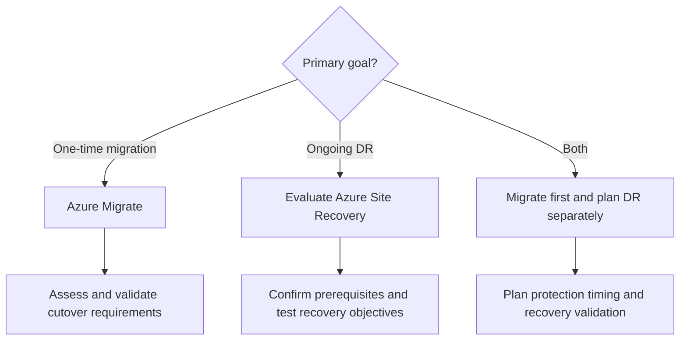

# Module 4: Azure Migrate vs. Azure Site Recovery — Strategic Tool Selection

> **Estimated Time:** ~45 minutes
>
> **CSA Competency:** Architectural Decision-Making · Tool Evaluation · DR Strategy Design
>
> **Objectives:** Compare migration and disaster recovery, apply a tool-selection framework, and record a recommendation with prerequisites, RPO/RTO requirements, and a recovery-plan outline.
>
> **Lab Scope:** The required work is a comparison and decision exercise. All four Hyper-V VMs use Azure Migrate for server rehosting. The optional ASR portal walkthrough in Section 7 does not enable disaster recovery.

## 1. Overview — Choosing the Right Tool: A Solution Architect's Guide

**Concept:**

Selecting between Azure Migrate and Azure Site Recovery (ASR) is not a feature checkbox exercise — it is an **architectural decision** that shapes your migration timeline, operational posture, and long-term DR strategy. As a Cloud Solution Architect, you evaluate both tools against business requirements, risk tolerance, and the operational maturity of the organization you are advising.

### Historical Context

Before Azure Migrate, organizations used ASR's failover workflow for lift-and-shift migrations. This legacy is important because:

- Many existing customers still conflate ASR with migration tooling
- Older documentation and blog posts recommend ASR for migration
- Some teams have institutional knowledge built around ASR-as-migration-tool

### Current Tool Selection

**Azure Migrate for migration, ASR for disaster recovery.** The nuance is the overlap:

- Some Azure Migrate replication paths use ASR technology under the hood; shared technology does not make their lifecycle purpose interchangeable
- In this lab, all four source VMs are on the **same Hyper-V host** and use its Azure Site Recovery Provider for Azure Migrate replication; they are not split into different replication architectures by guest operating system
- Migration configuration does not establish ongoing DR for the resulting Azure VMs
- The Azure Migrate-created migration vault is not a separate student DR vault

### What You Will Learn

- ASR's architecture, replication mechanics, and cost components
- A comparison matrix across migration and recovery capabilities
- A decision framework matched to business requirements
- An integrated migration + DR strategy using the tools for different lifecycle phases
- A recommendation recorded as an Architecture Decision Record (ADR)

**Why It Matters:** Migration is a project with a cutover; DR is an ongoing recovery capability. Confusing them can leave recovery requirements unaddressed.

**Student Actions:**

1. In your existing lab notes, record the two purposes: **Azure Migrate — one-time server rehost**; **ASR — separately planned ongoing DR**.
2. Record the lab scope: `OnPrem-Web`, `OnPrem-SQL`, `OnPrem-Linux-Web`, and `OnPrem-Linux-App`, all migrated as Azure IaaS VMs.
3. Mark ASR deployment as **not performed** in the required exercise. Section 7 is optional and limited to reviewing portal settings.

**Expected Outcome:** Your notes distinguish the migration already performed from a possible future DR deployment.

---

## 2. Azure Site Recovery — Architecture Deep Dive

**Concept:**

Understanding ASR at the infrastructure level is essential for making informed architectural recommendations. Components depend on the source environment; a VMware/physical-server diagram is not the Hyper-V architecture used in this lab.

### 2.1 Component Architecture

The Hyper-V path uses the provider on the host, rather than a Mobility Service installation inside each Windows or Ubuntu guest for this migration path.

```text
SOURCE ENVIRONMENT                         AZURE

Same Hyper-V host                          Recovery Services vault
  Azure Site Recovery Provider               Replication configuration
  Replication components                      Policy and recovery management
       |
       +-- OnPrem-Web                 --->  Replication storage/disks
       +-- OnPrem-SQL                        Recovery points
       +-- OnPrem-Linux-Web                    Target network settings
       +-- OnPrem-Linux-App                    Recovery plans (DR)
```

**Component roles an architect must understand:**

| Component | Role | Lab Relevance |
|---|---|---|
| **Recovery Services vault** | Manages Site Recovery configuration and protected items | A dedicated DR vault would be separate from migration resources |
| **Hyper-V host provider** | Coordinates host-based replication | The existing provider serves all four source VMs for Azure Migrate |
| **Replication storage/disks** | Holds replicated disk data for recovery | Depends on the selected replication scenario |
| **Replication policy** | Defines available replication and recovery-point settings | Settings require a separate DR design |
| **Recovery plan** | Sequences recovery and manual validation | A planning exercise here; no plan is deployed |

Other ASR source paths use different replication components. Configuration/process-server and Mobility Service descriptions from other scenarios are not instructions to install them on these Hyper-V guests.

### 2.2 Replication Mechanics

ASR replication tracks disk changes rather than copying application files individually. Initial replication transfers disk contents; subsequent replication transfers changed data asynchronously.

**Recovery Point Types:**

| Type | Mechanism | Use Case | Requirement to Review |
|---|---|---|---|
| **Crash-consistent** | Disk state comparable to an unexpected shutdown | Recovery when an application-consistent point is unavailable | Application recovery and data validation after boot |
| **App-consistent** | Application-aware coordination where supported | Transactional workloads | Guest/application support and available recovery points |
| **Multi-VM consistent** | Coordinated recovery points where supported | Multi-tier applications | Scenario support, grouping, and operational overhead |

The existence of a recovery point is not proof that a complete business transaction can be recovered within the required time.

### 2.3 Recovery Plans

Recovery Plans are ASR's orchestration mechanism for multi-VM failover — and a key differentiator from Azure Migrate:

- **Sequenced failover:** Boot order, such as database → application → web
- **Manual actions:** Approval and application verification points
- **Script execution:** Optional recovery automation in a separately designed environment
- **Grouping:** VMs that start in parallel within a sequence step

For this lab, a recovery-plan outline includes SQL availability, Tomcat readiness, Nginx proxy access, IIS access, and verification of the Contoso Order Desk data. Boot order alone is not application readiness.

### 2.4 RPO/RTO Requirements and Service Levels

| Metric | Meaning | Design Consideration |
|---|---|---|
| **RPO — Recovery Point Objective** | Maximum acceptable data loss measured in time | Required recovery-point age compared with actual replication and application consistency |
| **RTO — Recovery Time Objective** | Maximum acceptable time to restore the service | Failover, VM startup, networking, dependencies, and application validation |
| **Replication frequency** | How often changes are sent for the selected scenario | A configured interval is not a guaranteed achieved RPO |
| **Service-level agreement** | Service availability commitments under applicable terms | Not a guarantee of application RPO, RTO, or uninterrupted protection |

There is no zero-data-loss or immediate-recovery promise in this exercise. Achieved RPO and RTO require measured recovery tests in an approved environment.

### 2.5 Pricing Model

ASR uses protected-instance pricing, with additional resource charges depending on the scenario.

| Component | Cost Consideration |
|---|---|
| Protected instances | Current rates and any applicable introductory allowance |
| Replica storage/disks | Capacity, tier, retention, and change rate |
| Replication storage | Scenario-specific storage and transactions |
| Network transfer | Applicable transfer charges |
| Test/recovered VMs | Compute, disks, and networking while resources exist |

ASR cost is **ongoing** for DR. Current prices, currency, entitlement, and resource charges are reviewed in the portal before an optional deployment; this module does not assume a free DR exercise.

### 2.6 Supported Source Environments

| Source Environment | ASR Pattern | Notes |
|---|---|---|
| Hyper-V VMs | Host-based provider | The source pattern relevant to this lab |
| VMware VMs | Scenario-specific replication appliance/components | Not the source architecture for these four VMs |
| Physical servers | Agent-based replication | Separate prerequisites |
| Azure VMs | Azure-to-Azure recovery | Separate post-migration DR configuration |
| Other-cloud servers | Supported source-specific configuration | Not implemented in this lab |

**Why It Matters:** Shared replication technology does not remove scenario-specific prerequisites or establish a recovery guarantee.

**Student Actions:**

1. Identify the Hyper-V host provider in your comparison notes; distinguish it from guest-agent replication used by other source paths.
2. Record one RPO requirement and one RTO requirement for the sample application. Label them **requirements**, not measured results.
3. List the prerequisites for a future DR exercise: approved subscription and permissions, supported scenario/guest configuration, target region and capacity, network isolation, storage, budget, and disposable test data.
4. Sketch a recovery-plan sequence: SQL → Tomcat → Nginx/IIS, with SQL readiness and an order-read check before declaring the application recovered.

**Expected Outcome:** You have a source-appropriate architecture comparison, explicit recovery objectives, and a recovery-plan outline without changing replication or protection settings.

---

## 3. Comprehensive Comparison Matrix

**Concept:**

This comparison is designed for architecture review boards and stakeholder discussions. It provides the foundation for an Architecture Decision Record.

| Dimension | Azure Migrate | Azure Site Recovery |
|---|---|---|
| **Primary Purpose** | Migration — one-time server rehost | Disaster recovery — ongoing protection |
| **Discovery & Assessment** | Discovery, server assessment, and workload assessment capabilities | Not a replacement for migration assessment |
| **Business Case / TCO** | Business-case and sizing inputs, including licensing assumptions | DR resource costs require separate planning |
| **Agentless Replication** | Available for supported source paths; Hyper-V uses host components | Architecture depends on source; Hyper-V uses a host provider |
| **Agent-Based Replication** | Available for supported source paths | Used for supported source scenarios |
| **Continuous Replication** | Scenario-specific replication during migration | Ongoing replication for configured protection |
| **RPO** | Migration cutover requirements and measured replication state | Recovery objectives validated against actual recovery points |
| **Failback** | Not a general ongoing DR failback service | Scenario-specific failback/reprotection capabilities |
| **Recovery Plans** | Not the migration orchestration model | Multi-VM recovery sequencing and manual actions |
| **Multi-Region DR** | Not an ongoing DR tool | Azure-to-Azure recovery where supported |
| **Physical Servers** | Supported agent-based migration scenarios | Supported agent-based DR scenarios |
| **Cost Model** | Current migration terms plus consumed Azure resources | Current protected-instance terms plus consumed Azure resources |
| **Post-Migration DR** | Separate protection design/configuration | Requires appropriate protection direction and reprotection; not automatic after migration |
| **Automation** | Portal and management tooling | Portal, management tooling, and recovery plans |
| **Scale Limits** | Depend on source path and deployed components | Depend on source path and deployed components |
| **Migration Tracking** | Migration-specific project tracking | Recovery/protection tracking rather than migration assessment |
| **Dependency Visualization** | Assessment/dependency capabilities depend on the source and configuration | Recovery dependencies must be designed separately |

### How They Relate Architecturally

```text
Azure Migrate
  Discovery / Assessment / Business Case
                  |
  Source-appropriate migration replication
                  |
  Test migration -> Cutover -> Azure IaaS VMs
                                  |
                        Separate DR decision
                                  |
                    Optional ASR protection setup
```

The difference is lifecycle intent: **migrate once** versus **protect continuously**. Shared components do not make a migration vault a reusable DR exercise resource.

**Why It Matters:** Tool comparisons need to separate capabilities from configuration already present in the lab.

**Student Actions:**

1. Select five dimensions from the matrix that matter to this lab, including primary purpose, replication architecture, recovery plans, cost, and post-migration DR.
2. For each, record which tool addresses the requirement and whether that capability was actually configured in Modules 0–3.
3. Mark ASR recovery plans and ongoing Azure-to-Azure protection as **not deployed**, unless you have separate evidence from an approved exercise.

**Expected Outcome:** Your comparison distinguishes available product features from work you actually completed.

---

## 4. Decision Framework — CSA Decision Tree

**Concept:**

The goal is not to pick a "winner" — it is to match the tool to the scenario.

```text
Is this a one-time migration to Azure?
|
+-- YES -> Azure Migrate
|          Assess source, capacity, dependencies, and cutover needs
|          Select the supported source-appropriate replication path
|          Plan any ongoing DR separately
|
+-- NO -- Ongoing DR / Business Continuity
           +-- On-premises to Azure DR -> Evaluate ASR
           +-- Azure-to-Azure DR       -> Evaluate ASR
           +-- Other source scenario  -> Review supported DR path

Need BOTH migration and DR?
  Azure Migrate for rehosting + separately designed ASR protection
  Timing is driven by approved business recovery requirements
```

> **Architect's Rule of Thumb:** If the conversation is about a *project* with an end date, recommend Azure Migrate. If the conversation is about an *ongoing operational capability*, evaluate ASR.

### Visual Decision Tree



VM count helps plan capacity and migration waves; it is not a fixed rule that selects a tool at a particular server count. A low RPO requirement does not, by itself, turn a server-rehosting project into an ASR migration exercise.

**Why It Matters:** A recommendation needs a business purpose and evidence, rather than a server-count or replication-frequency shortcut.

**Student Actions:**

1. Apply the tree to this four-VM lab and record **Azure Migrate for server rehosting**.
2. Record whether future DR is required for your scenario; if it is, note the RPO/RTO, protection timing, and prerequisites from Section 2.
3. Add a short rationale explaining why ASR is evaluated separately rather than used to migrate these VMs again.

**Expected Outcome:** Your tool decision matches the lab's migration purpose without claiming that DR is already configured.

---

## 5. Real-World Scenario Analysis

**Concept:**

A CSA translates abstract decision trees into concrete recommendations. These scenarios are comparisons, not additional deployments.

### Scenario 1: Enterprise Datacenter Exit (500 VMs, Mixed OS)

**Context:** A financial services company is exiting a colocation facility. There are 500 Windows and Linux VMs, an 18-month timeline, and a mix of virtual and physical sources.

**Recommendation:** Azure Migrate + separately planned ASR post-migration.

- **Phase 1:** Discovery and assessment
- **Phase 2:** Migration in planned waves
- **Phase 3:** ASR DR for workloads whose recovery requirements justify it
- **Rationale:** Assessment and migration tracking support the datacenter exit; DR is a separate ongoing capability.

### Scenario 2: Single Mission-Critical SQL Server Migration

**Context:** A healthcare company needs to migrate a production SQL Server with a 2 TB database and a maximum 30-second RPO requirement during cutover.

**Recommendation:** Azure Migrate for server-rehost planning, with explicit validation of the cutover/data-protection approach against that requirement.

- A stated 30-second RPO is not proof that any default replication configuration meets it
- Application consistency, final synchronization, and the cutover window affect data loss
- Ongoing DR requires a separate design; replication does not simply continue in a new direction after cutover
- **Rationale:** The business recovery requirement must be validated rather than used as an automatic reason to replace migration tooling with ASR.

### Scenario 3: Development Environment Migration (50 VMs)

**Context:** A software company wants to migrate its development and QA environments to Azure. There is no strict RPO requirement; speed is the priority.

**Recommendation:** Azure Migrate using the supported source-appropriate replication path.

- Source architecture determines the appliance/provider requirements
- Assessment provides sizing recommendations to avoid over-provisioning
- **Rationale:** A one-time development migration does not require an ongoing DR deployment merely because replication is involved.

### Scenario 4: Multi-Cloud Migration (AWS → Azure)

**Context:** A retail company is migrating 200 EC2 instances from AWS to Azure as part of a cloud consolidation strategy.

**Recommendation:** Azure Migrate using the supported agent-based path.

- The migration approach treats these source machines similarly to physical servers
- Discovery and tracking support the migration project
- **Rationale:** This is a migration project, not an ongoing DR service. This source path is not used for the four Hyper-V VMs in this lab.

### Scenario 5: Hybrid DR Setup (On-Premises ↔ Azure)

**Context:** A manufacturing company keeps production on-premises and wants Azure as a DR site for 100 VMs, with RPO < 15 minutes and RTO < 4 hours.

**Recommendation:** Evaluate ASR for the supported source scenario.

- Production remains on-premises; there is no migration project
- Recovery plans sequence multi-tier recovery
- Isolated test failovers measure recovery and identify operational gaps
- **Rationale:** Ongoing replication, recovery validation, and supported failback address the business-continuity purpose.

**Why It Matters:** Similar VM estates can require different tools because their lifecycle purpose and recovery requirements differ.

**Student Actions:**

1. Choose two scenarios: one migration scenario and the hybrid DR scenario.
2. Record the tool, the business purpose, one prerequisite, and one validation question for each.
3. Compare those recommendations with the four-VM lab. Do not create resources for these scenarios.

**Expected Outcome:** You have two short scenario recommendations with reasons, rather than an unsupported claim that one tool fits every case.

---

## 6. Migration + DR Integration Strategy

**Concept:**

### The Recommended Pattern

For migrations that also require DR, the architecture calls for the tools in sequence:

```text
Assess             Migrate             Stabilize             Protect
Azure Migrate  ->  Azure Migrate   ->   Monitor/validate  ->   Separately planned ASR
Discovery          Replication         Baseline operations   Approved DR scope
```

| Factor | Separate Migration and DR Responsibilities |
|---|---|
| **Separation of concerns** | Migration is a project; DR is an operation, with different lifecycles |
| **Cost clarity** | Migration and ongoing protection have separate resource/cost records |
| **Tool optimization** | Each tool is used for its designed purpose |
| **Operational handoff** | Migration completion is distinguished from acceptance of DR readiness |

### The Stabilization Window

The original planning pattern uses a 2–4 week stabilization window. This is an example, not a requirement to leave a critical application unprotected.

| Example Period | Planning Focus |
|---|---|
| **T+0 to T+7** | Application validation and migration-induced issues |
| **T+7 to T+14** | Baseline monitoring and operational evidence |
| **T+14 to T+21** | Sizing review using representative utilization |
| **T+21 to T+30** | Approved DR setup and an isolated recovery test, if required |

Business requirements determine protection timing. An existing migration replication relationship does not guarantee protection after cutover or automatic failback.

### Migration and DR Are Separate Decisions

The migration approach remains Azure Migrate in this lab. A future ASR exercise would require its own approved resources, support review, target networking, recovery policy, and recovery test. No additional source-host registration or change to existing migration-protected VMs is part of this module.

**Why It Matters:** A DR plan needs an acceptance test and accountable timing; simply leaving migration resources in place is not a DR strategy.

**Student Actions:**

1. Add a migration-to-operations timeline to your notes, using the example periods only where they fit your recovery requirements.
2. Record the proposed DR purpose, required RPO/RTO, target region/network prerequisites, and who would approve a future deployment and its costs.
3. Include a recovery-plan acceptance check: services ready, required private-IP dependencies reachable, and an order read from the recovered application. A write test would require explicit approval and disposable data.
4. Mark actual DR protection and recovery testing as **planned/not performed** in this exercise.

**Expected Outcome:** Your migration/DR record includes timing, prerequisites, and a recovery test without claiming an untested protection state.

---

## 7. Hands-On: Understanding the ASR Setup Process

**Concept:**

Since all four VMs use Azure Migrate in Modules 2 and 3, this section is an **optional portal walkthrough**, not a re-migration or a requirement to deploy DR. The goal is to compare available ASR settings with the Azure Migrate experience.

> **Optional Exercise Boundary:** Creation of a new vault requires a separately approved dedicated lab scope, permissions, and budget. Any later replication or recovery test would also require entitlement/support review and disposable data. Do not reuse the Azure Migrate-created migration vault as a DR vault, register the existing Hyper-V host again, or alter the existing migration-protected VMs. No DR configuration is executed against the current host.

### 7.1 Create a Recovery Services Vault — Optional Approved Lab Only

**Concept:**

A **Recovery Services vault** is the management entity for ASR. It manages replication configuration and recovery operations. Vault placement depends on the selected DR scenario; it is not inferred from a resource group's name or location.

**Student Actions — Optional:**

1. If no dedicated lab resource creation has been approved, record **skipped — no DR resources approved** and continue to Section 8.
2. Otherwise, open the [Azure portal](https://portal.azure.com), search **Recovery Services vaults**, and select **+ Create**.
3. Review the following values for the separately approved scope:

   | Setting | Value |
   |---|---|
   | Subscription | Approved lab subscription |
   | Resource group | Approved dedicated DR lab resource group |
   | Vault name | A new, uniquely named DR lab vault, such as `MigrateWorkshop-ASR-Lab-Vault` |
   | Region | Region reviewed for the intended DR scenario |
   | Tags | Lab owner, purpose, and environment |

4. Review permissions, region, and resource scope. If creation is not approved, **Cancel** before submitting. If it is approved, select **Review + create** → **Create** for this new vault only.
5. Open the new vault and locate **Site Recovery**. Record its purpose separately from the migration vault.

**Expected Outcome:** Either no resource is created and the optional exercise is marked skipped, or one separately approved DR lab vault exists. No host or VM has been registered or protected.

### 7.2 Walk Through ASR Configuration for Hyper-V — Review and Cancel

**Concept:**

A Hyper-V site groups hosts for the DR source. A replication policy exposes scenario-specific frequency and recovery-point settings. These descriptions explain the workflow; they do not mean a new DR site or policy already exists.

**Student Actions — Optional, Using Only the Approved New Vault:**

1. Open **Site Recovery** → **Getting started**. Locate the Hyper-V-to-Azure preparation workflow, where available in the portal.
2. Review the source-type and target-region/network fields. Record how they compare with the settings used for Azure Migrate.
3. If a page exposes **Hyper-V site**, **Hyper-V server**, provider download, or registration-key options, note their purpose only. **Do not add a site/server, download a registration key, install a provider, or register the current host.**
4. Review policy fields if they can be viewed without submitting configuration: copy frequency, recovery-point retention, and application-consistent snapshot frequency. Record that copy frequency alone is not achieved RPO.
5. If a later page requires registration or an infrastructure write before showing more settings, stop there. Note the unavailable settings rather than creating prerequisites.
6. **Cancel/close the walkthrough before any infrastructure submission, replication enablement, or Configure disaster recovery action.** Do not select current migrated VMs for protection.
7. Record which settings you could review and confirm that no DR protection was enabled. Retain the new vault only within its approved lab resource lifecycle.

**Why It Matters:** Comparing a setup experience does not require creating a second replication architecture or changing the host that serves the migration lab.

**Expected Outcome:** You can describe vault, source-site, provider, policy, and replication settings. The current Hyper-V host, migration vault, and existing protected VMs remain unchanged.

---

## 8. Key Takeaways

**Concept:**

1. **There is no single "best" tool** — the right choice depends on the scenario, RPO/RTO requirements, and lifecycle phase.
2. **Both tools can have a role:** Azure Migrate for the migration project, ASR for separately designed ongoing DR where required.
3. **Shared replication technology is not shared lifecycle intent** — all four Hyper-V source VMs use the same host-provider path in this lab.
4. **The decision is documented** as an Architecture Decision Record, capturing context, options evaluated, and rationale.
5. **Tool selection belongs in planning**, not improvised during execution.
6. **Post-migration recovery needs a plan** — a planned capability is not evidence that protection or a successful recovery test exists.

> **ADR Template Prompt:** *"We recommend Azure Migrate for rehosting the four lab VMs because [assessment / supported Hyper-V replication / migration tracking]. The migration purpose is [purpose]. Future DR is [required/not required for this exercise]. Its requirements are RPO [value] and RTO [value], subject to [prerequisites and approval]. The proposed recovery plan is [sequence and validation]. Actual ASR deployment and recovery testing are [not performed/separately evidenced]."*

**Why It Matters:** A clear decision record separates the recommendation, required student work, and optional future implementation.

**Student Actions:**

1. Complete the ADR prompt in your existing notes using your comparison and scenario decisions.
2. Confirm that migration purpose, DR purpose, prerequisites, RPO/RTO, recovery-plan outline, and actual completion status are recorded.
3. Check that the record does not claim deployed ASR protection or a tested recovery time from this conceptual exercise.

**Expected Outcome:** You have a completed comparison/decision exercise. No mandatory DR deployment has been introduced.

---

## Next Steps

**Concept:** Module 5 applies the Azure Well-Architected Framework to Day 2 operations: monitoring, data protection, security, cost, and patch assessment. Optional paid services remain subject to approved scope and budget.

**Student Actions:**

1. Proceed to **[Module 5: Post-Migration — Operational Excellence & Governance](Module-5-Post-Migration.md)**.
2. Keep your migration/DR decision record available for the operations runbook.

**Expected Outcome:** Your tool-selection record is ready to support the post-migration activities.

---

> **Workshop Navigation:**
> [← Module 3: Agent-Based Migration](Module-3-Agent-Based-Migration.md) | [Module 5: Post-Migration — Operational Excellence & Governance →](Module-5-Post-Migration.md)
